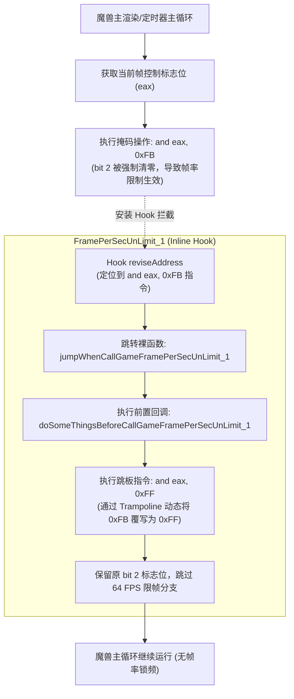

# 魔兽争霸3 帧率限制解除方案（一）：FramePerSecUnLimit_1

本方案基于对魔兽争霸3主循环中帧率限制标志位掩码操作（`and eax, 0xFB`）的挂钩与篡改，将原生的掩码替换为 `0xFF`，从而绕过软件层的帧率限制逻辑。

---

## 1. 核心架构与流程思维导图



---

## 2. 底层汇编原理解析

在魔兽争霸3主循环内，定时器/帧率限制模块通过对标志寄存器进行掩码操作来决定是否进入睡眠（Sleep / 限帧等待）：
- **原始指令**：`83 E0 FB` 即 `and eax, 0xFB`（二进制：`1111 1011`，把第 2 位清零）。
- **篡改目标**：通过 Inline Hook 跳板，将跳板内的立即数字节由 `0xFB` 动态修补为 `0xFF`（二进制：`1111 1111`），使 `and eax, 0xFF` 对 `eax` 的所有位不做任何剔除，保留高帧率标志位。

### 各版本指令与模块差异
| 魔兽版本分类 | 所在模块 | Hook 起始指令 | Hook 长度 | 预期原始指令字节 |
| :--- | :--- | :--- | :--- | :--- |
| **低版本**（1.0.17 ~ 1.21.0） | `war3.exe` | `83 E0 FB 53 BA` | 9 字节 | `83 E0 FB 53 BA` |
| **中版本**（1.22.0 ~ 1.26.0） | `game.dll` | `83 E0 FB 6A 00` | 5 字节 | `83 E0 FB 6A 00` |
| **高版本**（1.27.0.52240） | `game.dll` | `83 E0 FB 8D 53` | 6 字节 | `83 E0 FB 8D 53` |

> [!NOTE]
> 记录的偏移量 `g_offsetsForGameFramePerSecUnLimit_1` 指向立即数 `0xFB` 的位置，因此 `reviseAddress = baseAddress + offset - 2`（回退 2 字节指向 `83 E0`）。

---

## 3. 全版本偏移量（11个版本）与特征码

### 3.1 偏移量表 (`g_offsetsForGameFramePerSecUnLimit_1`)
```cpp
std::map<std::string, DWORD> g_offsetsForGameFramePerSecUnLimit_1 = {
    {
        {"1.0.17.5988", 0x0445FE},  {"1.0.20.6048", 0x0445FE},  {"1.20.4.6074", 0x0445FE},
        {"1.21.0.6263", 0x0445FE},  {"1.22.0.6328", 0x61D87B},  {"1.23.0.6352", 0x61F4FB},
        {"1.24.1.6374", 0x62DEEB},  {"1.24.4.6387", 0x62DF9B},  {"1.25.1.6397", 0x62D5CB},
        {"1.26.0.6401", 0x62D7FB},  {"1.27.0.52240",0x05FCFB}
    }
};
```

### 3.2 特征码配置 (`g_signForGameFramePerSecUnLimit_1`)
- **中版本（默认 1.22 ~ 1.26）**：
  ```cpp
  g_signForGameFramePerSecUnLimit_1 = { "A8 04 74 14 83 E0",
                                        "FB 6A 00 BA 11 00 00 00" };
  ```
- **高版本（1.27a）**：
  ```cpp
  g_signForGameFramePerSecUnLimit_1 = { "A8 04 74 11 83 E0",
                                        "FB 8D 53 11" };
  ```
- **低版本（1.0.17 ~ 1.21.0）**：
  ```cpp
  g_signForGameFramePerSecUnLimit_1 = { "A8 04 74 13 83 E0",
                                        "FB 53 BA 11 00 00 00" };
  ```

---

## 4. 头文件声明（`war3hook.h`）

```cpp
// 函数指针类型
typedef void (__fastcall *GameFramePerSecUnLimit_1Func)();

// 挂钩 / 卸载接口
bool hookGameFramePerSecUnLimit_1();
bool unhookGameFramePerSecUnLimit_1();

// 前置回调
int __stdcall doSomeThingsBeforeCallGameFramePerSecUnLimit_1();

// 跳转桩（裸函数）
[[maybe_unused]] static void __stdcall jumpWhenCallGameFramePerSecUnLimit_1();
```

---

## 5. 源文件实现（`war3hook.cpp`）

### 5.1 全局变量与缓存定义
```cpp
// 偏移与状态
DWORD g_offsetForGameFramePerSecUnLimit_1 = 0;
BYTE g_currentBytesForCallGameFramePerSecUnLimit_1[9] = { 0 };
BYTE g_originalBytesForCallGameFramePerSecUnLimit_1[9] = { 0 };
Trampoline g_trampolinesForCallGameFramePerSecUnLimit_1[1] = {{0}};
void *g_gameFramePerSecUnLimit_1ReturnValue = nullptr;
void *g_gameFramePerSecUnLimit_1ReviseAddress = nullptr;
GameFramePerSecUnLimit_1Func g_originalGameFramePerSecUnLimit_1 = nullptr;

// 动态修改跳板立即数：将 0xFB 替换为 0xFF
BYTE g_keepMaskForGameFramePerSecUnLimit_1[1] = { 0xFF };
```

### 5.2 Hook 安装与卸载逻辑
```cpp
bool hookGameFramePerSecUnLimit_1()
{
    WriteAsyncLogTo(g_wlogWar3HookPath, L"开始安装 FramePerSecUnLimit_1 Hook...");

    if (!detectAndSetWar3Version()) {
        g_originalGameFramePerSecUnLimit_1 = nullptr;
        return false;
    }

    const char *moduleName = g_detectedWar3VersionFlag == 0 ? "war3.exe" : "game.dll";
    DWORD baseAddress = 0;
    if (g_detectedWar3VersionFlag == 0) {
        if (g_war3ExeBaseAddress == 0) g_war3ExeBaseAddress = getModuleBaseAddress("war3.exe");
        baseAddress = g_war3ExeBaseAddress;
    } else {
        if (g_gameDllBaseAddress == 0) g_gameDllBaseAddress = getModuleBaseAddress("game.dll");
        baseAddress = g_gameDllBaseAddress;
    }

    if (g_offsetForGameFramePerSecUnLimit_1 == 0) {
        g_offsetForGameFramePerSecUnLimit_1 = findVersionOffsetEx(
            g_offsetsForGameFramePerSecUnLimit_1,
            g_detectedWar3Version,
            g_signForGameFramePerSecUnLimit_1
        );
    }

    DWORD hookSize = g_detectedWar3VersionFlag == 0 ? 9 : (g_detectedWar3VersionFlag == 2 ? 6 : 5);
    if (baseAddress == 0 || g_offsetForGameFramePerSecUnLimit_1 < 2) {
        g_originalGameFramePerSecUnLimit_1 = nullptr;
        return false;
    }

    // 回退 2 字节定位到 83 E0
    DWORD reviseRva = g_offsetForGameFramePerSecUnLimit_1 - 2;
    DWORD reviseAddress = baseAddress + reviseRva;
    if (!isReadable((void*)reviseAddress, hookSize)) {
        WriteAsyncLogTo(g_wlogWar3HookPath, L"地址 0x%p 不可读取 基地址: 0x%08X 偏移: 0x%08X", reviseAddress, baseAddress, reviseRva);
        g_originalGameFramePerSecUnLimit_1 = nullptr;
        return false;
    }

    BYTE expected[5] = { 0 };
    size_t expectedSize = 5;
    if (g_detectedWar3VersionFlag == 0) {
        BYTE lowBytes[5] = { 0x83, 0xE0, 0xFB, 0x53, 0xBA };
        memcpy(expected, lowBytes, 5);
    } else if (g_detectedWar3VersionFlag == 2) {
        BYTE highBytes[5] = { 0x83, 0xE0, 0xFB, 0x8D, 0x53 };
        memcpy(expected, highBytes, 5);
    } else {
        BYTE midBytes[5] = { 0x83, 0xE0, 0xFB, 0x6A, 0x00 };
        memcpy(expected, midBytes, 5);
    }

    if (memcmp((void*)reviseAddress, expected, expectedSize) != 0) {
        WriteAsyncLogTo(g_wlogWar3HookPath, L"[%hs] FramePerSecUnLimit_1 指令不匹配，取消安装。", moduleName);
        g_originalGameFramePerSecUnLimit_1 = nullptr;
        return false;
    }

    // 配置跳板：偏移 2 处（即 0xFB 位置）替换为 0xFF
    g_trampolinesForCallGameFramePerSecUnLimit_1[0].offset = 2;
    g_trampolinesForCallGameFramePerSecUnLimit_1[0].code = g_keepMaskForGameFramePerSecUnLimit_1;
    g_trampolinesForCallGameFramePerSecUnLimit_1[0].codeSize = 1;

    InlineHookResult inlineHookResult;
    bool success = installInlineHook(
        moduleName,
        moduleName,
        "jumpWhenCallGameFramePerSecUnLimit_1",
        (void*)jumpWhenCallGameFramePerSecUnLimit_1,
        reviseRva,
        reviseRva + hookSize,
        0,
        g_originalBytesForCallGameFramePerSecUnLimit_1,
        g_currentBytesForCallGameFramePerSecUnLimit_1,
        hookSize,
        HookType::Other,
        g_trampolinesForCallGameFramePerSecUnLimit_1,
        sizeof(g_trampolinesForCallGameFramePerSecUnLimit_1) / sizeof(g_trampolinesForCallGameFramePerSecUnLimit_1[0]),
        inlineHookResult
    );

    if (success) {
        if (isReadable(inlineHookResult.trampolineAddress, sizeof(void*))) {
            g_originalGameFramePerSecUnLimit_1 = (GameFramePerSecUnLimit_1Func)(inlineHookResult.trampolineAddress);
        }
        if (isReadable((void*)inlineHookResult.reviseAddress, sizeof(void*))) {
            g_gameFramePerSecUnLimit_1ReviseAddress = (void*)inlineHookResult.reviseAddress;
        }
        WriteAsyncLogTo(g_wlogWar3HookPath, L"[%hs] FramePerSecUnLimit_1 钩子安装成功。", moduleName);
        WriteAsyncLogTo(g_wlogWar3HookPath, L"  - 修改地址: 0x%08X", reviseAddress);
        WriteAsyncLogTo(g_wlogWar3HookPath, L"  - 标志字节: 0x%08X", baseAddress + g_offsetForGameFramePerSecUnLimit_1);
        WriteAsyncLogTo(g_wlogWar3HookPath, L"  - 跳板地址: 0x%08X", inlineHookResult.trampolineAddress);
    } else {
        g_originalGameFramePerSecUnLimit_1 = nullptr;
        WriteAsyncLogTo(g_wlogWar3HookPath, L"[%hs] FramePerSecUnLimit_1 钩子安装失败！", moduleName);
        freeTrampolineAllocation(&inlineHookResult.trampolineAddress, L"FramePerSecUnLimit_1");
    }

    return success;
}

bool unhookGameFramePerSecUnLimit_1()
{
    if (!g_gameFramePerSecUnLimit_1ReviseAddress) return true;
    DWORD hookSize = g_detectedWar3VersionFlag == 0 ? 9 : (g_detectedWar3VersionFlag == 2 ? 6 : 5);
    return uninstallInlineHook(DWORD(g_gameFramePerSecUnLimit_1ReviseAddress), g_originalBytesForCallGameFramePerSecUnLimit_1, hookSize);
}
```

### 5.3 裸跳转桩与回调
```cpp
#if defined(_MSC_VER)
static __declspec(naked) void __stdcall jumpWhenCallGameFramePerSecUnLimit_1()
{
    __asm {
        pushad
        pushfd
        call doSomeThingsBeforeCallGameFramePerSecUnLimit_1
        mov dword ptr [g_gameFramePerSecUnLimit_1ReturnValue], eax
        popfd
        popad
        jmp dword ptr [g_originalGameFramePerSecUnLimit_1]
    }
}
#elif defined(__GNUC__)
__attribute__((naked)) void __stdcall jumpWhenCallGameFramePerSecUnLimit_1()
{
    __asm__ __volatile__ (
        "pusha\n\t"
        "pushf\n\t"
        "call %0\n\t"
        "movl %%eax, %1\n\t"
        "popf\n\t"
        "popa\n\t"
        "jmp *%2\n\t"
        :
        : "m"(doSomeThingsBeforeCallGameFramePerSecUnLimit_1),
          "m"(g_gameFramePerSecUnLimit_1ReturnValue),
          "m"(g_originalGameFramePerSecUnLimit_1)
        : "eax", "memory", "cc"
    );
}
#endif

int __stdcall doSomeThingsBeforeCallGameFramePerSecUnLimit_1()
{
    return 1;
}
```
