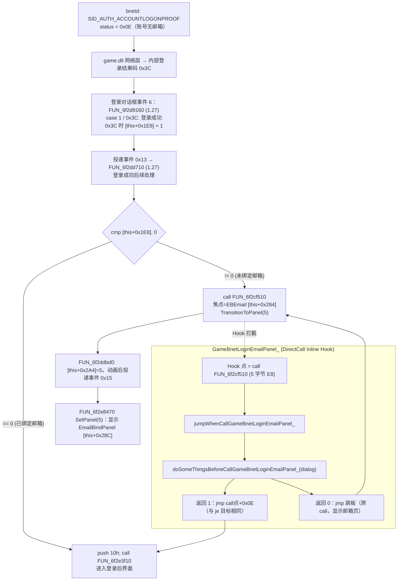

# 魔兽争霸3 战网登录后跳过邮箱绑定页：GameBnetLoginEmailPanel_

账号在 PvPGN 数据库中**没有邮箱**时，bnetd 对 `SID_AUTH_ACCOUNTLOGONPROOF` 返回 `0x0E`（W3 客户端 versionid ≥ 0x0D 且 `account_get_email()==NULL`），
game.dll 登录成功后不会进入战网主界面，而是切到 **EmailBindPanel（邮箱绑定页）**，静默登录流程因此停在该页面。

本方案在 game.dll 的 "登录成功" 事件处理中，拦截 **"切换到邮箱绑定页"** 的那一次 `call`，直接跳到 **"已绑定邮箱"** 分支（进入登录后界面），作为保底逻辑。
正常情况下邮箱由 Launcher 在登录后通过 `SID_SETEMAIL (0x59)` 自动绑定（`AiControlManager::bindTestEmail`、War3Bot `Client` 收到 0x0E 时），本 Hook 只在仍未绑定时兜底。

---

## 1. 调用链思维导图



---

## 2. 关键结构（登录对话框，各版本一致）

| 字段 | 含义 |
| :--- | :--- |
| `[this+0x1E8]` | **未绑定邮箱标志**（登录结果 0x3C 时置 1） |
| `[this+0x2A0]` | 当前子面板编号（1..7） |
| `[this+0x2A4]` | 待切换子面板（`TransitionToPanel` 写入，事件 0x15 时生效） |
| `[this+0x284]` / `[this+0x288]` | EBEmail / EBRepeatEmail 输入框 |
| `[this+0x28C]` | **EmailBindPanel** 帧 |
| 面板 5 | 邮箱绑定页：确定 → `FUN_6f2cf240`（提交邮箱）；取消 → `FUN_6f2cf1e0`（弹 `NETMESSAGE_CONFIRMNOEMAILBIND`） |

定位方法：字符串 `EmailBindPanel` / `EBEmail` 的引用（UI 初始化 `FUN_6f2b9d60` 把帧存入 `[this+0x28C]`），
再找 `SetPanel`（写 `[this+0x2A0]`）、`TransitionToPanel(5)` 的调用者，最终到 `[this+0x1E8]` 判断点。

---

## 3. Hook 点与各版本偏移

Hook 点统一为 **`call 切换到邮箱绑定页`** 这条 5 字节 `E8` 指令，跳过目标统一为 **call 点 + 0x0E**（`push 10h; call 进入登录后界面`）。

两种指令形态（标志字段都是 `[esi+0x1E8]`，`je` 偏移都是 `+0x0E`）：

| 版本段 | 判断指令 |
| :--- | :--- |
| 1.0.17 ~ 1.21.0 | `8B 86 E8 01 00 00` `mov eax,[esi+1E8h]` / `85 C0` `test eax,eax` / `8B CE` / `74 0E` / `E8 ...` |
| 1.22.0 ~ 1.27.0 | `83 BE E8 01 00 00 00` `cmp dword ptr [esi+1E8h],0` / `8B CE` / `74 0E` / `E8 ...` |

`g_offsetsForGameBnetLoginEmailPanel_`（RVA，game.dll 基址 0x6F000000）：

| 版本 | [0] call 点（Hook） | [1] 切换到邮箱页函数 | 跳过目标（call+0x0E） | 登录后界面函数 |
| :--- | :--- | :--- | :--- | :--- |
| 1.0.17.5988 | 0x22DFB0 | 0x22E3E0 | 0x22DFBE | 0x230C70 |
| 1.0.20.6048 | 0x22DFB0 | 0x22E3E0 | 0x22DFBE | 0x230C70 |
| 1.20.4.6074 | 0x22E0C0 | 0x22E4F0 | 0x22E0CE | 0x230D80 |
| 1.21.0.6263 | 0x231260 | 0x231690 | 0x23126E | 0x233F20 |
| 1.22.0.6328 | 0x5A588F | 0x577810 | 0x5A589D | 0x59C740 |
| 1.23.0.6352 | 0x5A73AF | 0x579520 | 0x5A73BD | 0x59E260 |
| 1.24.1.6374 | 0x5B5D9F | 0x587F10 | 0x5B5DAD | 0x5ACC50 |
| 1.24.4.6387 | 0x5B5E4F | 0x587F90 | 0x5B5E5D | 0x5ACD00 |
| 1.25.1.6397 | 0x5B547F | 0x5872F0 | 0x5B548D | 0x5AC330 |
| 1.26.0.6401 | 0x5B56AF | 0x587520 | 0x5B56BD | 0x5AC560 |
| 1.27.0.52240 | 0x2DD72F | 0x2CF510 | 0x2DD73D | 0x2E3F10 |

全部 11 个版本已离线校验：call 点为 `E8` 且目标即 [1]；[1] 函数序言为 `56 8B F1`（push esi; mov esi,ecx）；call+0x0E 为 `6A 10 E8`。

### 兜底特征码（未知版本）

```
"E8 01 00 00"                                          ; [esi+1E8h] 位移（新旧两种形态都包含）
"8B CE 74 0E"                                          ; mov ecx,esi ; je +0E
"E8 ?? ?? ?? ?? B8 01 00 00 00 5E C2 04 00 6A 10 E8"   ; call 邮箱页 ; mov eax,1 ; pop esi ; ret 4 ; push 10h ; call
```

`findOffsetBySigns` 正向返回最后一段起点 = call 点；`resolveOpcode=true` 时解析 `E8` 得到 [1]。
用 `shared/scripts/sim_find_offset_by_signs.py` 离线复现：1.0.17 / 1.21 / 1.22 / 1.24.4 / 1.26 / 1.27 均**唯一命中**且落在 call 点。

---

## 4. 实机反汇编记录

### 1.27a（1.27.0.52240，Ghidra）

```x86asm
; FUN_6f2dd710 —— 登录对话框事件 0x13（登录成功后续处理）
6F2DD710  56                      PUSH ESI
6F2DD711  8B F1                   MOV ESI,ECX
6F2DD713  E8 A8 30 FE FF          CALL 0x6f2c07c0
6F2DD718  56                      PUSH ESI
6F2DD719  8B 88 C8 03 00 00       MOV ECX,dword ptr [EAX + 0x3c8]
6F2DD71F  E8 9C 23 01 00          CALL 0x6f2efac0
6F2DD724  83 BE E8 01 00 00 00    CMP dword ptr [ESI + 0x1e8],0x0     ; 未绑定邮箱标志
6F2DD72B  8B CE                   MOV ECX,ESI
6F2DD72D  74 0E                   JZ 0x6f2dd73d                       ; 已绑定 → 登录后界面
6F2DD72F  E8 DC 1D FF FF          CALL 0x6f2cf510                     ; ★ Hook 点：切换到邮箱绑定页
6F2DD734  B8 01 00 00 00          MOV EAX,0x1
6F2DD739  5E                      POP ESI
6F2DD73A  C2 04 00                RET 0x4
6F2DD73D  6A 10                   PUSH 0x10                           ; ★ 跳过目标 (call+0x0E)
6F2DD73F  E8 CC 67 00 00          CALL 0x6f2e3f10                     ; 进入登录后界面
```

```x86asm
; FUN_6f2cf510 —— 切换到邮箱绑定页
6F2CF510  56                      PUSH ESI
6F2CF511  8B F1                   MOV ESI,ECX
6F2CF513  6A 05                   PUSH 0x5                            ; 面板 5 = EmailBindPanel
6F2CF515  8B 86 84 02 00 00       MOV EAX,dword ptr [ESI + 0x284]     ; EBEmail
6F2CF51B  89 86 D0 01 00 00       MOV dword ptr [ESI + 0x1d0],EAX     ; 焦点
6F2CF521  E8 AA E6 00 00          CALL 0x6f2ddbd0                     ; TransitionToPanel(5)
```

`[this+0x1E8]` 写入点（登录结果处理，事件 6）：

```c
// FUN_6f2d9160
switch (result) {           // param_2+0x18：内部登录结果
case 1:                     // 登录成功
case 0x3c:                  // 登录成功，但账号未绑定邮箱
    if (result == 0x3c) *(int *)(this + 0x1e8) = 1;
    ...
    FUN_6f2e1be0(0x13, this);   // 投递事件 0x13 → FUN_6f2dd710
```

### 1.26a（1.26.0.6401，dumpbin）

```x86asm
6F5B56A4: 83 BE E8 01 00 00 00  cmp dword ptr [esi+000001E8h],0
6F5B56AB: 8B CE                 mov ecx,esi
6F5B56AD: 74 0E                 je 6F5B56BD
6F5B56AF: E8 6C 1E FD FF        call 6F587520                         ; ★ Hook 点
6F5B56B4: B8 01 00 00 00        mov eax,1
6F5B56B9: 5E                    pop esi
6F5B56BA: C2 04 00              ret 4
6F5B56BD: 6A 10                 push 10h                              ; ★ 跳过目标
6F5B56BF: E8 9C 6E FF FF        call 6F5AC560
```

### 1.0.17（1.0.17.5988，dumpbin，旧形态）

```x86asm
6F22DFA4: 8B 86 E8 01 00 00     mov eax,dword ptr [esi+000001E8h]
6F22DFAA: 85 C0                 test eax,eax
6F22DFAC: 8B CE                 mov ecx,esi
6F22DFAE: 74 0E                 je 6F22DFBE
6F22DFB0: E8 2B 04 00 00        call 6F22E3E0                         ; ★ Hook 点
6F22DFB5: B8 01 00 00 00        mov eax,1
6F22DFBA: 5E                    pop esi
6F22DFBB: C2 04 00              ret 4
6F22DFBE: 6A 10                 push 10h                              ; ★ 跳过目标
6F22DFC0: E8 AB 2C 00 00        call 6F230C70
```

全部版本的判断点反汇编：`artifacts/email-bind/decision-disasm-all-versions.txt`。

---

## 5. Hook 实现要点（war3hook.cpp）

- 名称：`GameBnetLoginEmailPanel_`（与 `GameBnetLoginUIInitFocus` 等同为 `Game` + 20 字符，下划线补齐）。
- 类型：`HookType::DirectCall`，修改 5 字节；`rva0 = call 点`，`rva0 + 5 = 返回地址`，`rva1 = 切换到邮箱页函数`。
- 安装时校验 call 点 `E8`、call+0x0E 为 `6A 10 E8`，并记录 `g_gameBnetLoginEmailPanel_SkipToAddress = call 点 + 0x0E`。
- 裸函数 `jumpWhenCallGameBnetLoginEmailPanel_`：
  - Inline Hook 用 `jmp` 进入（不压返回地址）；被调函数为 thiscall 无栈参数，故无需调整栈；
  - `push ecx`（登录对话框）调用 `doSomeThingsBeforeCallGameBnetLoginEmailPanel_`，返回值写入 pushad 帧 EAX 槽（线程安全，与其它桩一致）；
  - 返回 1：`jmp [g_gameBnetLoginEmailPanel_SkipToAddress]`（`ecx` 已由 popad 恢复为对话框，满足 `push 10h; call` 的 thiscall）；
  - 返回 0：`jmp [g_originalGameBnetLoginEmailPanel_]`（跳板执行原 call，正常显示邮箱页）。
- 回调：指针不可读或跳过地址为空时返回 0（保持原逻辑），否则记录日志并返回 1。

---

## 6. 复现工具

| 工具 | 用途 |
| :--- | :--- |
| `shared/scripts/find_imm_xrefs.py` | 不依赖 capstone，查字符串/VA 的立即数引用 |
| `shared/scripts/sim_find_offset_by_signs.py` | 离线复现 `findOffsetBySigns`，校验特征码链唯一性 |
| `shared/ghidra-scripts/DumpEmailBind.java` | headless：定位邮箱相关字符串引用函数并反编译（含 2 层调用者） |
| `shared/ghidra-scripts/DumpAt.java` | headless：反编译包含指定地址的函数 |
| MSVC `dumpbin /DISASM /RANGE:start,end` | 定点反汇编（各版本 game.dll） |

Ghidra 工程：`ghidra/projects/War3_127`（1.27，已有）、`ghidra/projects/War3_126`（1.26，本次新建并完成自动分析）。

---

## 7. 关联问题：本地联调卡在 57%（非邮箱页）

本次排查中实际卡住的原因是 **war3hook `connect` 链路决策误判**：本地 War3Server 与房间主机同为 `10.0.2.15`，
`g_allowedServerIPs` 只含官方三台服务器，导致 `10.0.2.15:6112` 的战网登录连接被当作房间连接重定向到房间代理端口（如 6499），战网握手永远不会开始。
修复：Launcher 把 `GlobalConfig::bnetHostOverride` 写入共享内存 `bnet_server_ip`，hook 把 `<该IP>:6112` 的连接一律识别为战网连接原样放行（与官方服务器分支一致）。注意不能限定 "尚无战网连接"：登录后 war3 还会再开一条 6112 连接走 BNFTP 下载 `IX86ver1.mpq`（版本校验文件），若被当作房间连接重定向，版本校验会卡死。本地机器人房间端口为 6113~7113，不与 6112 冲突。
