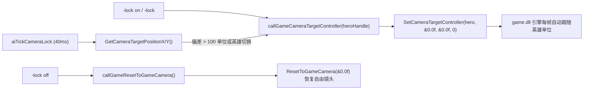

# War3 `-lock` 英雄镜头锁定（跟随）逆向分析与全版本 RVA 表

## 一、原 `-lock` 逻辑诊断

原 `war3hook_ai.cpp` 中的 `aiTickCameraLock()` 采用轮询 `SetCameraPosition(hx, hy)`（英雄移动超过 4 单位时重置一次镜头位置），存在以下问题：
1. **非引擎原生锁定**：`SetCameraPosition` 只是瞬时把镜头目标点挪到 `(hx, hy)`，并未绑定镜头目标控制器（Camera Target Controller）。
2. **英雄静止时不锁定**：当英雄停下、补刀或小范围微操（位移 `< 4` 单位）时，若玩家边缘滚动鼠标、拖动中键或点击小地图，镜头会立刻脱锁停留在别处。
3. **帧率与解锁缺陷**：40ms（25Hz）轮询改坐标在移动时有卡顿感；且关闭 `-lock` 时无法释放原生控制器。

---

## 二、正确的引擎原生锁定机制

通过逆向 `D:\Qt\workspace\War3Launcher\versions` 下全部 **11 个版本** `game.dll` 的 JASS 原生注册表（`mov edx, "原生名" ; mov ecx, <实现>`，取第一处正式注册；第二处注册统一指向校验桩函数，不可调用），确认魔兽争霸 III 引擎原生的镜头跟随/解锁/读取接口如下：

### 关键原生函数签名（均为 `__cdecl`，`real` 参数传 `float*`，`real` 返回值在 `eax` 位模式）

| 原生函数 | JASS 签名 | C/C++ 原型 | 作用 |
|---|---|---|---|
| `SetCameraTargetController` | `(Hunit;RRB)V` | `void (__cdecl *)(uint32_t unitHandle, float *xOffset, float *yOffset, uint32_t inheritOrientation)` | 绑定镜头目标控制器到指定单位（引擎原生每帧跟随） |
| `ResetToGameCamera` | `(R)V` | `void (__cdecl *)(float *duration)` | 清除目标控制器，恢复普通自由镜头（`duration=0` 立即生效） |
| `GetCameraTargetPositionX` | `()R` | `uint32_t (__cdecl *)()` | 读取当前镜头目标 X（`eax` 为 IEEE-754 float 位模式） |
| `GetCameraTargetPositionY` | `()R` | `uint32_t (__cdecl *)()` | 读取当前镜头目标 Y（`eax` 为 IEEE-754 float 位模式） |

---

## 三、全版本 `game.dll` RVA 对照表（基址 `0x6F000000`）

| 版本 | `SetCameraTargetController` | `ResetToGameCamera` | `GetCameraTargetPositionX` | `GetCameraTargetPositionY` |
|---|---|---|---|---|
| `1.0.17.5988` | `0x2DD570` | `0x2DD300` | `0x2DE4A0` | `0x2DE4D0` |
| `1.0.20.6048` | `0x2DD570` | `0x2DD300` | `0x2DE4A0` | `0x2DE4D0` |
| `1.20.4.6074` | `0x2DD690` | `0x2DD420` | `0x2DE5C0` | `0x2DE5F0` |
| `1.21.0.6263` | `0x2E0C60` | `0x2E09F0` | `0x2E1B90` | `0x2E1BC0` |
| `1.22.0.6328` | `0x3C5DF0` | `0x3AEE70` | `0x3AF4C0` | `0x3AF4F0` |
| `1.23.0.6352` | `0x3C7B10` | `0x3B0B70` | `0x3B11C0` | `0x3B11F0` |
| `1.24.1.6374` | `0x3CE1E0` | `0x3B5130` | `0x3B5780` | `0x3B57B0` |
| `1.24.4.6387` | `0x3CE2A0` | `0x3B51F0` | `0x3B5840` | `0x3B5870` |
| `1.25.1.6397` | `0x3CD530` | `0x3B4480` | `0x3B4AD0` | `0x3B4B00` |
| `1.26.0.6401` | `0x3CD760` | `0x3B46B0` | `0x3B4D00` | `0x3B4D30` |
| `1.27.0.52240` | `0x1F42F0` | `0x1F3110` | `0x1E1AE0` | `0x1E1B20` |

> [!IMPORTANT]
> **注意双注册点陷阱**：每个版本 `game.dll` 中这些原生名都会出现两次注册。第二处注册（如 1.26 的 `0x71D9D0`、1.27 的 `0x70A0C0`）所有原生都指向同一个全局桩函数；必须使用第一处正式注册的实现 RVA。

---

## 四、War3Hook 落地方案

1. [war3hook_internal.h](file:///d:/Qt/workspace/War3Launcher/hooker/war3hook_internal.h)：声明 `g_offsetsForGameCameraTargetController` / `g_offsetsForGameResetToGameCamera` / `g_offsetsForGameCameraTargetPositionX` / `g_offsetsForGameCameraTargetPositionY` 及 `resolveGameCameraLockNatives()`、`callGameCameraTargetController()`、`callGameResetToGameCamera()`、`callGameCameraTargetPosition()`。
2. [war3hook_jass.cpp](file:///d:/Qt/workspace/War3Launcher/hooker/war3hook_jass.cpp)：封装全版本 RVA 表与 SEH 保护调用（避开选人/读图阶段调用导致空指针崩溃）。
3. [war3hook_ai.cpp](file:///d:/Qt/workspace/War3Launcher/hooker/war3hook_ai.cpp)：`AI_UNIT_CMD_CAMERA_LOCK` 开启时立即调用 `callGameCameraTargetController(hero)`，关闭时调用 `callGameResetToGameCamera()`；`aiTickCameraLock()` 每 40ms 对比英雄坐标与 `GetCameraTargetPositionX/Y()`，偏差超过 100 单位或英雄切换时自动重锁。

