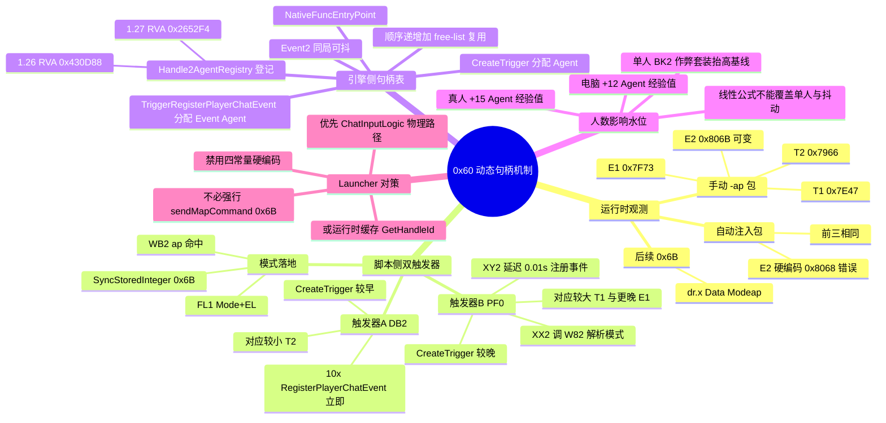
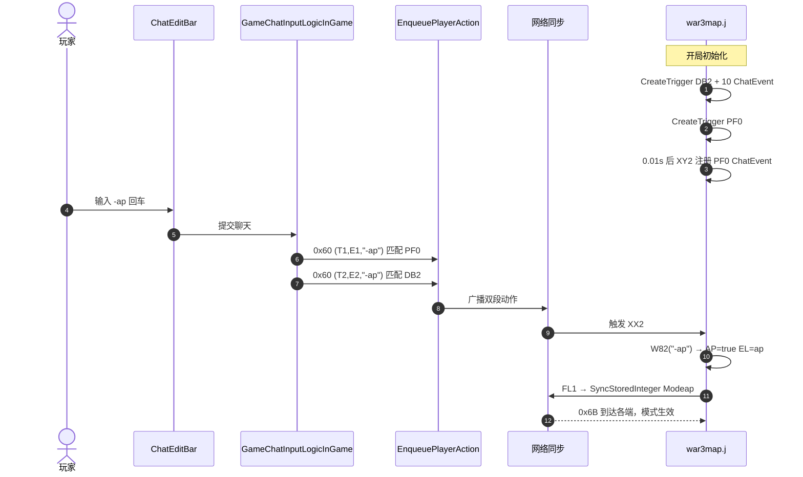
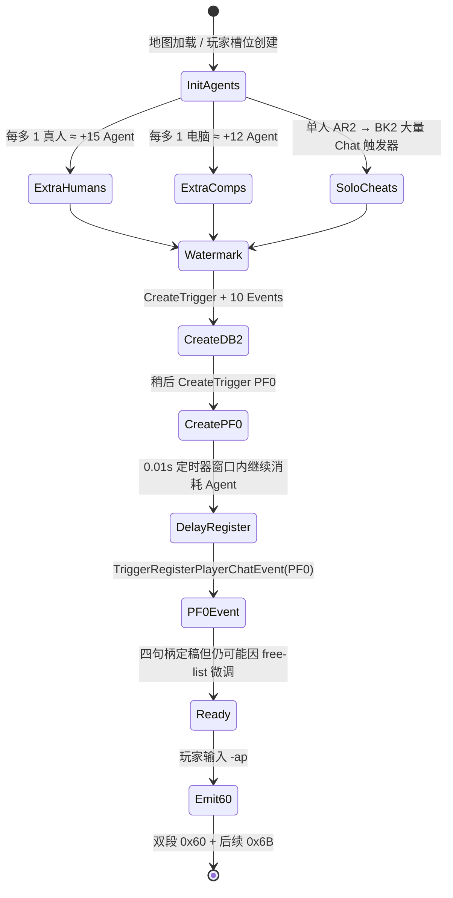
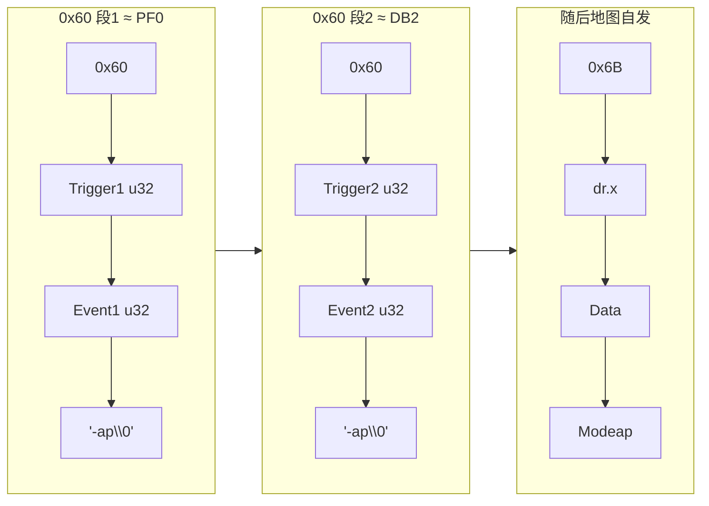
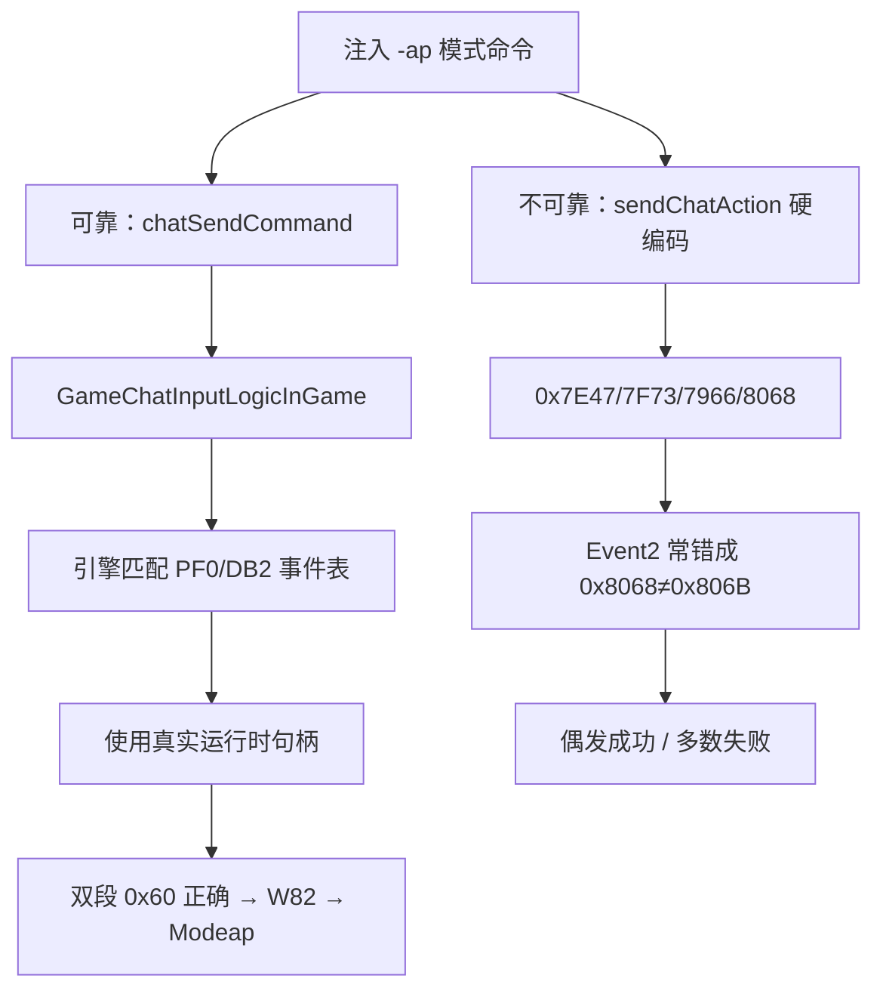

# DotA `0x60` 聊天动作动态句柄 — 思维导图与架构图

本文档用 Mermaid 展现 Trigger/Event 动态句柄的生成链路、双段 `0x60` 成因，以及与 `0x6B Modeap` 的关系。

详细论证见：[`dota-0x60-chat-action-dynamic-handles.md`](./dota-0x60-chat-action-dynamic-handles.md)

---

## 一、全景思维导图

---

## 二、端到端时序图

---

## 三、句柄水位状态图

---

## 四、包结构解剖图

---

## 五、可靠注入 vs 错误硬编码

