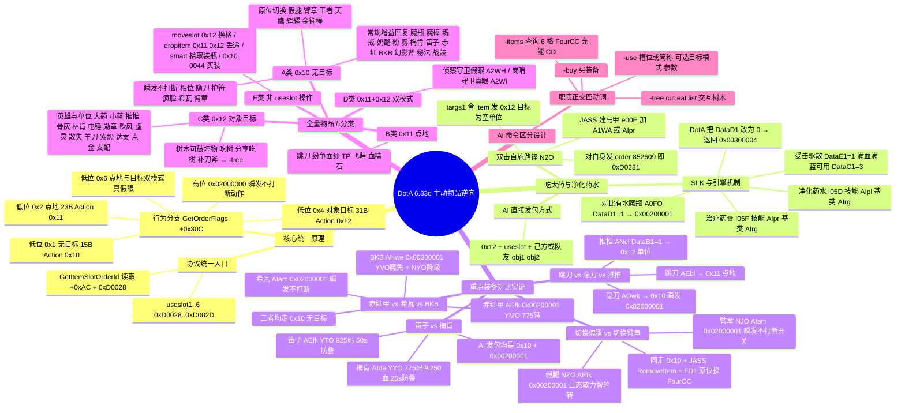

# DotA 6.83d 吃大药、净化药水与全部主动物品逆向 — 思维导图

| 字段 | 内容 |
| :--- | :--- |
| **分析模型** | Antigravity AI Agent |
| **分析目的** | 结构化呈现 DotA 6.83d 吃大药、吃净化药水及全量主动物品的地图机制、引擎协议分类与 AI 命令设计 |
| **命名方式** | `dota-6.83d-active-items-and-consumables-reverse-mindmap`；主命令 `-use` / `-items` |
| **分析时间** | 2026-11-19 |

