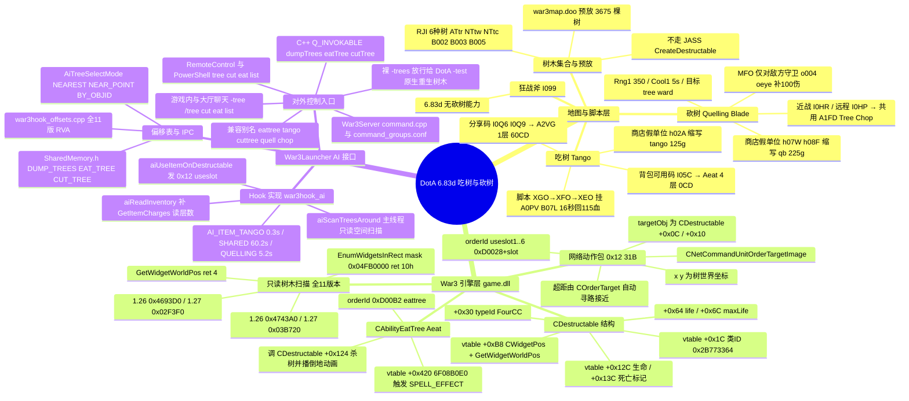

# DotA 6.83d 吃树与砍树逆向及 AI 接口 — 思维导图

| 字段 | 内容 |
| :--- | :--- |
| **分析模型** | Antigravity AI Agent |
| **分析目的** | 结构化呈现 DotA 6.83d 吃树/砍树地图脚本、`game.dll` 底层实现及 `War3Launcher` AI 接口链路 |
| **命名方式** | `dota-6.83d-eat-and-cut-tree-reverse-mindmap`；对外主指令 `-tree / -tree cut|eat|list` 与 `/tree cut|eat|list` |
| **分析时间** | 2026-11-19 |

