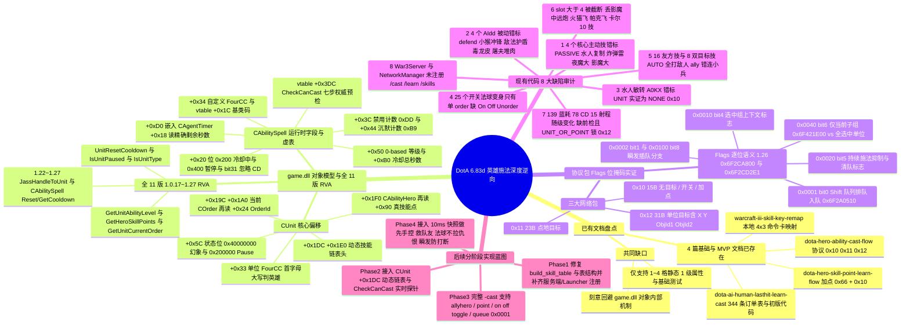

# DotA 6.83d 英雄使用技能深度逆向与 AI 控制体系 — 思维导图

| 字段 | 内容 |
| :--- | :--- |
| **分析模型** | Antigravity AI Agent（Planning + Execution） |
| **分析目的** | 结构化呈现 DotA 6.83d 英雄施法的已有文档覆盖度、`game.dll` 技能对象模型、全 11 版 RVA、协议 `Flags`、现有代码 8 大缺陷及分阶段升级蓝图 |
| **命名方式** | `dota-6.83d-hero-ability-cast-deep-reverse-and-ai-design-mindmap`；命令体系 `-cast`/`-learn`/`-skills`/`-autolearn` |
| **分析时间** | 2026-11-19 |

