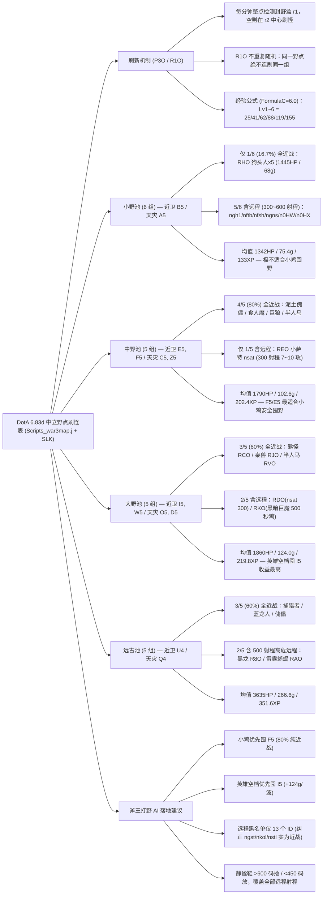

# DotA 6.83d 全野点刷怪表与近卫野区分析（思维导图）

| 字段 | 内容 |
| :--- | :--- |
| **分析模型** | Gemini（Antigravity IDE） |
| **分析目的** | 可视化 6.83d 12 野点刷新池、不重复随机逻辑、近战/远程分布及斧王打野/小鸡囤野策略 |
| **命名方式** | `dota-683d-neutral-camp-creeps-mindmap.md` |
| **分析时间** | 2026-11-27 20:15 |
| **配套正文** | [`dota-683d-neutral-camp-creeps.md`](./dota-683d-neutral-camp-creeps.md) |

