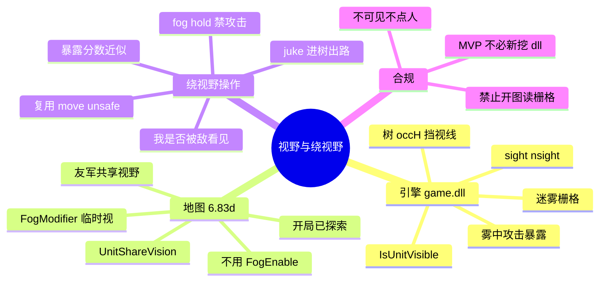

# DotA 6.83d 视野与绕视野 — 思维导图

| 字段 | 内容 |
| :--- | :--- |
| **分析模型** | Auto（Cursor Agent / Composer） |
| **分析目的** | 导图化视野分层与英雄绕视野 AI |
| **命名方式** | `dota-683d-vision-and-fog-juke-mindmap` |
| **分析时间** | 2026-11-17 |

配套正文：[`dota-683d-vision-and-fog-juke.md`](./dota-683d-vision-and-fog-juke.md)
