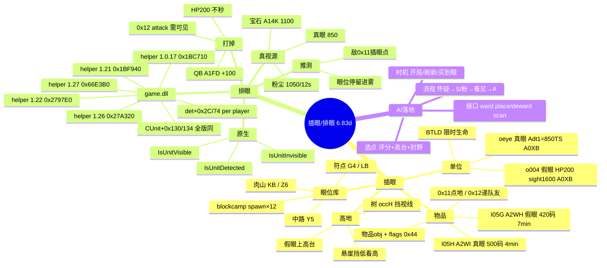

# DotA 6.83d 插眼 / 排眼 — 思维导图

| 项 | 内容 |
| :--- | :--- |
| **分析模型** | Composer（Cursor Agent） |
| **分析目的** | 导图索引正文 [`dota-683d-ward-and-deward.md`](./dota-683d-ward-and-deward.md) |
| **命名方式** | `dota-683d-ward-and-deward-mindmap` |
| **分析时间** | 2026-11-21 |

## 速查边

| 从 | 到 |
| :--- | :--- |
| 假眼 | `o004` / 1600 视野 / 7 min / 隐身 `A0XB` |
| 真眼 | `oeye` / `Adt1` 850 / 4 min / 隐身 `A0XB` |
| 粉尘 | `I0GH` `AItb` 1050×12s |
| 宝石 | `I04D` `A14K` 1100 |
| 侦测 helper | 1.0.17 `0x1BC710` · 1.21 `0x1BF940` · 1.22 `0x2797E0` · 1.24.4 `0x27AE40` · 1.26 `0x27A320` · 1.27 `0x66E3B0`（全表见正文） |
| 字段 | `CUnit+0x130/134` + det `+0x2C/+0x74`（1.0.17→1.27 同） |
| 封野 | spawn-box check 内 / tactics `blockcamp` |
| 打眼 | 可见后 `0xD000F`；QB +100 |
