# DotA 6.83d 卡兵实测记录分析与数据驱动参数思维导图

| 字段 | 内容 |
|---|---|
| **分析模型** | Gemini 4 Neon (Medium) |
| **分析目的** | 以思维导图呈现 15 个卡兵 CSV + 真人录制（共 100 有效波、200 次漏兵）的成败规律、各路难卡段、真人 vs AI 差异、数据驱动参数建议与数据缺口 |
| **命名方式** | `dota-ai-block-records-analysis-mindmap` |
| **分析时间** | 2026-11-21 |
| **关联正文** | [dota-ai-block-records-analysis.md](file:///D:/Qt/workspace/War3Analysis/analyses/dota-ai-block-records-analysis.md) |

```mermaid
flowchart LR
    Root["DotA 6.83d 卡兵实测记录分析<br/>(15 CSV 80波 + 真人 20波 = 100波 / 200次漏兵)"]

    %% 1. 按波分类
    Root --> Cat["一、按波分类 (路 × 模式 × 光环期 × 成绩)"]
    Cat --> MidG["近卫中路 (常速 325)<br/>• AI: 20满分 / 1漏1 / 2漏2+ (均分 96, 拖延 8.1s)<br/>• 真人: 10满分 / 1漏1 (拖延 3.5s)"]
    Cat --> TopG["近卫上路<br/>• AI 减速(244): 3满分(100) / 1漏3(W2, 62.5) 均分 91<br/>• AI 常速(325): 1满分(96.5) / 2漏1 / 6漏2+ 均分 37"]
    Cat --> BotG["近卫下路<br/>• AI 加速(406): 28波无满分 (均分 5.0, 免考)<br/>• AI 常速(325): 1满分(W4) / 15漏2+ (门口起卡 093216/094838 仅 9~34分!)<br/>• 真人: 加速 2波 / 常速 7波 (1满分)"]

    %% 2. 成败最大差异变量
    Root --> Diff["二、满分波 vs 漏兵波 Top 4 差异变量"]
    Diff --> Vhs["1. 英雄有效前进速 v_hs (差异 2.5x~4x)<br/>• 满分波: 208.5/s (中) / 210.2/s (上常速)<br/>• 漏兵瞬间: 下常速仅 72.7/s, 上常速仅 48.6/s!<br/>• 元凶: L3961 |latErr|>20 即把前进压到 70 触发转向停顿"]
    Diff --> Gap["2. 最差前距 gap_p10 (生死线 75~80)<br/>• 全部满分波 p10: 78 ~ 95<br/>• 全部失败波 p10: 18 ~ 60 (贴身即侧滑)"]
    Diff --> Span["3. 漏前 0.5s 波宽 (物理极限 2×48 = 96)<br/>• 下路常速漏前波宽 110.8 / 上路 106.2<br/>• rowWidth<=110 强站中点导致左右双列同时漏"]
    Diff --> Role["4. 漏兵兵种与侧向<br/>• 72%~100% 为近战兵 esen (碰撞仅 16)<br/>• 上路 76%~100% 从 +侧(西/外侧) 漂移漏走"]

    %% 3. 地形与难卡段
    Root --> HardSeg["三、各路难卡段 (对照路点与 CPoSeparate)"]
    HardSeg --> MidSeg["中路: s=1280~1680 (100% 漏兵)<br/>高地出口折入主轴 (SA->Turn1)，宽排切西北坡沿"]
    HardSeg --> TopSeg["上路:<br/>• s=1000~2850 (88% 常速漏兵): 走廊持续向西(+侧)漂移<br/>• s=4500~4650 (减速 W2 漏 3): 过15s恢复325 + 树林左凸弯"]
    HardSeg --> BotSeg["下路:<br/>• s=1380~2380 (94% 常速门口漏兵): 树林直道分裂南北双列(宽115)<br/>• s=3500~4260 (二塔 FV 绕塔): 南外侧挤至 l=-154..-189<br/>• s=6800~8100 (S形双弯): 树林劈开 320 宽双股"]

    %% 4. 真人 vs AI
    Root --> HvA["四、真人 vs AI"]
    HvA --> MidCmp["中路: AI 已全面超越真人<br/>• 起步更早 (gap 287 vs 162)<br/>• 横差更准 (11.3 vs 28.6)<br/>• 站住更少 (3.0% vs 21.3%)，拖延翻倍 (8.1s vs 3.5s)"]
    HvA --> SideLearn["边路可向真人借用的 3 条做法<br/>• 低横移不自减速 (真人横移速 9.5/s)<br/>• 宽排果断保排头/主列，不站空档中点<br/>• 常速边路拉大起步前距，守住 gap_p10 >= 80"]

    %% 5. 数据驱动参数建议与回放验证
    Root --> Params["五、数据驱动参数建议 + 离线回放验证"]
    Params --> P1["1. 修复边路短步自减速 (L3961)<br/>|latErr|>20 -> >40；targetProj +70 -> +115"]
    Params --> P2["2. 收紧前排中点宽度 (L3766/3797)<br/>rowWidthMax: 110 -> 96 (单身位物理极限)"]
    Params --> P3["3. 分光环期等兵位与起步阈值<br/>• 中路: 等450, walk/hold 200/240<br/>• 边路减速(244): sp+360, walk/hold 280/320<br/>• 边路常速(325): sp+450~500, walk/hold 350/380<br/>• 优势路加速(406): 跳过不卡/免考"]
    Params --> P4["4. 抑制 medPrev 跳变脉冲 + 外侧基础预偏<br/>单帧 |Δmed|>32 重置；单前排收 20->10；弯道外侧偏 ±14~15"]
    Params --> Sim["5. 离线轨迹回放验证 (原漏兵时刻对比)<br/>• 下路常速(9波): Δgap = +116.6, Δ|latErr| = +5.6<br/>• 上路常速(9波): Δgap = +90.4, Δ|latErr| = +16.3<br/>• 上路减速 W2: Δgap = +109.7, 横差 164.2 -> 46.3"]

    %% 6. 数据缺口
    Root --> Gaps["六、数据缺口与建议测试步骤"]
    Gaps --> G1["1. 近卫上/下路 Wave 12+ 常速期新参数各补 >=8 波"]
    Gaps --> G2["2. 天灾三路全空白: 天灾中 >=10 波、天灾下减速 >=6 波"]
    Gaps --> G3["3. 真人边路门口起卡标杆: 上路/下路常速各 >=4 波"]
    Gaps --> G4["4. 300 档 (影魔) / >=310 档 (月骑/草鞋) 各补 >=6 波"]
```

