# 卡兵记录第二轮分析导图（边路常速期与上路减速期复盘）

- **分析模型**：Gemini 4 Neon (Medium)
- **分析目的**：以结构化导图总览第二轮卡兵记录复盘的四大根因、上路减速期 5 场演进、4 项精准修复方案与离线仿真增益，以及常速/减速期分开及格线建议。
- **命名方式**：`dota-ai-block-records-round2-mindmap`
- **分析时间**：2026-11-21
- **验证状态**：与正文 [dota-ai-block-records-round2.md](file:///D:/Qt/workspace/War3Analysis/analyses/dota-ai-block-records-round2.md) 一致

```mermaid
flowchart TD
    Root["第二轮卡兵记录复盘 (2026-11-21)<br/>下路常速 37 | 上路常速 51 | 上路减速 91→26"]

    Root --> Q1["1. 下路常速 114223 (avg 37)<br/>前3波 63/54/69 vs 后5波 17~29"]
    Root --> Q2["2. 上路常速 113623 (avg 51)<br/>4个关键量复算"]
    Root --> Q3["3. 上路减速 91→54→35→62→26<br/>逐场归因 (非随机波动)"]
    Root --> Q4["4. 第二轮4项修复 & 离线验证"]
    Root --> Q5["5. 物理上限 & 及格线建议"]

    Q1 --> Q1A["排除假因: joinS(0.3~0.6s)/等兵位/攻城车/engaged 均非主因"]
    Q1 --> Q1B["主因①: W27起弯道排宽拉开 → driftAdj正反馈震荡<br/>目标横0.3s狂甩120~180px (|adj|≥30占34~42%)"]
    Q1 --> Q1C["主因②: W27起 AiTick 帧率退化<br/>63~67ms → 79~99ms (W27峰值卡死829ms)"]

    Q2 --> Q2A["已改善: gap0稳定, 全程均速200~210/s"]
    Q2 --> Q2B["未根治①: 漏兵瞬间v_hs仍掉到88/s<br/>driftAdj震荡使单边漏(+87%)变双边摇摆漏(+59%/-41%)"]
    Q2 --> Q2C["未根治②: L3881 medianAim=true 屏蔽 L3884 splitAim<br/>宽排>96仍站正中连漏2~3只"]

    Q3 --> Q3A["055720 (91): 旧门口(-4086), 无900封印, AiTick 70ms"]
    Q3 --> Q3B["102009 (54): 门口按最前兵前移+286 + 上路误开贴身前对最前排"]
    Q3 --> Q3C["104450 (35): 固定等兵位偏后偏右 + 仍未回退 + AiTick 108ms"]
    Q3 --> Q3D["105450 (62): 回退上路贴身前逻辑 + 流畅55ms → 普通波回升75/75/67"]
    Q3 --> Q3E["111403 (26): AiTick严重掉帧(142ms/峰值1062ms)<br/>+ 门口前移致900封印延至s=1274炸出+60~80脉冲 + kWalkOn=280偏晚"]

    Q4 --> F1["P0: 纯rawMed算漂移 + 跳变>24衰减vel*0.3<br/>取消±35阶跃lean, 改线性±38 + spawnProj线性淡入"]
    Q4 --> F2["P0: 修复L3884死代码, 边路rowW>96激活splitAim弃孤守大撮"]
    Q4 --> F3["P1: gap<85限制斜角≤23° (fwd≥150, latLim=65)保前进速度"]
    Q4 --> F4["P1: 上路减速期等兵位回调(-6160,-3675), kWalkOn回调300"]
    Q4 --> Sim["离线回放增益:<br/>下路114223漏兵 -43.5%, 目标跳 -73.9%<br/>上路113623漏兵 -58.3% (0漏2→5/8), 目标跳 -73.6%<br/>上路111403漏兵 -100% (10/10满分)"]

    Q5 --> U1["冰女280 vs 常速325 尚未达物理上限 (仍有+20~25分空间)"]
    Q5 --> U2["稳态预期上限: 上路常速 75~80, 下路常速 68~72"]
    Q5 --> U3["建议分期及格线 (冰女/快英雄):<br/>上路减速 75/85 | 上路常速 60/75 | 下路常速 50/65"]
```

