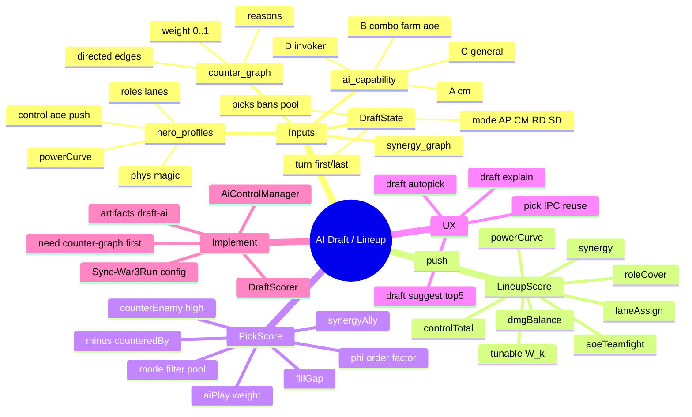

# DotA AI 选人 / 阵容评估 — 思维导图

| 项 | 内容 |
| :--- | :--- |
| **分析模型** | Composer（Cursor Agent） |
| **分析目的** | 导图配套 [`dota-ai-draft-and-lineup.md`](./dota-ai-draft-and-lineup.md) |
| **命名方式** | `dota-ai-draft-and-lineup-mindmap` |
| **分析时间** | 2026-11-21 |



## 流程（简）

```text
                    ┌─────────────┐
  SharedMemory ───►│ DraftState  │
  picks/bans/pool   └──────┬──────┘
                           ▼
   profiles + counters ─► eligible(mode)
                           ▼
                    scorePick each ──► TopK + breakdown
                           │
              autopick? ───┼──► pick abbrev ──► 现有 HERO_PICK IPC
                           └──► 仅显示 suggest
```

## 打分一览

| 层 | 主信号 | 高权重 |
| :--- | :--- | :--- |
| 阵容 | 定位齐全、分路、发力期 | `roleCover` `laneAssign` |
| 选人 | 克对方、别被克、AI 会玩 | `counterEnemy` `counteredBy` `aiPlay` |
| 顺序 | 先手 flex / 后手克制 / 末位补洞 | \(\phi\) + 临时调 `Vc`/`Vg` |

## 用例锚点

- 敌 `Usyl` → 荐含 `E01B`：C←边 0.85，X←0.25，A←tier C  
- SD：`cm` 压过 `invoker`（A 1.0 vs D 0.1）
