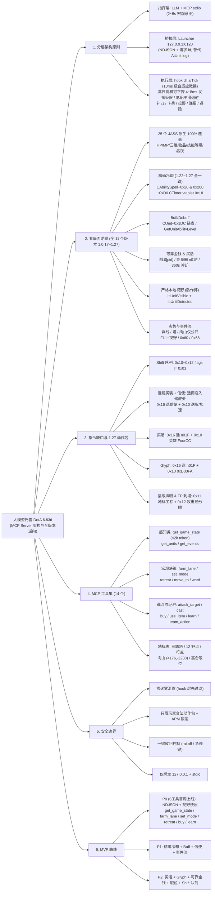

# 大模型托管 DotA 6.83d（MCP Server）思维导图

| 字段 | 内容 |
| :--- | :--- |
| **分析模型** | Gemini 4 Neon (Medium) |
| **分析目的** | 以思维导图形式呈现大模型托管 DotA 6.83d 的分层架构、War3 全 11 个版本逆向数据层、10ms 级自适应微操、动作包缺口、MCP 工具集、安全边界与 MVP 路线 |
| **命名方式** | `dota-ai-llm-mcp-control-mindmap`（配套正文 [`dota-ai-llm-mcp-control.md`](./dota-ai-llm-mcp-control.md)） |
| **分析时间** | 2026-11-21 |

