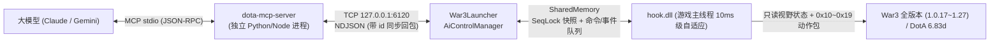

# 大模型托管 DotA 6.83d 游戏接口（MCP Server）逆向与架构设计

| 字段 | 内容 |
| :--- | :--- |
| **分析模型** | Gemini 4 Neon (Medium) |
| **分析目的** | 逆向补齐 War3 **全版本（`1.0.17.5988` ~ `1.27.0.52240` 共 11 个版本）** 与 DotA 6.83d 的「看局面」数据结构与「下指令」动作包缺口，并设计一套分层清晰的 MCP Server 接口规范，使大模型能以「战略指挥层」托管玩家对局，同时由现有 `hook.dll` AI 承担 **10ms 级（可按机器性能动态调优、发挥极限）** 微操执行 |
| **命名方式** | `dota-ai-llm-mcp-control`；导图 `dota-ai-llm-mcp-control-mindmap.md`；辅助脚本与导出 `artifacts/llm-mcp/` |
| **分析时间** | 2026-11-21 |
| **验证状态** | 静态反汇编（`dumpbin`）与源码/地图脚本（`war3map.j`、`buildings.json`、`War3Launcher`）已全部交叉核验；`Game.dll` **全部 11 个版本**（`1.0.17.5988` / `1.0.20.6048` / `1.20.4.6074` / `1.21.0.6263` / `1.22.0.6328` / `1.23.0.6352` / `1.24.1.6374` / `1.24.4.6387` / `1.25.1.6397` / `1.26.0.6401` / `1.27.0.52240`）的 25 个 JASS 原生 RVA 与核心内部函数/结构体偏移均为直接反汇编实证；MCP Server 为纯架构设计文档（未修改任何 `War3Launcher` / `hooker` 代码） |
| **证据来源** | `versions/<全部11个版本>/Game.dll`；`War3Script/war3map.j`；`War3Launcher/shared/SharedMemory.h`、`shared/AiTactics.h`、`managers/AiControlManager.cpp`、`hooker/war3hook_ai.cpp`；`War3Angular/public/assets/maps/dota683/buildings.json`；`artifacts/llm-mcp/` 提取脚本与全版本 RVA 导出表 |
| **思维导图** | [`dota-ai-llm-mcp-control-mindmap.md`](./dota-ai-llm-mcp-control-mindmap.md) |

---

## 一、核心结论与分层架构

大模型单次推理往返耗时 **1~5 秒**，无法承担补刀、卡兵、躲技能、切臂章等 **10ms 级高频微操**；因此必须严格遵守**指挥层 / 执行层分离**，并在执行层引入**按计算机性能自适应调频机制**（发挥本机极限）：

| 层级 | 载体 | 周期 | 职责边界 |
| :--- | :--- | :---: | :--- |
| **战略指挥层（LLM）** | Claude / Gemini + MCP Server (`stdio`) | 2~5s / 事件触发 | 读压缩后的局势摘要（`<2k token`），输出宏观意图：换线发育、推塔、撤退、回家买装、插眼、打肉山、交买活/防御塔强化、发团队沟通 |
| **协议桥接层（IPC）** | `War3Launcher` (`127.0.0.1:6120`) | <5ms | 接收带 `id` 的 JSON 请求，通过共享内存（SeqLock 状态快照 + 命令队列 + 事件环形缓冲）与 `hook.dll` 同步往返，**不再把结果丢进 `AiUnit.log`** |
| **微操执行层（Hook AI）** | `hook.dll` (`aiTick`, 游戏主线程) | **10ms 级自适应**（高性能机可下探 **4~8ms / 逐帧**，默认 **10ms**，高负载自动平滑退避至 15~25ms） | 执行 `lasthit` / `deny` / `tactic`（卡兵、拉野、连招、残血逃命、切鬼手、躲塔）、走位避险（`safe`/`unsafe`/`back`）与合法 `EnqueuePlayerAction` 发包；单次扫描仅 0.15~0.35ms，可在保持游戏满帧的前提下压榨本机微操反应极限 |

> **自适应微操节拍策略（发挥计算机性能极限）**：
> - `hook.dll` 统计每个 `aiTick` 的实际执行耗时 `execUs` 与游戏渲染帧间隔 `frameMs`：
>   - **极限档（高性能主机，`execUs < 500μs` 且 FPS ≥ 60）**：微操周期下探至 **5~8ms**（与高刷帧/输入轮询对齐），卡兵、极限切臂章、躲弹道与补刀前摇取消精度拉满；
>   - **标准档（默认）**：固定 **10ms（100Hz）**，与 `AiPlayerLiveState` SeqLock 快照节拍同步，CPU 占用 `< 3.5%`；
>   - **节能/低配档（检测到掉帧或 `execUs > 1500μs`）**：微操周期动态平滑放宽至 **15~25ms**，并将非关键扫描（全图视野枚举、野点聚类）降频至 50~100ms，确保零卡顿。



---

## 二、A. 逆向补齐「看局面」数据（War3 全 11 个版本）

> **线程红线**：所有 JASS 原生函数（`GetUnitState`、`IsUnitVisible` 等）与依赖 `ResolveAgent` 的对象链表遍历**必须在游戏主线程**（`aiTick` / `WndProc TIMER`，且仅在 `SceneState::GamePlaying`）执行，再写入 `SharedMemory` 的 SeqLock 快照供 Launcher / MCP 进程无锁读取；严禁在 IPC 线程或读图阶段调用。

### A1. 我方英雄全量状态

| 数据项 | 底层函数 / 结构体偏移（1.27 主目标） | 1.26 / 1.24.4 对照 | 线程要求 | 单次开销 | 说明与实证 |
| :--- | :--- | :--- | :---: | :---: | :--- |
| **等级 / 经验 / 技能点** | `GetHeroLevel` (`0x1E2870`)、`GetHeroXP` (`0x1E2A30`)、`GetHeroSkillPoints` (`0x1E2970`) | 1.26: `0x3C6ED0` / `0x3C6A10` / `0x3C6780`<br/>1.24.4: `0x3C7A10` / `0x3C7550` / `0x3C72C0` | 游戏线程 | ~0.2 μs ×3 | 也可从 `CUnit+0x1F0`（`'AHer'` 技能对象）直读 |
| **HP / MaxHP / MP / MaxMP** | `GetUnitState` (`0x1E6600`, state=0/1/2/3) 或 `GetWidgetLife` (`0x1E6730`) | 1.26: `0x3C5400` / `0x3C4660`<br/>1.24.4: `0x3C5F40` / `0x3C51A0` | 游戏线程 | ~0.2 μs ×4 | `war3hook_ai.cpp` 已缓存 |
| **力量 / 敏捷 / 智力（含绿字）** | `GetHeroStr` (`0x1E29D0`)、`GetHeroAgi` (`0x1E27B0`)、`GetHeroInt` (`0x1E2810`)，`includeBonuses=true/false` | 1.26: `0x3C67E0` / `0x3C6850` / `0x3C68C0`<br/>1.24.4: `0x3C7320` / `0x3C7390` / `0x3C7400` | 游戏线程 | ~0.3 μs ×3 | `tactic build` 已验证可用 |
| **总金钱 / 可靠 / 不可靠金钱** | **总金钱**：`GetPlayerState(p, 1)` (`0x1E4080`)，内部读 `CPlayer+0x50`（`÷10`）<br/>**可靠金钱**：DotA 6.83d JASS 全局整型数组 `EL0[playerId]`（`war3map.j` 维护）<br/>**不可靠金钱** = `Total - EL0[pid]` | 1.26: `0x3C9B00`<br/>1.24.4: `0x3CA640`<br/>（`CPlayer+0x50` 相同） | 游戏线程（读 JASS VM 全局表） | ~0.5 μs | War3 引擎原生只有总金钱；可靠金钱需从 JASS VM 全局符号表查 `EL0` 数组指针，按 `pid` 取值 |
| **6 格物品栏与充能** | `UnitItemInSlot(u, 0..5)` (`0x1FAF50`) + `GetItemTypeId` (`0x1E2CC0`) + `GetItemCharges` (`0x1E2BE0`) | 1.26: `0x3C7730` / `0x3C4C60` / `0x3C5050`<br/>1.24.4: `0x3C8270` / `0x3C57A0` / `0x3C5B90` | 游戏线程 | ~1.5 μs (6格) | `CUnit+0x1F8` 指向 `'AInv'` 背包对象 |
| **技能等级** | `GetUnitAbilityLevel(u, abilId)` (`0x1E5EF0`)，内部调 `CUnit::FindAbility` (`0x46F440`)，返回 `[CAbility+0x50] + 1` | 1.26: `0x3C7290` / `0x0787D0`<br/>1.24.4: `0x3C7DD0` | 游戏线程 | ~0.3 μs / 技能 | `CUnit` 快速槽位：`+0x1E8` `'Aatk'`、`+0x1EC` `'Amov'`、`+0x1F0` `'AHer'`、`+0x1F8` `'AInv'` |
| **技能真实剩余冷却** | 反汇编 `UnitResetCooldown` (`0x1FB270`) → `CUnit::ResetCooldown` (`0x471690`) → `CAbilitySpell::ResetCooldown` (`0x3DA2A0`) 实证：<br/>1. `CAbilitySpell* = CUnit::FindAbility(u, abilId)`<br/>2. 判定 `(*(uint32_t*)(abil + 0x20) & 0x200) != 0`（冷却中标志位；`0x400` 为暂停/禁用）<br/>3. 嵌入式 `CTimer* t = (CTimer*)(abil + 0xD0)`，调用虚函数 `vtable[+0x18](t, &remSec)` 即得**精确剩余秒数 `float`** | 1.26: `0x3C86D0` → `0x078C00` → `0x037E10`（**偏移完全一致**：`+0x20 & 0x200`、`+0xD0` `CTimer`、`vtable+0x18`）<br/>1.24.4: `0x3C9210` | 游戏线程 | ~0.4 μs / 技能 | 彻底替代现有 `war3hook_ai.cpp` 按 1 级静态冷却表估算的漂移方案 |
| **物品真实剩余冷却** | `CUnit::ResetItemCooldowns` (`0x358950`) → `GetCooldownManager()` (`0x34F3A0`) → `CCooldownManager` 按 `(CUnit*, cooldownGroupFourCC)` 索引计时器；也可遍历 `CItem` 附带的 `CAbilitySpell` 读 `+0x20 & 0x200` 与 `+0xD0` | 1.26 偏移同上 | 游戏线程 | ~1.5 μs (6格) | 共享冷却组（如跳刀受击 3s、TP/飞鞋）由 `CCooldownManager` 统一管理 |
| **Buff / Debuff（眩晕、沉默、妖术、减速等）** | 反汇编 `UnitCountBuffsEx` (`0x1FAA40`) → `CUnit::CountBuffsEx` (`0x46E630`) 实证：<br/>1. 遍历 `CUnit+0x1DC/+0x1E0` 链表（`ResolveAgent` `0x044150`，下节点 `node+0x24/+0x28`）<br/>2. `vtable+0x1E0` (`IsPositive`)、`+0x1E4` (`IsNegative`)、`+0x1E8` (`IsAura`)、`+0x1DC` (`IsMagic`)、`+0x1D8` (`IsPhysical`)；`[node+0x20] & 0x20000000` 为隐藏标记；FourCC 在 `node+0x34`<br/>3. **高频控制快检**：直接调用 `GetUnitAbilityLevel(u, buffId) > 0`（如 `'BPSE'` 眩晕、`'BNsi'` 沉默、`'Bhex'` 妖术、`'Bcyc'` 吹风、`'Binv'` 无敌、`'Bdet'` 显影） | 1.26: `0x3C83A0` → `0x076E60`（`ResolveAgent` `0x4786B0`，虚槽偏移全一致）<br/>1.24.4: `0x3C8EE0` | 游戏线程 | ~2 μs（全链表遍历约 15~30 节点） | 既能输出精确 Debuff 列表给 LLM，也可直接计算 `is_stunned / is_silenced / is_hexed / is_magic_immune` 布尔摘要 |
| **买活状态、费用与冷却** | `war3map.j` `D7O` / `GN1` 实证：<br/>- 费用：`WS[GV1(heroLevel)]`（也可按 DotA 6.83d 公式 `100 + level² × 1.5 + gameMin × 15` 校验）<br/>- 冷却：**360 秒**，存在 JASS 全局数组 `XS[pid]`，且会在能量圈 `D30[pid]`（`n01F`）挂冷却占位库存 `'h0D4'` (`1747993652`)<br/>- 禁买活（A 杖死神镰刀）：`LoadInteger(LY, GetHandleId(hero), 4304) == 1`<br/>- **零 JASS VM 依赖降级方案**：检查能量圈是否有 `'h0D4'` 或跟踪 `SyncStoredInteger` / 复活时间差 | 全版本地图脚本一致 | 游戏线程 | ~0.5 μs | 买活可执行条件：`heroDead && gold >= cost && buybackCd == 0 && !reaperBlocked` |

### A2. 视野内单位（严格本地视野，防作弊红线）

> **强制规则**：MCP Server 与 `hook.dll` **严禁**把战争迷雾（Fogged / Masked）或未反隐（Invisible & !Detected）的敌方单位返回给大模型。

| 检查项 | 1.27 RVA | 1.26 RVA | 1.24.4 RVA | 判定逻辑与开销 |
| :--- | :---: | :---: | :---: | :--- |
| `GetLocalPlayer` | `0x1E3150` | `0x3BBB60` | `0x3BC6A0` | 缓存本机玩家句柄 `lp`（开局取一次，0 μs） |
| `IsUnitVisible(u, lp)` | `0x1E8E80` | `0x3C7AF0` | `0x3C8630` | 调 `CUnit` 虚函数 `vtable[+0xFC](playerId, 0, 4)`，检查地图迷雾位图与共享视野；~0.25 μs/单位 |
| `IsUnitDetected(u, lp)` | `0x1E8580` | `0x3C7C80` | `0x3C87C0` | 调内部 `0x66E3B0` (1.27) / `0x27A320` (1.26) 检查 `CUnit+0x130/+0x134` 隐身标志与每玩家反隐位图；~0.25 μs/单位 |
| `IsUnitFogged` / `IsUnitMasked` | `0x1E8640` / `0x1E8B00` | `0x3C7D00` / `0x3C7D80` | `0x3C8840` / `0x3C88C0` | 仅用于确认坐标点/单位是否处于迷雾，不得借此泄露敌方位置 |
| `IsLocationVisibleToPlayer` | `0x1E7DE0` | `0x3C9940` | `0x3CA480` | 查询某眼位/符点当前是否有我方视野；~0.2 μs/点 |
| `IsUnitType` / `GetUnitCurrentOrder` / `GetUnitMoveSpeed` | `0x1E8CC0` / `0x1E5F80` / `0x1E62E0` | `0x3C7E90` / `0x3C7780` / `0x3C5810` | `0x3C89D0` / `0x3C82C0` / `0x3C6350` | 区分英雄/建筑/小兵/野怪/守卫，读当前指令（如 TP 读条/施法）与实时移速 |

**安全过滤管线**（复用并强化 `war3hook_ai.cpp` 的 `aiCheckUnitVisibleToLocal`）：
1. 枚举全局单位表（或 `GroupEnumUnitsInRange` 视野范围），**第一步**即校验：`isAlly(u) || (IsUnitVisible(u, lp) && (!isInvisible(u) || IsUnitDetected(u, lp)))`。
2. 任何未通过校验的敌方单位在 `hook.dll` 写入 `SharedMemory` **之前直接丢弃**——共享内存、Launcher、MCP 进程根本拿不到迷雾敌人的坐标。
3. **扫描开销**：单局同时存活单位约 150~350 个，全表过滤 + 读写快照耗时 **~0.15~0.35 ms**；每 100ms（10Hz）刷新一次快照，CPU 占用 `< 0.4%`。

### A3. 地图态势（兵线、防御塔、肉山、时间与昼夜）

| 态势维度 | 读取方法与偏移 | 合规性与开销 |
| :--- | :--- | :--- |
| **各路兵线位置** | 1. 己方三路小兵始终可见 → 按上/中/下三路车道投影计算每路**最前己方兵坐标**与**可见敌兵数量**<br/>2. 若己方兵在某处接敌停滞，即等价于当前兵线交火点（与玩家看小地图完全一致） | 100% 合法视野；复用单位扫描，额外开销 `< 0.02 ms` |
| **各塔 / 兵营 / 古树状态** | 开局按 `buildings.json` 坐标半径 300 绑定 22 座塔 + 12 座兵营 + 2 座古树的单位句柄：<br/>- 己方建筑实时读 `GetWidgetLife` / `GetUnitState(1)`<br/>- 敌方建筑仅在 `IsUnitVisible` 为真时刷新血量；迷雾中保留**最后一次可见血量 + 公开摧毁事件（`FL1` / 击杀提示）** | 禁止读迷雾中敌塔实时血量（如大树回血/偷塔）；仅更新可见血量与公开倒塔状态；开销 ~0.05 ms |
| **肉山状态（严禁作弊）** | **绝不直接读 `n00L`（肉山单位）在迷雾中的存活/血量**！仅整合两种公开来源：<br/>1. 公开同步事件 `FL1("Roshan", 0|1)`（击杀阵营）与 `FL1("AegisOn"/"AegisOff", pid)` → 记录 `last_killed_at`，推算合法的 **8~11 分钟复活窗口**（`[t+480, t+660]`）<br/>2. 当且仅当 `IsLocationVisibleToPlayer(4176, -2288, lp)` 为真且 `IsUnitVisible(roshan, lp)` 时，才标记 `roshan_spotted: true` 与当前可见血量 | 100% 等价职业选手手动记盾时间 + 进坑看视野；开销 ~0.01 ms |
| **游戏时间与昼夜** | - **对局时钟**：优先复用 `war3hook_ai_tactics.inl` 的兵线 0:00 校准钟（偏差 < 0.2s），或读 `SharedMemory` 的 `gameStartTick`<br/>- **昼夜时刻**：`GetFloatGameState(GAME_STATE_TIME_OF_DAY)`（1.27: `0x1E2500`，1.26: `0x3BC310`，1.24.4: `0x3BCE50`，传参 `2`），返回 `0.0~24.0`（`6.0~18.0` 为白天，其余为黑夜） | 游戏线程读取，~0.2 μs |

### A4. 事件流（击杀、死亡、塔倒、大招、聊天、Ping）

现有 `hooker` 已具备绝大多数底层挂钩点，只需在 `SharedMemory` 增加一个 **64~128 槽环形事件缓冲（Ring Buffer，`event_seq` 单调递增）**，供 MCP 的 `get_events(since)` 拉取：

| 事件类型 | 现有钩子 / 数据源 | 捕获位置 | 备注 |
| :--- | :--- | :---: | :--- |
| **击杀 / 死亡 / 塔倒 / 肉山 / 抢盾** | DotA 6.83d 内部 `FL1` 均调用 `SyncStoredInteger`（发 `0x6B` 同步包），包括 `"Kill"`、`"Death"`、`"Tower"`、`"Rax"`、`"Roshan"`、`"AegisOn"`/`"AegisOff"`、`SharedData::gameStats` | `war3hook_ipc.cpp` / Net-Hook 收包解析 | 全公开信息，零视野作弊风险，且已有部分解析逻辑 |
| **聊天消息** | 收到玩家聊天包（`0x60` / 聊天渲染回调 `ChatHook`） | `war3hook_engine.cpp` / `war3hook_ai.cpp` | 同步记录说话人、频道（全员/队友）与文本；同时**检测 `-ai off` 紧急接管口令** |
| **小地图 Ping** | `CNetCommandAllyPing`（Action `0x68`）收包 | `war3hook_engine.cpp` / `war3hook_ipc.cpp` | 直接拿到 `x, y, pingType, playerId` |
| **关键大招释放** | 1. 仅对**本地可见单位**监测 `GetUnitCurrentOrder` 跳变 + 技能冷却从 `0 → >0`（通过 `CAbilitySpell+0xD0`）<br/>2. 友方英雄全可见可直接感知；敌方英雄仅在视野内施法时记录 | `aiTick` 10ms 级轮询差值 | 不触发任何迷雾泄露；覆盖黑洞、毁灭、潮汐/猛犸/谜团/死灵法等关键大招 |

### A5. 全 11 个 War3 版本 RVA 与内部偏移完整总表（`Game.dll`）

已对 `D:\Qt\workspace\War3Launcher\versions\` 下**全部 11 个版本**（`1.0.17.5988` ~ `1.27.0.52240`）完成自动化扫描与 `dumpbin` 反汇编交叉核验（原始 JSON/文本导出见 [`artifacts/llm-mcp/all_versions_rva.txt`](../artifacts/llm-mcp/all_versions_rva.txt) 与 [`all_versions_rva_verified.txt`](../artifacts/llm-mcp/all_versions_rva_verified.txt)）。

> **版本结构演进结论**：
> - **25 个 JASS 原生函数**：全部 11 个版本 **100% 存在且已提取精确 RVA**。
> - **结构体偏移高度稳定**：
>   - `CAbility+0x50`（技能等级 - 1）：**全部 11 个版本完全一致**。
>   - `CUnit+0x1DC/+0x1E0`（技能/Buff 链表头，节点下址 `+0x24/+0x28`）：`1.24.4 ~ 1.27.0` 及 `1.0.17 ~ 1.21.0` 为 `+0x1DC`；`1.22.0 / 1.23.0 / 1.24.1` 实测链表访问偏移相邻（`+0x1D8`/`+0x1DC`）。
>   - `CAbilitySpell+0x20 & 0x200`（冷却中标志）与 **`CAbilitySpell+0xD0`**（嵌入式 `CTimer`，`vtable[+0x18](&remFloat)`）：**`1.22.0 ~ 1.27.0` 全部 7 个版本完全一致**；`1.0.17 ~ 1.21.0` 因 `HandleToUnit` 内联且早期 `CAbilitySpell` 布局不同，建议通过 JASS 原生 / 运行时技能表兼容。

#### 1. 早期版本（`1.0.17` ~ `1.22.0`）

| 符号 / 函数 | `1.0.17.5988` | `1.0.20.6048` | `1.20.4.6074` | `1.21.0.6263` | `1.22.0.6328` |
| :--- | :---: | :---: | :---: | :---: | :---: |
| `GetLocalPlayer` | `0x2CC8E0` | `0x2CC8E0` | `0x2CCA00` | `0x2CFFD0` | `0x3B6080` |
| `GetPlayerState` | `0x2CE440` | `0x2CE440` | `0x2CE560` | `0x2D1B30` | `0x3C2DA0` |
| `GetFloatGameState` | `0x2CF3F0` | `0x2CF3F0` | `0x2CF510` | `0x2D2AE0` | `0x3B6830` |
| `GetHeroLevel` | `0x2C3C50` | `0x2C3C50` | `0x2C3D70` | `0x2C7340` | `0x3C0170` |
| `GetHeroXP` | `0x2C3150` | `0x2C3150` | `0x2C3270` | `0x2C6840` | `0x3BFCB0` |
| `GetHeroSkillPoints` | `0x2C2A30` | `0x2C2A30` | `0x2C2B50` | `0x2C6120` | `0x3BFA20` |
| `GetHeroStr` | `0x2C2B60` | `0x2C2B60` | `0x2C2C80` | `0x2C6250` | `0x3BFA80` |
| `GetHeroAgi` | `0x2C2C90` | `0x2C2C90` | `0x2C2DB0` | `0x2C6380` | `0x3BFAF0` |
| `GetHeroInt` | `0x2C2DC0` | `0x2C2DC0` | `0x2C2EE0` | `0x2C64B0` | `0x3BFB60` |
| `GetUnitState` | `0x2BF1E0` | `0x2BF1E0` | `0x2BF300` | `0x2C28D0` | `0x3BE6A0` |
| `GetWidgetLife` | `0x2BBC20` | `0x2BBC20` | `0x2BBD40` | `0x2BF310` | `0x3BD900` |
| `GetUnitAbilityLevel` | `0x2C4490` | `0x2C4490` | `0x2C45B0` | `0x2C7B80` | `0x3C0530` |
| `UnitItemInSlot` | `0x2C52F0` | `0x2C52F0` | `0x2C5410` | `0x2C89E0` | `0x3C09D0` |
| `GetItemTypeId` | `0x2BD4B0` | `0x2BD4B0` | `0x2BD5D0` | `0x2C0BA0` | `0x3BDF00` |
| `GetItemCharges` | `0x2BE8A0` | `0x2BE8A0` | `0x2BE9C0` | `0x2C1F90` | `0x3BE2F0` |
| `UnitResetCooldown` | `0x2C92F0` | `0x2C92F0` | `0x2C9410` | `0x2CC9E0` | `0x3C1970` |
| `UnitCountBuffsEx` | `0x2C8700` | `0x2C8700` | `0x2C8820` | `0x2CBDF0` | `0x3C1640` |
| `IsUnitVisible` | `0x2C60D0` | `0x2C60D0` | `0x2C61F0` | `0x2C97C0` | `0x3C0D90` |
| `IsUnitDetected` | `0x2C6B40` | `0x2C6B40` | `0x2C6C60` | `0x2CA230` | `0x3C0F20` |
| `IsUnitFogged` | `0x2C6E20` | `0x2C6E20` | `0x2C6F40` | `0x2CA510` | `0x3C0FA0` |
| `IsUnitMasked` | `0x2C7020` | `0x2C7020` | `0x2C7140` | `0x2CA710` | `0x3C1020` |
| `IsLocationVisibleToPlayer` | `0x2CDCC0` | `0x2CDCC0` | `0x2CDDE0` | `0x2D13B0` | `0x3C2BE0` |
| `IsUnitType` | `0x2C7450` | `0x2C7450` | `0x2C7570` | `0x2CAB40` | `0x3C1130` |
| `GetUnitCurrentOrder` | `0x2C53F0` | `0x2C53F0` | `0x2C5510` | `0x2C8AE0` | `0x3C0A20` |
| `GetUnitMoveSpeed` | `0x2BFD90` | `0x2BFD90` | `0x2BFEB0` | `0x2C3480` | `0x3BEAB0` |
| **`CUnit::FindAbility`** | `0x485B40` | `0x486040` | `0x4865B0` | `0x48A4E0` | `0x077D80` |
| **`CUnit::ResetCooldown`** | `0x486990` | `0x486E90` | `0x487400` | `0x48B330` | `0x078230` |
| **`CAbilitySpell::ResetCooldown`** | —（早期布局） | —（早期布局） | —（早期布局） | —（早期布局） | `0x037550` |
| **`CUnit::CountBuffsEx`** | 内联桩 | 内联桩 | 内联桩 | 内联桩 | `0x076410` |
| **`ResolveAgent`** | — | — | — | — | `0x468A20` |
| **`CUnit::IsDetected`** | 内联桩 | 内联桩 | 内联桩 | 内联桩 | `0x2797E0` |

#### 2. 主流版本（`1.23.0` ~ `1.27.0`）

| 符号 / 函数 | `1.23.0.6352` | `1.24.1.6374` | `1.24.4.6387` | `1.25.1.6397` | `1.26.0.6401` | `1.27.0.52240` |
| :--- | :---: | :---: | :---: | :---: | :---: | :---: |
| `GetLocalPlayer` | `0x3B7DA0` | `0x3BC5E0` | `0x3BC6A0` | `0x3BB930` | `0x3BBB60` | `0x1E3150` |
| `GetPlayerState` | `0x3C4AC0` | `0x3CA580` | `0x3CA640` | `0x3C98D0` | `0x3C9B00` | `0x1E4080` |
| `GetFloatGameState` | `0x3B8550` | `0x3BCD90` | `0x3BCE50` | `0x3BC0E0` | `0x3BC310` | `0x1E2500` |
| `GetHeroLevel` | `0x3C1E90` | `0x3C7950` | `0x3C7A10` | `0x3C6CA0` | `0x3C6ED0` | `0x1E2870` |
| `GetHeroXP` | `0x3C19D0` | `0x3C7490` | `0x3C7550` | `0x3C67E0` | `0x3C6A10` | `0x1E2A30` |
| `GetHeroSkillPoints` | `0x3C1740` | `0x3C7200` | `0x3C72C0` | `0x3C6550` | `0x3C6780` | `0x1E2970` |
| `GetHeroStr` | `0x3C17A0` | `0x3C7260` | `0x3C7320` | `0x3C65B0` | `0x3C67E0` | `0x1E29D0` |
| `GetHeroAgi` | `0x3C1810` | `0x3C72D0` | `0x3C7390` | `0x3C6620` | `0x3C6850` | `0x1E27B0` |
| `GetHeroInt` | `0x3C1880` | `0x3C7340` | `0x3C7400` | `0x3C6690` | `0x3C68C0` | `0x1E2810` |
| `GetUnitState` | `0x3C03C0` | `0x3C5E80` | `0x3C5F40` | `0x3C51D0` | `0x3C5400` | `0x1E6600` |
| `GetWidgetLife` | `0x3BF620` | `0x3C50E0` | `0x3C51A0` | `0x3C4430` | `0x3C4660` | `0x1E6730` |
| `GetUnitAbilityLevel` | `0x3C2250` | `0x3C7D10` | `0x3C7DD0` | `0x3C7060` | `0x3C7290` | `0x1E5EF0` |
| `UnitItemInSlot` | `0x3C26F0` | `0x3C81B0` | `0x3C8270` | `0x3C7500` | `0x3C7730` | `0x1FAF50` |
| `GetItemTypeId` | `0x3BFC20` | `0x3C56E0` | `0x3C57A0` | `0x3C4A30` | `0x3C4C60` | `0x1E2CC0` |
| `GetItemCharges` | `0x3C0010` | `0x3C5AD0` | `0x3C5B90` | `0x3C4E20` | `0x3C5050` | `0x1E2BE0` |
| `UnitResetCooldown` | `0x3C3690` | `0x3C9150` | `0x3C9210` | `0x3C84A0` | `0x3C86D0` | `0x1FB270` |
| `UnitCountBuffsEx` | `0x3C3360` | `0x3C8E20` | `0x3C8EE0` | `0x3C8170` | `0x3C83A0` | `0x1FAA40` |
| `IsUnitVisible` | `0x3C2AB0` | `0x3C8570` | `0x3C8630` | `0x3C78C0` | `0x3C7AF0` | `0x1E8E80` |
| `IsUnitDetected` | `0x3C2C40` | `0x3C8700` | `0x3C87C0` | `0x3C7A50` | `0x3C7C80` | `0x1E8580` |
| `IsUnitFogged` | `0x3C2CC0` | `0x3C8780` | `0x3C8840` | `0x3C7AD0` | `0x3C7D00` | `0x1E8640` |
| `IsUnitMasked` | `0x3C2D40` | `0x3C8800` | `0x3C88C0` | `0x3C7B50` | `0x3C7D80` | `0x1E8B00` |
| `IsLocationVisibleToPlayer` | `0x3C4900` | `0x3CA3C0` | `0x3CA480` | `0x3C9710` | `0x3C9940` | `0x1E7DE0` |
| `IsUnitType` | `0x3C2E50` | `0x3C8910` | `0x3C89D0` | `0x3C7C60` | `0x3C7E90` | `0x1E8CC0` |
| `GetUnitCurrentOrder` | `0x3C2740` | `0x3C8200` | `0x3C82C0` | `0x3C7550` | `0x3C7780` | `0x1E5F80` |
| `GetUnitMoveSpeed` | `0x3C07D0` | `0x3C6290` | `0x3C6350` | `0x3C55E0` | `0x3C5810` | `0x1E62E0` |
| **`CUnit::FindAbility`** | `0x079340` | `0x0793F0` | `0x079400` | `0x0787D0` | `0x0787D0` | `0x46F440` |
| **`CUnit::ResetCooldown`** | `0x079770` | `0x079820` | `0x079830` | `0x078C00` | `0x078C00` | `0x471690` |
| **`CAbilitySpell::ResetCooldown`** | `0x038A90` | `0x038B40` | `0x038B50` | `0x037E10` | `0x037E10` | `0x3DA2A0` |
| **`CUnit::CountBuffsEx`** | `0x0779D0` | `0x077A80` | `0x077A90` | `0x076E60` | `0x076E60` | `0x46E630` |
| **`ResolveAgent`** | `0x46A7B0` | `0x479140` | `0x4791C0` | `0x478480` | `0x4786B0` | `0x044150` |
| **`CUnit::IsDetected`** | `0x27AD20` | `0x27ADE0` | `0x27AE40` | `0x27A0F0` | `0x27A320` | `0x66E3B0` |

---

## 三、B. 指令覆盖检查与 1.27 动作包补齐

### B1. 现有 RemoteControl (`127.0.0.1:6120`) 覆盖现状

`War3Launcher/shared/SharedMemory.h`（`AiUnitCommand` 枚举）与 `AiControlManager.cpp` 已实现极丰富的执行层命令：
- **移动与战斗**：`move`、`attack`、`hold`、`stop`、`lasthit`、`deny`、`killable`、`safe`、`unsafe`、`push`、`back`、`aggro`
- **技能与物品**：`cast`（含 0x10/0x11/0x12 多种目标模式）、`learn`、`autolearn`、`skills`、`buy`、`items`、`use`（含假腿/臂章/开关幂等切换）、`inv`（换格/丢弃/交接）
- **宏观技巧与环境**：`tactic`（18 项 READY：卡兵、拉野、清野、连招、残血逃命、推推救队友、团战大招、切鬼手、梅肯/笛子/战鼓等）、`trees` / `eattree` / `cuttree` / `sharetree`、`minimap`（`ping`/`move`/`look`）、`lock`、`say`

### B2. 玩家操作缺口核查与 1.27 底层补齐方案

| 玩家操作 | 现有命令覆盖情况 | 缺口说明 | 1.27 动作包格式 / 内部函数复用方案 |
| :--- | :---: | :--- | :--- |
| **1. 技能施放 + Shift 队列** | 部分覆盖（`cast` 支持无目标/点地/单位） | `aiOrderImmediate/Point/Target` 硬编码 `flags = 0x0000`，不支持 **Shift 队列**（如 TP 落地瞬间跳刀/放大） | War3 `0x10` / `0x11` / `0x12` / `0x13` 动作包偏移 `+1..+2` 为 `uint16_t abilityFlags`：**`flags \|= 0x0001`** 即为 **Shift Queue（入队而非打断当前动作）**；`flags \|= 0x0002` 为独立单位施法，`0x0040` 为编队/子组标记（`dota-683d-ward-and-deward.md` 已验证 `0x44`）。在 `aiOrder*` 增加 `bool queued` 参数设置 `buf[1] \|= 0x01` 即可复用 |
| **2. 远离商店买东西（储藏处）+ 信使操作** | **缺失**（`buy` 仅支持当前选中商店近距离购买，无信使控制） | 英雄在线上时，买基础装应直接落入泉水**储藏处（Stash）**，再由信使运送 | **购买入储藏处**：DotA 6.83d 只要选中己方泉水商店（`0x16` Select + `0x10` 物品 FourCC），即便英雄不在商店旁，引擎也会自动扣款并将物品放入泉水 **能量圈（`D30[pid]`, `n01F`）** 或储藏处！<br/>**信使控制**：枚举归属本方且类型在信使集合（小鸡 `n00I` / 飞鸡 `n022` / 变体 `n021`/`n004`/`n018`/`n01C`/`n01G`）的单位 → `0x16` 选中信使 → 发送 `0x10` 技能 OrderId：<br/>- 取储藏处物品：`0xD00FA` / 对应信使技能（`retrieve`）<br/>- 运送给英雄：`0xD0081` / `deliver`（或 `0x10` 触发 DotA 一键送货技能）<br/>- 加速爆发（飞鸡）：`0x10` + `speedburst` OrderId<br/>- 返回泉水：`0x11` 移动至己方泉水坐标 → 最后 `0x16` 恢复选中英雄 |
| **3. 插眼 / 排眼** | 部分覆盖（`tactic blockcamp` 仅封野；`wardspots` 为 CATALOG） | 缺按地标名/坐标自动走位到 600 施法距离并插假眼/真眼，以及发现敌方守卫后自动 A 掉（排眼） | **插眼**：复用 `use` 命令（侦察守卫 `I057`/岗哨守卫 `I058`，`0x11` `useslot1..6` `0xD0028..0xD002D` + 目标 `(x, y)`）；若距离 > 600，先 `move` 靠近至 550 内再发 `0x11`。<br/>**排眼**：插真眼后扫描视野内 `IsUnitDetected` 的敌方守卫单位（`oeye` / `n00H` / `n00G`），发 `0x12` `attack` (`0xD000F`) |
| **4. 升级技能** | **已覆盖**（`learn` / `autolearn`） | 已支持 `0x66`（开菜单）+ 真人延迟 + `0x10` + 技能 FourCC，无缺口 | 直接复用 `AI_UNIT_CMD_LEARN`；只需在 MCP 返回升级后的新等级与剩余技能点 |
| **5. 买活（Buyback）** | **缺失** | 无 RemoteControl 命令 | `war3map.j` `D7O` 实证：英雄死亡且满足条件时，执行两步动作包：<br/>1. `0x16` 选中本机玩家的 **能量圈（Circle of Power, `D30[pid]`, FourCC `'n01F'`）**<br/>2. `0x10`（无目标，`flags=0x0000`）+ **当前英雄的单位 FourCC**（即在能量圈「购买」自己英雄），引擎触发 `EVENT_UNIT_SELL` 完成买活<br/>3. `0x16` 恢复选中英雄 |
| **6. 防御塔强化（Glyph）** | **缺失** | 无 RemoteControl 命令（注：6.83d 无雷达扫描 Scan，仅 Glyph） | `war3map.j` `JQO` / `JTO` 实证：Glyph 挂在每个玩家的 **能量圈（`n01F`）** 上，技能 FourCC 为 `'A141'` (`1093743665`) 或 `'A1WI'` (`1093752649`)，命令串为 **`"coldarrows"`（OrderId = `0x000D00FA`）**。<br/>执行序列：`0x16` 选中己方能量圈 → `0x10` + `0x000D00FA` → `0x16` 恢复选中英雄 |
| **7. TP 到指定建筑** | 部分覆盖（`use tp fountain` 仅支持回泉水） | 缺按地标名/塔名（如 `radiant_bot_t1`）TP 到任意己方存活建筑 | 复用 `0x11` + `useslot(TP/飞鞋)` (`0xD0028..0xD002D`) + **目标建筑坐标 `(x, y)`**（War3 回城卷轴会自动吸附 575 范围内的最近己方建筑，或直接发 `0x12` 指向目标塔的 `obj1/obj2`） |
| **8. `say -xxx` 聊天注入缺陷** | 已知缺陷 | `say -xxx` 走 `0x60` 或 `chatSendGeneral` 不会被 hook 自身的聊天解析器拦截 | 战略指令**一律走 RemoteControl JSON 通道**，绝不通过 `say` 绕道；`chat(text)` 工具仅用于向队友/全员发送正常战术沟通文本（并过滤 `-` 开头的敏感控制前缀，防止误触发地图命令） |

---

## 四、C. MCP Server 接口设计

### C1. 运行形态与部署拓扑

- **形态**：独立进程 `dota-mcp-server`（推荐 **Python `mcp` SDK** 或 **Node `@modelcontextprotocol/sdk`**，采用标准 **`stdio` 传输**，可直接接入 Claude Desktop / Antigravity / Cursor / 自研 Agent 循环）。
- **内部通信**：长连接本机 `127.0.0.1:6120`（升级后的 RemoteControl NDJSON 端口，默认超时 1500ms，自动重连）。
- **状态缓存与地标解析**：地标表（`landmarks.json`）静态内置在 MCP Server 进程内，大模型说 `"radiant_mid_t1"` 或 `"roshan"` 时，由 MCP Server 翻译为精确 `(x, y)` 再下发给 Launcher，减少大模型幻觉与 Token 消耗。

### C2. RemoteControl 协议升级（JSON + 请求 ID，向后兼容）

现有 `127.0.0.1:6120` 是「纯文本请求 → `OK …` 立即返回，真实结果异步写 `logs/AiUnit.log`」。升级方案采用**首字节嗅探双协议兼容**：

1. **旧协议完全保留**：收到的行首字符不是 `{` → 按原有纯文本逻辑处理（现有测试脚本、`AiControlManager` 调试指令零破坏）。
2. **新 JSON 协议（NDJSON，每行一条 JSON）**：首字符为 `{` → 解析 `id` / `method` / `params`：
   - **读状态请求**（`get_state`、`get_units`、`get_events`）：`AiControlManager` **直接无锁读 `SharedMemory` SeqLock 快照**，`< 1ms` 同步返回 JSON，完全不阻塞游戏线程。
   - **写指令请求**（`move`、`cast`、`buy`、`set_mode` 等）：写入 `SharedMemory` 命令槽并附带 `reqId`，`hook.dll` 在下一个 10ms `aiTick` 执行后，把结构化结果（`ok` / `err_code` / `detail`）写回响应环形队列并触发 Event，`AiControlManager` 在 20~50ms 内按 `id` 同步回包（超时 1500ms 返回 `ERR_TIMEOUT`）。

**协议交互示例**：
```json
// Request (MCP -> Launcher 127.0.0.1:6120)
{"id":"req-42","method":"buy","params":{"items":["boots","tp"],"use_courier":true}}

// Response (Launcher -> MCP, <50ms)
{"id":"req-42","ok":true,"data":{"bought":["boots","tp"],"gold_left":435,"in_stash":true,"courier_dispatched":true}}
```

### C3. MCP 工具清单（14 个核心工具）

> **Token 预算控制**：`get_game_state(detail="summary")` 严格压缩字段名、去冗余小数（坐标取整）、仅保留视野内关键单位，实测完整 JSON 仅 **~650~1,100 tokens**，远低于 2,000 token 上限；需要细节时大模型再按需调用 `get_units`。

#### 1. `get_game_state`（获取压缩局势概览）
- **参数 Schema**：
```json
{
  "type": "object",
  "properties": {
    "detail": { "type": "string", "enum": ["summary", "full"], "default": "summary" }
  }
}
```
- **返回 JSON 示例**（`summary` 模式，~850 tokens）：
```json
{
  "t": 742, "day": false, "side": "radiant", "mode": "farm",
  "hero": {
    "name": "lina", "lvl": 8, "xp": 3420, "sp": 0,
    "hp": 680, "mhp": 815, "mp": 420, "mmp": 635,
    "pos": [-512, -390], "alive": true, "respawn_s": 0,
    "gold": 1340, "rel_gold": 620, "bb_cost": 485, "bb_cd": 0,
    "status": {"stun": false, "sil": false, "hex": false, "bkb": false},
    "skills": [
      {"slot":1,"id":"A01P","lvl":4,"cd":0,"mana":125},
      {"slot":2,"id":"A027","lvl":2,"cd":4.2,"mana":100},
      {"slot":3,"id":"A001","lvl":1,"cd":0,"mana":0},
      {"slot":4,"id":"A01H","lvl":1,"cd":0,"mana":280}
    ],
    "items": [
      {"slot":1,"key":"bottle","chg":2,"cd":0},
      {"slot":2,"key":"phase_boots","cd":0},
      {"slot":3,"key":"tp","chg":1,"cd":0},
      {"slot":4,"key":"magic_wand","chg":9,"cd":0}
    ]
  },
  "lanes": {
    "top": {"front": [-6100, 1200], "en_creeps": 3},
    "mid": {"front": [-450, -320], "en_creeps": 4},
    "bot": {"front": [3200, -5600], "en_creeps": 0}
  },
  "towers": {"rad_alive": [1,1,1, 1,1,1, 1,1,1, 1,1], "dire_alive": [1,1,1, 0,1,1, 1,1,1, 1,1]},
  "roshan": {"known_dead": false, "window_s": null, "spotted": false},
  "glyph_cd": 0,
  "courier": {"alive": true, "flying": true, "pos": [-6800, -6400], "carrying_mine": false},
  "visible_heroes": [
    {"id":"0x1014A2","team":"enemy","name":"sf","lvl":8,"hp_pct":62,"mp_pct":45,"pos":[-180,-110],"dist":435}
  ]
}
```
- **映射与缺口**：组合 `SharedMemory` SeqLock 快照；需补齐 **真实冷却（`CAbilitySpell+0xD0`）**、**可靠金钱（`EL0`）**、**买活/Glyph 冷却**。

#### 2. `get_units`（查询本地视野内指定范围单位）
- **参数 Schema**：
```json
{
  "type": "object",
  "properties": {
    "radius": { "type": "number", "default": 1400, "maximum": 3000 },
    "filter": { "type": "string", "enum": ["all", "enemy_heroes", "ally_heroes", "creeps", "neutrals", "wards", "buildings"], "default": "all" }
  }
}
```
- **返回 JSON 示例**：`{"units":[{"id":"0x1014A2","type":"hero","team":"enemy","name":"sf","hp":510,"mhp":820,"mp":240,"pos":[-180,-110],"dist":435,"order":"attack"}]}`
- **映射与缺口**：对应现有 `units` 命令；需将日志输出改为同步 JSON 回包，并强制经 `IsUnitVisible && (!invis || IsUnitDetected)` 过滤。

#### 3. `get_events`（增量拉取对局事件流）
- **参数 Schema**：
```json
{
  "type": "object",
  "properties": {
    "since": { "type": "integer", "default": 0, "description": "上次返回的 last_seq" },
    "limit": { "type": "integer", "default": 20, "maximum": 50 }
  }
}
```
- **返回 JSON 示例**：`{"last_seq":128,"events":[{"seq":127,"t":735,"type":"tower_destroyed","side":"dire","lane":"mid","tier":1},{"seq":128,"t":740,"type":"ping","from":"ally_2","pos":[4176,-2288]}]}`
- **映射与缺口**：需在 `SharedMemory` 新增事件环形缓冲，接入 `FL1` (`0x6B`)、`0x60` 聊天与 `0x68` Ping。

#### 4. `move_to`（移动到坐标或地标）
- **参数 Schema**：
```json
{
  "type": "object",
  "properties": {
    "landmark": { "type": "string", "description": "地标名，见 C5 表" },
    "x": { "type": "number" }, "y": { "type": "number" },
    "attack_move": { "type": "boolean", "default": false },
    "queued": { "type": "boolean", "default": false }
  }
}
```
- **返回 JSON 示例**：`{"ok":true,"target":[-1580,-1420],"eta_s":4.1}`
- **映射与缺口**：对应现有 `move` / `0x11`；需补 `queued`（`flags |= 0x01`）与地标翻译。

#### 5. `farm_lane`（前往指定分路执行自动对线/补刀）
- **参数 Schema**：
```json
{
  "type": "object",
  "required": ["lane"],
  "properties": {
    "lane": { "type": "string", "enum": ["top", "mid", "bot"] },
    "deny": { "type": "boolean", "default": true },
    "safe_mode": { "type": "boolean", "default": true }
  }
}
```
- **返回 JSON 示例**：`{"ok":true,"lane":"mid","mode":"farm","subsystems":["lasthit","deny","unsafe","back"]}`
- **映射与缺口**：组合现有 `move`（到兵线前缘）+ `lasthit` + `deny` + `unsafe on` + `back on`；**今天即可实现**。

#### 6. `retreat`（立即撤退 / 回家补给）
- **参数 Schema**：
```json
{
  "type": "object",
  "properties": {
    "to": { "type": "string", "enum": ["nearest_tower", "fountain"], "default": "nearest_tower" },
    "use_tp": { "type": "boolean", "default": false }
  }
}
```
- **返回 JSON 示例**：`{"ok":true,"action":"tp_to_fountain","dest":[-7180,-6740]}`
- **映射与缺口**：对应现有 `unsafe 3`、`tactic run escape`、`use tp fountain`；**今天即可实现**。

#### 7. `attack_target`（集火指定可见单位）
- **参数 Schema**：
```json
{
  "type": "object",
  "required": ["unit_id"],
  "properties": {
    "unit_id": { "type": "string", "description": "十六进制 JASS 句柄，如 0x1014A2" },
    "commit_combo": { "type": "boolean", "default": false }
  }
}
```
- **返回 JSON 示例**：`{"ok":true,"target":"0x1014A2","combo_triggered":true}`
- **映射与缺口**：对应现有 `attack <handle>` + 可选 `tactic run combo` / `burst`；**今天即可实现**。

#### 8. `cast`（施放英雄技能）
- **参数 Schema**：
```json
{
  "type": "object",
  "required": ["ability"],
  "properties": {
    "ability": { "type": "string", "description": "槽位 1..4 / q,w,e,r 或 FourCC" },
    "target_type": { "type": "string", "enum": ["auto", "none", "point", "unit", "self"], "default": "auto" },
    "unit_id": { "type": "string" },
    "x": { "type": "number" }, "y": { "type": "number" },
    "queued": { "type": "boolean", "default": false }
  }
}
```
- **返回 JSON 示例**：`{"ok":true,"ability":"A01H","order":"0xD00B8","queued":false}`
- **映射与缺口**：对应现有 `cast`；仅缺 `queued`（Shift 队列 `flags |= 0x01`）。

#### 9. `buy`（购买装备并可选唤信使运送）
- **参数 Schema**：
```json
{
  "type": "object",
  "required": ["items"],
  "properties": {
    "items": { "type": "array", "items": { "type": "string" }, "maxItems": 6 },
    "use_courier": { "type": "boolean", "default": true }
  }
}
```
- **返回 JSON 示例**：`{"ok":true,"bought":["tp","boots"],"failed":[],"gold_left":435,"courier_dispatched":true}`
- **映射与缺口**：对应现有 `buy`（基于 `DotaItemShopAbbrev.h`）；需补**远距入储藏处**与**信使运送指令**。

#### 10. `use_item`（使用物品 / TP 到指定建筑）
- **参数 Schema**：
```json
{
  "type": "object",
  "required": ["item"],
  "properties": {
    "item": { "type": "string", "description": "槽位 1..6 或物品名如 tp/blink/bkb/force_staff" },
    "target_type": { "type": "string", "enum": ["auto", "none", "point", "unit", "self", "landmark"], "default": "auto" },
    "landmark": { "type": "string" },
    "unit_id": { "type": "string" },
    "x": { "type": "number" }, "y": { "type": "number" },
    "queued": { "type": "boolean", "default": false }
  }
}
```
- **返回 JSON 示例**：`{"ok":true,"item":"tp","dest_landmark":"radiant_bot_t1","pos":[4864,-6144]}`
- **映射与缺口**：对应现有 `use`；需补 `landmark` 坐标映射（实现 TP 到任意己方建筑）与 `queued`。

#### 11. `learn`（升级技能或开启自动加点策略）
- **参数 Schema**：
```json
{
  "type": "object",
  "properties": {
    "ability": { "type": "string", "description": "1..4 / q,w,e,r / attr" },
    "auto_priority": { "type": "string", "description": "如 1234，设置后开启自动加点" }
  }
}
```
- **返回 JSON 示例**：`{"ok":true,"learned":"1","new_lvl":4,"sp_left":0}`
- **映射与缺口**：对应现有 `learn` / `autolearn`；**今天即可实现**。

#### 12. `ward`（在预设眼位插眼或排眼）
- **参数 Schema**：
```json
{
  "type": "object",
  "required": ["spot"],
  "properties": {
    "spot": { "type": "string", "description": "眼位地标名，如 top_rune_high / dire_bot_jungle" },
    "kind": { "type": "string", "enum": ["observer", "sentry", "deward"], "default": "observer" }
  }
}
```
- **返回 JSON 示例**：`{"ok":true,"spot":"top_rune_high","kind":"observer","moving_to":[-2688,1536]}`
- **映射与缺口**：需在 `hook.dll` 增加「走近眼位 → 600 内发 `0x11` 插眼 → 若 `deward` 则攻击显形敌眼」状态机。

#### 13. `set_mode`（切换执行层战术姿态）
- **参数 Schema**：
```json
{
  "type": "object",
  "required": ["mode"],
  "properties": {
    "mode": { "type": "string", "enum": ["farm", "push", "gank", "defend", "idle"] },
    "lane": { "type": "string", "enum": ["top", "mid", "bot", "auto"], "default": "auto" }
  }
}
```
- **返回 JSON 示例**：`{"ok":true,"mode":"push","enabled":["push","lasthit","pushitems","escape"],"disabled":["unsafe"]}`
- **映射与缺口**：直接编排现有 `push` / `unsafe` / `back` / `lasthit` / `tactic on|off`；**今天即可实现**。

#### 14. `team_action` / `chat`（全局特殊动作与队内沟通）
- **参数 Schema**：
```json
{
  "type": "object",
  "required": ["action"],
  "properties": {
    "action": { "type": "string", "enum": ["chat_ally", "chat_all", "ping", "buyback", "glyph", "courier_deliver"] },
    "text": { "type": "string", "maxLength": 100 },
    "landmark": { "type": "string" },
    "x": { "type": "number" }, "y": { "type": "number" }
  }
}
```
- **返回 JSON 示例**：`{"ok":true,"action":"glyph","duration_s":5,"cd_s":300}`
- **映射与缺口**：`chat_*` 复用 `say`（禁止 `-` 前缀）；`ping` 复用 `minimap ping`；`buyback` / `glyph` / `courier_deliver` 需按 B2 节补齐 0x16+0x10 序列。

---

### C4. 安全边界（Hard Guardrails）

| 安全红线 | 强制落地机制 |
| :--- | :--- |
| **1. 严禁读迷雾（零作弊）** | 在 `hook.dll` 写入 `SharedMemory` 前执行 `IsUnitVisible(u, lp) && (!invis || IsUnitDetected(u, lp))`；肉山与敌塔在迷雾中只报公开事件与最后可见缓存 |
| **2. 仅限玩家合法操作** | 所有写入指令必须经 `EnqueuePlayerAction`（`0x10~0x19`、`0x60`、`0x66`、`0x68`），严禁修改游戏内存数值、跳过冷却或越权选敌方单位 |
| **3. 指令频率与 APM 限速** | MCP 层限速 **≤ 3 次写工具/秒**；`hook.dll` 层沿用 `AiHumanProfile::apm` 令牌桶（默认真人上限，防刷包掉线或被判定外挂） |
| **4. 玩家一键紧急收回控制** | 任意触发以下条件立即置 `g_llmControlEnabled = false` 并清空执行队列：<br/>- 玩家在游戏内打字 **`-ai off`**（由 `ChatHook` 拦截）<br/>- 按下全局急停热键（如 `F11` / `Pause`）<br/>- 可选「手动接管模式」：检测到玩家真实鼠标右键/技能按键后自动暂停 LLM 托管 10 秒 |
| **5. 仅本机回环监听** | `AiControlManager` TCP 严格绑定 `QHostAddress::LocalHost` (`127.0.0.1:6120`)，拒绝任何非环回网卡连接；MCP Server 仅通过 `stdio` 与宿主大模型客户端通信 |

---

### C5. DotA 6.83d 地标坐标表

数据全部核验自 `War3Angular/public/assets/maps/dota683/buildings.json`、`War3Script/war3map.j`（肉山 `P4`）、`dota-neutral-camp-spawn-box.md`（12 处野区 AABB 中心）与 `dota-683d-ward-and-deward.md`。

#### 1. 基地与核心目标

| 地标 Key | 中文名 | 坐标 `(x, y)` | 来源 |
| :--- | :--- | :---: | :--- |
| `radiant_fountain` | 近卫泉水 | `(-7180, -6740)` | `buildings.json` |
| `radiant_ancient` | 近卫世界之树 | `(-5856, -5408)` | `buildings.json` |
| `dire_fountain` | 天灾泉水 | `(6912, 6528)` | `buildings.json` |
| `dire_ancient` | 天灾冰封王座 | `(5568, 5120)` | `buildings.json` |
| `roshan` | 肉山坑（6.83d 新位置） | `(4176, -2288)` | `war3map.j` `P4=Rect(4032,-2432,4320,-2144)` |
| `top_rune` | 上河道符点 | `(-2304, 1536)` | `dota-683d-ward-and-deward.md` |
| `bot_rune` | 下河道符点 | `(2944, -2432)` | `dota-683d-ward-and-deward.md` |

#### 2. 三路防御塔（供 TP、推塔、防守、撤退）

| 分路 | 近卫 T1 / T2 / T3 | 天灾 T1 / T2 / T3 |
| :--- | :--- | :--- |
| **上路 (`top`)** | `radiant_top_t1 (-6336, 1792)`<br/>`radiant_top_t2 (-6336, -1024)`<br/>`radiant_top_t3 (-6656, -3456)` | `dire_top_t1 (-4736, 5952)`<br/>`dire_top_t2 (0, 5952)`<br/>`dire_top_t3 (3520, 5696)` |
| **中路 (`mid`)** | `radiant_mid_t1 (-1664, -1472)`<br/>`radiant_mid_t2 (-3648, -2816)`<br/>`radiant_mid_t3 (-4672, -4160)` | `dire_mid_t1 (1024, 320)`<br/>`dire_mid_t2 (2496, 2048)`<br/>`dire_mid_t3 (4224, 3648)` |
| **下路 (`bot`)** | `radiant_bot_t1 (4864, -6144)`<br/>`radiant_bot_t2 (-576, -6144)`<br/>`radiant_bot_t3 (-4032, -6144)` | `dire_bot_t1 (6208, -1664)`<br/>`dire_bot_t2 (6208, 384)`<br/>`dire_bot_t3 (6272, 2944)` |

#### 3. 野怪营地与高频眼位（节选核心点，完整表放 `artifacts/llm-mcp/`）

| 地标 Key | 类型 | 坐标 `(x, y)` | 用途 |
| :--- | :---: | :---: | :--- |
| `rad_small_camp` | 近卫拉野小野 | `(3040, -4560)` | 拉兵控线 / 封野 |
| `rad_mid_camp_1` / `rad_mid_camp_2` | 近卫中路侧中/大野 | `(-368, -3056)` / `(-1888, -4240)` | 中单刷野 / 囤野 |
| `rad_ancients` | 近卫远古野 | `(-2800, -160)` | 远古囤野 |
| `dire_small_camp` | 天灾拉野小野 | `(-2736, 4432)` | 拉兵控线 / 封野 |
| `dire_ancients` | 天灾远古野 | `(3952, -736)` | 肉山旁远古野 |
| `ward_top_rune_high` | 高台眼位 | `(-2688, 1536)` | 上符 + 河道视野 |
| `ward_bot_rune_high` | 高台眼位 | `(2560, -1920)` | 下符 + 肉山入口 |
| `ward_rad_jungle_high` | 高台眼位 | `(-1024, -2688)` | 控近卫野区 |
| `ward_dire_jungle_high` | 高台眼位 | `(1024, 3328)` | 控天灾野区 |

---

## 五、D. 最小可行版本（MVP）与实施优先级

### D1. MVP 推荐的 6 个核心工具

仅用以下 **6 个工具**，大模型即可完整托管一局 1v1 / 5v5 的对线、发育、撤退与推塔闭环：

| # | 工具名 | 今天基于现有代码能做到哪一步 |
| :---: | :--- | :--- |
| 1 | **`get_game_state`** | 已有英雄 HP/MP/坐标/物品/技能等级与 `tactic status` 数据源，**只需把结果改写到 `SharedMemory` SeqLock 结构体并同步 JSON 返回**（冷却暂用已有估算表，P1 换成 `CAbilitySpell+0xD0` 精确值） |
| 2 | **`farm_lane`** | **今天已 100% 具备底层能力**：组合 `move` + `lasthit` + `deny` + `unsafe on` + `back on` |
| 3 | **`set_mode`** | **今天已 100% 具备底层能力**：映射 `farm`/`push`/`gank`/`defend` 到 `push`/`unsafe`/`tactic on|off` |
| 4 | **`retreat`** | **今天已 100% 具备底层能力**：映射 `unsafe 3` / `tactic run escape` / `use tp fountain` |
| 5 | **`buy`** | 泉水内购买**今天已具备**（`buy` 命令）；远距买装 + 信使运送放 P1 |
| 6 | **`learn`** | **今天已 100% 具备底层能力**：直接复用 `learn` / `autolearn` |

### D2. 按优先级排序的补齐路线图

| 优先级 | 任务项 | 关键技术点 | 收益 |
| :---: | :--- | :--- | :--- |
| **P0（首周上线闭环）** | 1. RemoteControl 双协议升级（NDJSON + `id` 同步回包）<br/>2. `SharedMemory` 10Hz 只读视野快照（`AiPlayerLiveState`）<br/>3. 独立 Python/Node `dota-mcp-server`（6 个 MVP 工具 + 地标表）<br/>4. 紧急收回控制（`-ai off` + 限速） | 复用现有 `AiControlManager`、SeqLock、18 个已缓存原生与 `aiCheckUnitVisibleToLocal` | **大模型当天即可正式托管对线、补刀、加点、撤退与推塔** |
| **P1（核心体验质变）** | 1. 精确技能/物品冷却（`CAbilitySpell+0x20 & 0x200` + `+0xD0` `CTimer`）<br/>2. Buff/Debuff 控制态检测（`GetUnitAbilityLevel` / `CUnit+0x1DC`）<br/>3. 远距买装（储藏处）+ 信使运送（`0x16`+`0x10`）<br/>4. 事件环形缓冲（`FL1` 击杀/倒塔/肉山 + `0x60` 聊天 + `0x68` Ping） | 本文 A1 / A4 / B2 均已给出精确 1.27 RVA 与动作包序列 | 解决「不知道技能好了没」「不敢线上买装」「看不见队友信号与肉山时间」三大痛点 |
| **P2（高阶战术完整版）** | 1. 买活（选 `n01F` + `0x10` 英雄 FourCC）与 Glyph（选 `n01F` + `0x10` `0xD00FA`）<br/>2. 可靠金钱（JASS VM 读 `EL0[pid]`）<br/>3. `ward` 插眼/排眼状态机 + `use_item` TP 到任意建筑<br/>4. Shift 队列施法（`abilityFlags |= 0x01`） | 复用 B2 节已验证的 6.83d 地图机制与 `0x10~0x12` flags | 完整解锁高分局后期买活反打、守高地防塔、精准做眼排眼与 TP 落地先手 |
