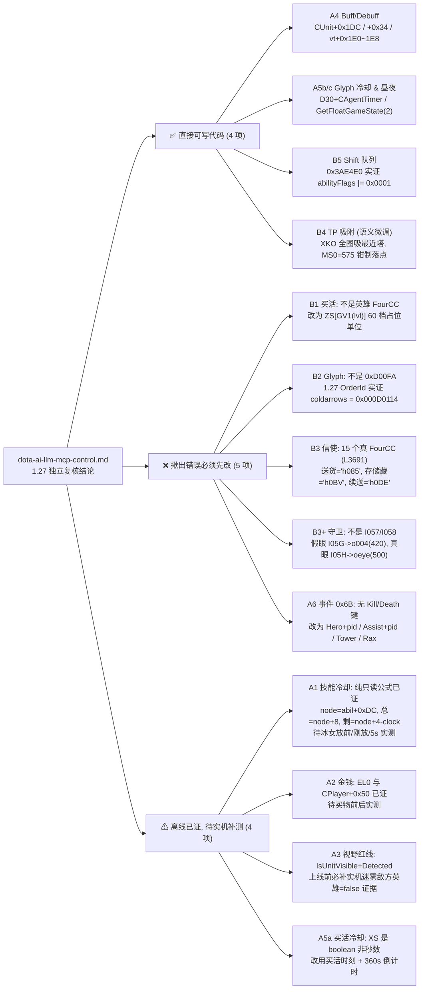

# 「大模型托管 DotA」接口核验结果思维导图

| 字段 | 内容 |
| :--- | :--- |
| **分析模型** | Gemini 4 Neon (Medium) |
| **分析目的** | 一览 `dota-ai-llm-mcp-control.md` 逐项独立核验结果（✅ 通过 / ⚠ 部分对或待实机 / ❌ 必须更正） |
| **命名方式** | `dota-ai-llm-mcp-verify-mindmap`（配套正文 [`dota-ai-llm-mcp-verify.md`](./dota-ai-llm-mcp-verify.md)） |
| **分析时间** | 2026-11-21 |

