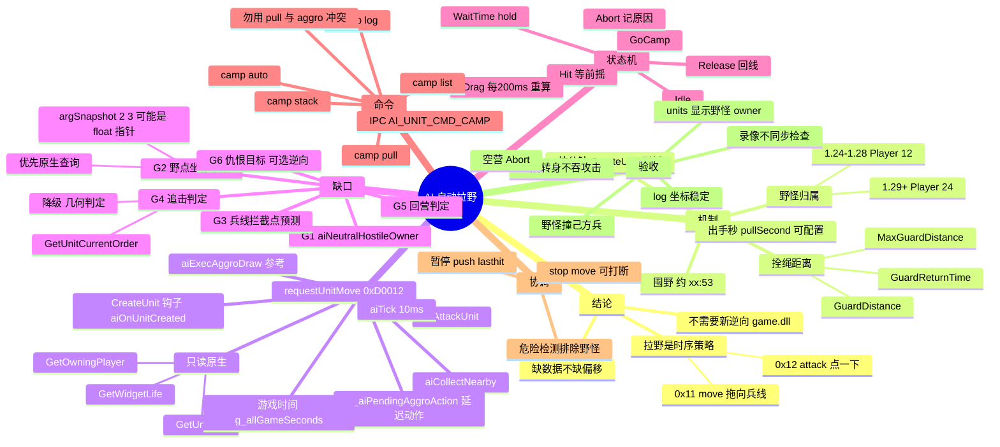

# DotA AI 自动拉野 — 思维导图

| 字段 | 内容 |
| :--- | :--- |
| **分析模型** | Claude Opus（Antigravity Agent） |
| **分析目的** | 导图化拉野方案：能力盘点、缺口、状态机、命令、验收 |
| **命名方式** | `dota-ai-neutral-creep-pull-mindmap`；对外命令 **`camp`** |
| **分析时间** | 2026-11-16 |

配套正文：[`dota-ai-neutral-creep-pull.md`](./dota-ai-neutral-creep-pull.md)

