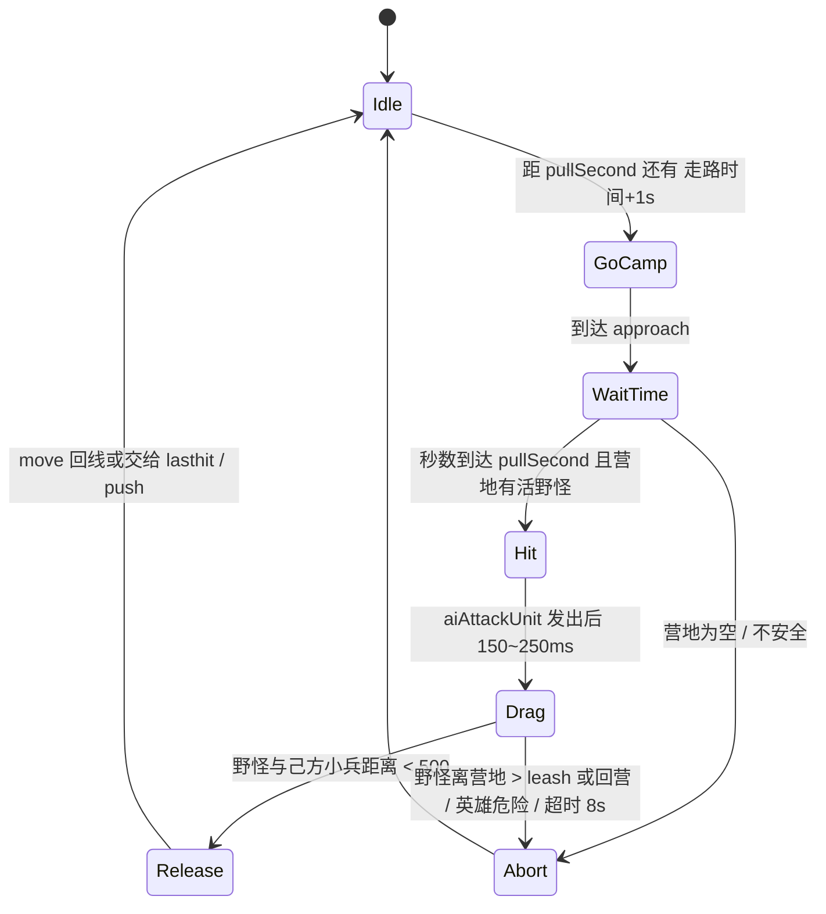

# DotA AI 自动拉野（Neutral Creep Pull）实现方案

| 字段 | 内容 |
| :--- | :--- |
| **分析模型** | Claude Opus（Antigravity Agent） |
| **分析目的** | 回答「如何让 AI 控制英雄自动拉野、是否需要逆向 game.dll」，并把落地方案固定下来，供其他 AI / 开发者直接照做 |
| **命名方式** | `dota-ai-neutral-creep-pull`；对外命令建议主名 **`camp`**（`-camp pull` / `-camp stack` / `-camp log`） |
| **分析时间** | 2026-11-16 |
| **状态** | **方案（未编码）** |
| **代码基线** | `D:\Qt\workspace\War3Launcher\hooker\war3hook_ai.cpp`（2089 行版本）、`war3hook_jass.cpp`、`shared/SharedMemory.h` |
| **前置文档** | [`warcraft-iii-ai-unit-attack-lasthit-deny.md`](./warcraft-iii-ai-unit-attack-lasthit-deny.md)、[`warcraft-iii-ai-hero-move-command.md`](./warcraft-iii-ai-hero-move-command.md) |
| **配套思维导图** | [`dota-ai-neutral-creep-pull-mindmap.md`](./dota-ai-neutral-creep-pull-mindmap.md) |
| **封野几何** | [`dota-neutral-camp-spawn-box.md`](./dota-neutral-camp-spawn-box.md)（AABB，非 600 圆） |

---

## 一、结论（先看这里）

1. **不需要新逆向 game.dll。** 拉野要用的四种基础能力：找到野怪、查询野怪状态、A 一下、往兵线走，在 `war3hook_ai.cpp` 里**都已存在**，它们是 `-attack` / `-lasthit` / `-aggro` / `-safe` 共用的底层。
2. 拉野**不是新的网络动作包**，而是**一段时序策略**：在正确的游戏时间 → 走到野点 → `0x12 attack` 点一下野怪 → 立即 `0x11 move` 走向己方兵线 → 野怪被小兵接住后英雄回线。性质与「正补 = 攻击包 + 时序」相同。
3. 真正缺的是**数据与判定**，不是偏移：
   - 野怪归属玩家号（`PLAYER_NEUTRAL_AGGRESSIVE`）没有纳入 `aiCreepOwner`。
   - 缺 **DotA 版本对应的野点坐标表**（可从 `CreateUnit` 钩子日志自动采集）。
   - 缺「野怪是否在追我 / 是否已回营」的判定（可加只读原生 `GetUnitCurrentOrder`，或用距离营地判定）。
4. **只有**在需要「野怪当前仇恨目标对象」「攻击冷却 / 弹道实时状态」这类 JASS 原生拿不到的数据时，才需要逆向单位对象结构。第一版用不到。

---

## 二、背景：DotA1 拉野机制

| 项 | 说明 |
| :--- | :--- |
| 野怪归属 | `Player(PLAYER_NEUTRAL_AGGRESSIVE)`。**1.24 / 1.26 / 1.27 = 12**；**1.29+ = 24**（玩家上限扩到 24） |
| 刷新方式 | 地图触发器按分钟定时用 `CreateUnit` 刷新，营地内没有单位（且没有被单位挡点）时才刷。首刷时间以及「挡点」规则以具体 DotA 版本为准 |
| 仇恨规则 | 野怪被攻击后会追击攻击者；离开营地超过「守卫距离」或追击超时就回营（回营途中会回血） |
| 拴绳参数 | 在地图 `war3mapMisc.txt` / 游戏常数里：`GuardDistance`、`MaxGuardDistance`、`GuardReturnTime`。拉线点离营地不能超过这个范围 |
| 拉野目的 | 让野怪撞上**己方**小兵，使己方小兵被野怪消耗，兵线回到己方塔下（控线），或者让己方英雄额外吃到野怪经验和金钱 |
| 出手时机 | 用户经验值是「约 30 秒时去拉」。本质是让**野怪被拉到兵线路径的时间 ≈ 己方小兵经过该点的时间**。每个野点的最佳秒数不同，必须做成**可配置参数** `pullSecond`（每分钟内的秒数，如 15 / 30 / 45） |
| 囤野（stack） | 约 `xx:53` 把野怪拉出营地，让下一分钟刷新时营地是空的，于是多刷一组。逻辑与拉野相同，只有时间点和拉出方向不同 |

> [!NOTE]
> 本文不写死任何 DotA 版本的野点坐标或秒数，因为 6.7x / 6.8x 的地形与营地多次调整过。坐标和秒数一律通过「第五节：采集」得到。

---

## 三、现有能力盘点（代码事实）

| 拉野需要 | 现有实现 | 位置 |
| :--- | :--- | :--- |
| 找到野怪单位 | 号角后的 `CreateUnit` / `CreateUnitAtLoc` 返回值进入 `aiOnUnitCreated(handle, typeId)` → `g_aiUnits` | `war3hook_jass.cpp` `doSomeThingsAfterCallGameNativeFuncEntryPoint`（约 1084–1091 行）；`war3hook_ai.cpp:229` |
| 句柄 → 代理 → 网络对象 ID | `aiRecordHandleAgent` 写入环形缓冲和持久 map；`aiResolveUnitObjectIds` 读代理 `+0x0C/+0x10` | `war3hook_ai.cpp:184`、`:247` |
| 位置 / 血量 / 归属 / 类型 | `aiQueryPosition`、`aiRefreshUnit` 内部调用只读原生 `GetUnitX/Y`、`GetWidgetLife`、`GetUnitState`、`GetOwningPlayer`、`GetPlayerId`、`GetUnitTypeId`、`IsUnitType`、`IsUnitVisible` | `war3hook_ai.cpp:33–127`、`:306`、`:329` |
| 周边扫描 | `aiCollectNearby(hx, hy, radius, out)` → `std::vector<AiUnitState>`（含 `ownerId`、`dist`、`hero`、`structure`、`maxLife`） | `war3hook_ai.cpp:400` |
| 选中英雄 | `aiSelectHero()`（只加选、不带取消段） | `war3hook_ai.cpp:435` |
| A 指定单位 | `aiAttackUnit(handle, x, y)` → `0x12` + Order `0xD000F` | `war3hook_ai.cpp:461–482` |
| 走到某点 | `requestUnitMove(x, y, 0xD0012)`（move，**不是** A 地板 `0xD000F`） | 声明 `war3hook_internal.h:3682` |
| stop / hold | `aiOrderImmediate(0xD0004 / 0xD0019)` | `war3hook_ai.cpp:449` |
| 延迟动作框架 | `g_aiPendingAggroAction` + `g_aiPendingAggroTick`，在 `aiTickBackAndPush` 里到点执行 | `war3hook_ai.cpp:555`、`:1436`、`:1569` |
| 「点一下再撤」参考 | `aiExecAggroDraw`（点敌方英雄后撤）、`aiExecAggroDrop`（A 友兵丢仇恨） | `war3hook_ai.cpp:1540`、`:1576` |
| 撤退点计算 | `aiComputeRetreatPoint(hx, hy, dist, &x, &y)` | `war3hook_ai.cpp:1356` |
| 危险检测 | `aiDetectCreepDanger`、`g_aiSafetyScore`、`aiUpdateMinimapAndSafety` | `war3hook_ai.cpp:1113`、`:1373` |
| 游戏时间 | `g_allGameSeconds - g_gameTimeOffset`（逻辑秒）；`g_hornSoundedTick`（号角时刻的 TickCount） | `war3hook_jass.cpp:1227`；`war3hook_globals.cpp:238/308` |
| 主线程节拍 | `aiTick()`，由 WndProc `TIMER_AI_TICK` 每 `AI_TICK_INTERVAL_MS = 10ms` 调用 | `war3hook.cpp:1171/1647`；`war3hook.h:73` |
| 命令入口 | 游戏内聊天 `handleAttackCommand` → `requestAiUnitCommand`；IPC `MSG_TYPE_AI_UNIT_COMMAND` + `AiUnitCommandPayload {cmd,target,x,y,p1,p2,p3}` | `war3hook_ai.cpp:1980`；`shared/SharedMemory.h:268/598` |

### 为何不会不同步

- 读取类调用全部是**只读 JASS 原生**，在游戏主线程中调用，不修改游戏状态。
- 下达类动作全部走 `EnqueuePlayerAction` 网络动作包（`0x10/0x11/0x12`），与真人鼠标操作等价，会正常同步给所有玩家，也会进录像。

---

## 四、缺口与补法

| # | 缺口 | 补法 | 需要逆向？ |
| :-- | :--- | :--- | :--- |
| G1 | `aiCreepOwner` 只认 Player 0 / 6，不认野怪 | 新增 `aiNeutralHostileOwner()`：按 `g_detectedWar3Version` 返回 12 或 24 | 否 |
| G2 | 没有野点坐标表 | 在 `CreateUnit` 钩子号角后分支里，若 owner 是中立敌对，就记录 `x, y, typeId, 游戏秒` 到 `AiUnit.log`；按坐标聚类得到营地 | 否 |
| G3 | 没有兵线路径 | 拉野时取最近的己方小兵，用两次采样得到移动方向，前推 2～3 秒得到拦截点；也可以按营地静态配置一个「拉线点」 | 否 |
| G4 | 不知道野怪是否在追 | 方案 A：`kAiNativeNames` 增加 `GetUnitCurrentOrder`，判断野怪当前命令是否为 attack（`851983 = 0xD000F`）。方案 B：只用几何判定，即野怪离营地距离增大且离英雄距离减小 | 否 |
| G5 | 不知道野怪已回营 | 野怪离营地中心小于约 200 且离英雄越来越远 → 视为丢仇恨 | 否 |
| G6 | 野怪当前仇恨目标对象 / 攻击冷却 | 第一版不做；确有必要时再逆向 `CUnit` 结构 | **是（可选）** |

### G2 坐标读取注意事项

- `CreateUnit(player, unitid, x, y, face)` 的 `argSnapshot[0..4]`：`[0]` = 玩家句柄，`[1]` = 单位类型（现有代码已经用 `argSnapshot[1]` 作为 typeId），`[2]/[3]` = x/y。
- game.dll 原生调用约定中，JASS `real` 参数**通常以 `float*`（指向浮点的指针）传入**。实现前先打印 `argSnapshot[2]` 的原值，确认它是指针还是 float 位模式，再决定是否要解引用（解引用必须走 `isReadable` / SEH 保护）。
- 更稳的办法是：不读参数，在 `aiOnUnitCreated` 之后用已解析的 `GetUnitX/Y`、`GetOwningPlayer` 对返回句柄查询一次。

### G4 原生地址的限制

`aiLearnNative` 只有在**地图第一次调用某个原生时**才能学到它的实现地址。`GetUnitCurrentOrder` 在 DotA 脚本里调用得很频繁，大概率很早就能学到，但需要实测；没学到时自动降级到方案 B。

---

## 五、实施步骤

### 步骤 1：识别野怪（G1）

```cpp
// 中立敌对玩家序号：1.24~1.28 为 12，1.29+ 为 24
static int aiNeutralHostileOwner();
```

在 `aiDumpUnits` / `-units` 输出中把 owner = 中立敌对的单位标记为「野怪」，用来验收。

### 步骤 2：采集野点（G2）

1. 号角后，对每个新建且 owner 为中立敌对的单位，记一行日志：`🏕 [Camp] t=%.1fs type=%hs x=%.0f y=%.0f handle=0x%08X`。
2. 跑一局，在每分钟刷新时刻得到成组坐标；距离小于 400 的单位聚成一个营地，取中心点。
3. 产出 `config/dota_camps_<地图版本>.json`（建议放在 Launcher 侧配置目录，由 IPC 下发或 DLL 启动时读取）：

```json
{
  "map": "DotA v6.83d",
  "neutralOwner": 12,
  "camps": [
    {
      "id": "sentinel_bot_small",
      "team": 1,
      "center": [0, 0],
      "approach": [0, 0],
      "pullTo":   [0, 0],
      "pullSecond": 30,
      "stackSecond": 53,
      "leash": 900
    }
  ]
}
```

| 字段 | 含义 |
| :--- | :--- |
| `team` | 该营地属于哪方的拉野营地（1 = 近卫，2 = 天灾），只对本方英雄启用 |
| `center` | 营地中心（采集得到） |
| `approach` | 英雄站位点：在野怪仇恨范围边缘，靠兵线那一侧 |
| `pullTo` | 默认拉线目标点（兵线路径上的点）。运行时可以用 G3 的动态预测覆盖 |
| `pullSecond` | 每分钟第几秒出手 A 野怪 |
| `stackSecond` | 囤野出手秒 |
| `leash` | 离 `center` 的最大拉扯距离，不超过地图 `MaxGuardDistance` |

> 坐标全部填 `0` 是占位，必须用步骤 2 的实测结果替换。

### 步骤 3：拉野状态机



| 状态 | 动作 | 退出条件 |
| :--- | :--- | :--- |
| `Idle` | 每个 tick 检查时间窗口和 `g_aiSafetyScore` | 进入窗口 → `GoCamp` |
| `GoCamp` | `requestUnitMove(approach, 0xD0012)`；同时暂停 `push` / `lasthit` 例程 | 到达（距离 < 80）→ `WaitTime` |
| `WaitTime` | 原地 hold（`0xD0019`），防止被小兵吸走 | 秒数到 → `Hit` |
| `Hit` | 选营地里离英雄最近的活野怪，`aiAttackUnit`；设置 `pendingTick = now + 180` | 到点 → `Drag` |
| `Drag` | `requestUnitMove(拦截点, 0xD0012)`；每 200ms 重新算拦截点；监控野怪位置 | 见状态图 |
| `Release` | 英雄脱离野怪（往己方塔方向走 300），交还给其他例程 | → `Idle` |
| `Abort` | 记录原因，恢复其他例程 | → `Idle` |

**Hit → Drag 的关键时序**：A 出手后必须等攻击**真正打出去**（或者至少让野怪进入追击状态）再下 move，否则会被 move 取消攻击、野怪不吃仇恨。近战英雄约 150ms，远程英雄应等弹道发出，取攻击前摇加 50ms。可以复用 `-lasthit` 的「前摇秒」参数。

### 步骤 4：命令与 IPC

| 入口 | 语法 | 说明 |
| :--- | :--- | :--- |
| 游戏内 | `-camp pull [campId]` | 立即对最近或指定营地执行一次拉野（忽略时间窗，用于调试） |
| 游戏内 | `-camp auto on\|off` | 按 `pullSecond` 自动循环拉野 |
| 游戏内 | `-camp stack [campId]` | 囤野一次 |
| 游戏内 | `-camp log on\|off` | 开关步骤 2 的野怪刷新坐标采集 |
| 游戏内 | `-camp list` | 列出已加载营地和当前野怪存活数 |
| IPC | `AI_UNIT_CMD_CAMP`（新增枚举，追加在 `AI_UNIT_CMD_AGGRO` 之后） | `target`：0 = 关，1 = pull，2 = auto，3 = stack，4 = log；`p1` = campIndex（-1 = 最近）；`p2` = pullSecond 覆盖值 |

> [!WARNING]
> 现有 `-aggro pull` 已经是 `-aggro draw`（点敌方英雄吸小兵仇恨）的别名，见 `war3hook_ai.cpp:2066`。**拉野不要再用 `pull` 作为顶层命令**，否则语义冲突。所以主名定为 `camp`。

### 步骤 5：与现有例程协调

- `GoCamp` 到 `Release` 期间暂停 `aiTickBackAndPush` 的 push 逻辑和 `g_aiRoutine`（补刀），结束后恢复。
- `aiDetectCreepDanger` 会把**野怪**误判为威胁吗？它只看敌方小兵 owner（0/6）和敌塔，野怪 owner 是 12/24，所以不会，但要在代码里显式排除，防止后续改动引入误判。
- `-stop` / `-move` 必须能打断拉野状态机（与补刀例程一致）。

### 步骤 6：代码组织（遵守 War3Launcher 规范）

- 新函数在 `war3hook.h` / `war3hook_internal.h` 中前置声明；实现集中放在 `war3hook_ai.cpp` 的一个新功能块 `// 拉野 / 囤野` 中，位置在 `aiExecAggroDrop` 之后、`aiSafeMove` 之前。
- 全局状态（营地表、状态机）定义为 `war3hook_ai.cpp` 内的 `static` 变量，**不要**放进头文件。
- 全部用中文注释，日志写到 `logs\AiUnit.log`。
- 编译后执行 `D:\Qt\workspace\sync_war3run.bat` 同步到 `C:\War3Run`，从 `C:\War3Run` 启动测试。

---

## 六、验收清单

| # | 场景 | 期望 |
| :-- | :--- | :--- |
| 1 | `-units 3000`，站在野点旁 | 野怪 owner 显示为 12（1.26/1.27），并标记为「野怪」 |
| 2 | `-camp log on` 跑 3 分钟 | `AiUnit.log` 每分钟出现一组营地刷新坐标，同一营地多次刷新坐标一致 |
| 3 | `-camp pull`（单人测试图） | 英雄 A 一下野怪后立即转身，野怪跟随，不会被 move 吞掉攻击 |
| 4 | `-camp auto on`，按配置秒数 | 野怪与己方小兵在 `pullTo` 附近交战；英雄脱离后回线 |
| 5 | 营地为空、被挡点或附近有敌方英雄 | 状态机进入 `Abort`，日志写明原因，不会卡在 `WaitTime` |
| 6 | 拉野途中 `-stop` / `-move` | 立即中止，其他例程恢复 |
| 7 | 录像回放 | 动作与实时一致，无不同步 |

---

## 七、风险与限制

| 风险 | 说明 / 对策 |
| :--- | :--- |
| 野点坐标随版本变化 | 坐标表按地图版本分文件，启动时按地图名或版本选取；采集工具常驻 |
| `real` 参数传递方式 | 见 G2：先打印再决定是否解引用；优先用原生查询 |
| `GetUnitCurrentOrder` 学不到地址 | 降级为几何判定 |
| 秒数不准 | `pullSecond` 做成可调参数；后续可以根据「野怪与小兵是否在 `pullTo` ±300 内相遇」做自动微调 |
| 野怪先打英雄 | 英雄 HP 低于阈值或 `g_aiSafetyScore` 不安全时不出手 |
| 公平竞技 | 自动化操作仅用于单机或 AI 联调或自建服；在公开天梯使用属于违规脚本 |

---

## 八、给其他 AI 的快速上下文

- **工程**：`D:\Qt\workspace\War3Launcher`（Qt 5.15.2 MSVC 32 位）；注入 DLL 源码在 `hooker/`；AI 单位控制全部在 `hooker/war3hook_ai.cpp`。
- **动作包**：`0x10` 无目标（stop `0xD0004`，hold `0xD0019`）；`0x11` 点目标（move `0xD0012`，attack-move `0xD000F`）；`0x12` 单位目标（attack `0xD000F`，smart `0xD0003`）。
- **读取**：只读 JASS 原生，地址由 `aiLearnNative` 在原生入口钩子里按名字学习得到。新增原生只需在 `AiNativeIndex` / `kAiNativeNames` 里追加。
- **线程**：读取和下指令都在 WndProc 定时器线程（游戏主线程）的 `aiTick` 中进行；聊天 / IPC 线程只能 `requestAiUnitCommand` 入队。
- **不要做的事**：不要直接写游戏内存改单位状态（会不同步）；不要新增 game.dll RVA，除非走到 G6。

