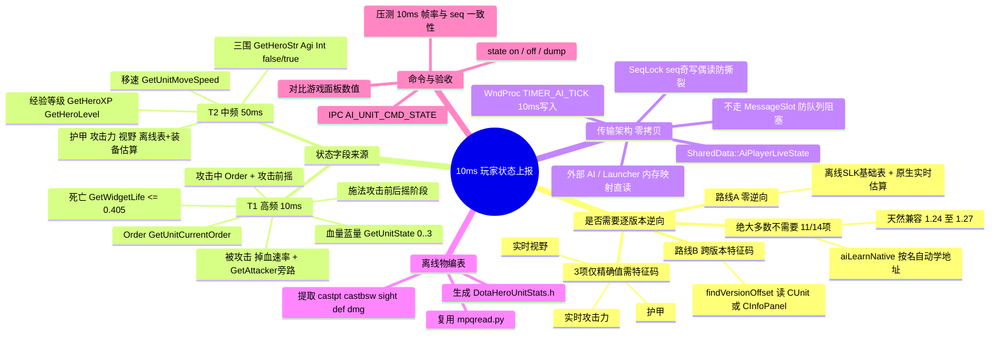

# DotA AI 10ms 动态玩家状态上报系统 — 思维导图

| 字段 | 内容 |
| :--- | :--- |
| **分析模型** | Gemini 4 Hydrogen（Antigravity Agent） |
| **分析目的** | 导图化 10ms 玩家状态采集、无锁共享内存上报与跨版本免逆向方案 |
| **命名方式** | `dota-ai-player-live-state-10ms-reporter-mindmap`；主命令 `state` |
| **分析时间** | 2026-11-17 |

配套正文：[`dota-ai-player-live-state-10ms-reporter.md`](./dota-ai-player-live-state-10ms-reporter.md)

