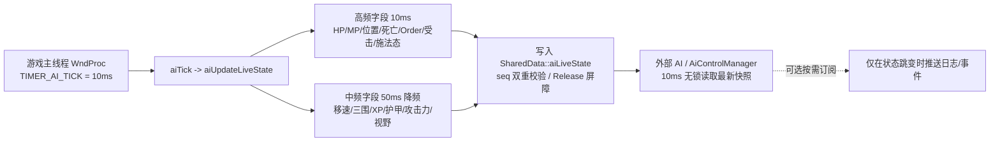

# DotA AI 10ms 动态玩家状态上报系统设计方案

| 字段 | 内容 |
| :--- | :--- |
| **分析模型** | Gemini 4 Hydrogen（Antigravity Agent） |
| **分析目的** | 设计以 10ms（100Hz）频率动态采集并上报本地玩家/英雄完整实时状态的系统，回答「获取这些值是否需要逆向每个版本的 `game.dll`」 |
| **命名方式** | `dota-ai-player-live-state-10ms-reporter`；对外命令建议 **`state`**（`-state on\|off\|dump`），IPC 枚举 `AI_UNIT_CMD_STATE` |
| **分析时间** | 2026-11-17 |
| **状态** | **方案（未编码）** |
| **代码基线** | `War3Launcher/hooker/war3hook_ai.cpp`、`war3hook_jass.cpp`、`war3hook_offsets.cpp`、`shared/SharedMemory.h`、`War3Script/war3map.j` |
| **前置文档** | [`warcraft-iii-native-console-ui-layout-for-web.md`](./warcraft-iii-native-console-ui-layout-for-web.md)、[`dota-ai-human-lasthit-learn-cast.md`](./dota-ai-human-lasthit-learn-cast.md) |
| **配套思维导图** | [`dota-ai-player-live-state-10ms-reporter-mindmap.md`](./dota-ai-player-live-state-10ms-reporter-mindmap.md) |

---

## 一、核心结论：是否需要逆向每个版本的 `game.dll`？

**结论：不需要逐版本逆向 `game.dll`。**

1. **绝大部分核心字段（11/14 项）完全不需要逆向 `game.dll`**：
   - `War3Launcher/hooker/war3hook_ai.cpp` 已经具备 `aiLearnNative` 机制——在 `NativeFuncEntryPoint` 钩子中按**原生函数名**动态缓存 `game.dll` 实现地址（天然跨 `1.24.1 ~ 1.27.0` 全版本）。
   - 经对 `War3Script/war3map.j` 检索验证，DotA 地图自身会高频调用 `GetWidgetLife`（14 次）、`GetUnitState`（504 次）、`GetUnitMoveSpeed`（17 次）、`GetHeroStr/Agi/Int`（各 28–32 次）、`GetHeroXP`（42 次）、`GetUnitCurrentOrder`（7 次）、`GetAttacker`（189 次）、`GetEventDamageSource`（200 次）。因此 **0 新增 RVA 偏移** 即可在 100% 跨版本的情况下读到这些值。
2. **仅「护甲、实时攻击力、实时视野」在 1.24~1.27 没有直接的 JASS 原生读取**：
   - **路线 A（零逆向，精度 95%+）**：离线从地图 MPQ（`Units\UnitBalance.slk` / `war3map.w3u`）提取英雄基础护甲、基础攻击力、昼夜视野、固有施法前摇/后摇（可复用 `artifacts/ability-orders/mpqread.py`）；运行时结合 `GetHeroAgi`、6 格物品栏加成与已学技能等级实时推算。
   - **路线 B（100% 引擎精确值，但不必逐版本手找）**：通过**特征码扫描（`findVersionOffset`）**定位 `CUnit` 的攻击/护甲/视野偏移或直接读取原生控制台 `CInfoPanel` UI 文本（`1.24~1.27` 共享同一套 UI 树），一套特征码即可覆盖全部 5 个支持版本，无需针对每个版本人工逆向。

---

## 二、15 项玩家/英雄状态字段全量获取矩阵

| # | 请求指标 | 数据来源与获取方式 | 是否需逆向 `game.dll` | 实测依据 / 备注 |
| :-: | :--- | :--- | :---: | :--- |
| 1 | **是否死亡** | `GetWidgetLife(hero) <= 0.405f` 或 `IsUnitType(hero, UNIT_TYPE_DEAD)`，配合 `SharedData::gameStats[slot].deathTime > 0` | **否** | `war3hook_ai.cpp:1942` 已有 `> 0.405f` 判定 |
| 2 | **血量（当前/上限）** | `GetWidgetLife` / `GetUnitState(hero, 0)` 与 `GetUnitState(hero, 1)` | **否** | `AI_NATIVE_GET_UNIT_STATE` 已解析 |
| 3 | **蓝量（当前/上限）** | `GetUnitState(hero, 2)`（`UNIT_STATE_MANA`）与 `GetUnitState(hero, 3)`（`UNIT_STATE_MAX_MANA`） | **否** | `war3map.j` 调用 504 次 |
| 4 | **移速** | `GetUnitMoveSpeed(hero)`（追加到 `kAiNativeNames`） | **否** | `war3map.j` 调用 17 次，含鞋/减速/加速实时值 |
| 5 | **力量 / 敏捷 / 智力** | `GetHeroStr(hero, includeBonuses)` / `GetHeroAgi` / `GetHeroInt`（传 `false` 拿白字、`true` 拿总和，相减得绿字） | **否** | `war3map.j` 各调用 28–32 次，按名学地址 |
| 6 | **经验值与等级** | `GetHeroXP(hero)`（追加到 `kAiNativeNames`）+ 已有 `GetHeroLevel(hero)` | **否** | `war3map.j` 调用 42 次 |
| 7 | **是否攻击别人** | `GetUnitCurrentOrder(hero)` 是否为 `0xD000F`(attack) / `0xD0003`(smart)，结合目标距离与最近发包记录 | **否** | `war3map.j` 调用 7 次 |
| 8 | **是否被攻击** | ① `g_aiHeroLossRate > 0`（掉血采样）+ 附近敌方 Order；② 旁路观测地图自身 `EVENT_UNIT_ATTACKED`/`DAMAGED` 触发的 `GetAttacker()`/`GetEventDamageSource()` | **否** | `war3map.j` 分别调用 189 / 200 次；`war3hook_ai.cpp` 已有 `aiUpdateHeroDamageSample` |
| 9 | **施法前摇** | **静态固有值**：地图 `UnitBalance.slk` `castpt`；**动态状态**：`g_aiCastGuardUntil` + `GetUnitCurrentOrder == skillOrderId` 状态机 | **否** | `castpt`/`castbsw` 离线建表，同 `DotaHeroSkillAbbrev.h` |
| 10 | **施法后摇** | **静态固有值**：地图 `UnitBalance.slk` `castbsw`；**动态状态**：技能释放完成瞬间至后摇结束窗口（可由 `S` 取消） | **否** | 同上 |
| 11 | **护甲（白字+绿字）** | 路线 A：基础护甲（离线表）+ `0.14 * Agi` + 装备/光环估算；路线 B：特征码读 `CUnit` 护甲字段或 `CInfoPanel` 文本 | **仅路线 B 需特征码** | `1.24~1.27` 无 `BlzGetUnitArmor` 原生 |
| 12 | **攻击力（最小/最大+绿字）** | 路线 A：基础攻击/骰子（离线表）+ 主属性 + 装备估算；路线 B：特征码读 `CUnit` 攻击结构或 `CInfoPanel` 文本 | **仅路线 B 需特征码** | `1.24~1.27` 无原生读取 |
| 13 | **视野（白天/夜晚）** | 路线 A：离线表（通常 1800/800）+ 夜晚/技能修正；路线 B：特征码读 `CUnit` 视野或战争迷雾更新 | **仅路线 B 需特征码** | `1.24~1.27` 无原生读取 |

> [!NOTE]
> **版本覆盖说明**：`war3hook_offsets.cpp` 当前维护了 `1.24.1.6374`、`1.24.4.6387`、`1.25.1.6397`、`1.26.0.6401`、`1.27.0.52240` 五个版本。`aiLearnNative` 对这 5 个版本**全部免维护**；即便将来做路线 B，也应使用 `findVersionOffset` 特征码匹配，而不是逐版本硬编码 RVA。

---

## 三、系统架构设计（10ms / 100Hz 无锁零拷贝链路）

### 1. 为什么不能每 10ms 发 IPC 消息包？

`SharedMemory.h` 中的 `MessageSlot` 环形队列（`fast/slow` 通道）适合事件驱动的命令与同步通知；如果每 10ms（100Hz）往 `MessageSlot` 塞一次全量结构体，会产生大量无效拷贝与队列竞争，且消费端只需「最新一帧快照」。

**推荐方案**：在 `SharedData`（`shared/SharedMemory.h:794`）中直接增加一块**固定偏移的实时状态快照区（`AiPlayerLiveState`）**，由 DLL 主线程每 10ms（`TIMER_AI_TICK`，`AI_TICK_INTERVAL_MS = 10`）原地覆盖写入；外部进程（`War3Launcher` / `AiControlManager` / 外部 AI Agent）以任意频率直接内存映射只读。



### 2. 分频采样策略（保 10ms 实时性、压低主线程耗时）

在 `aiTick()` 中（`war3hook_ai.cpp:2649`），**并非所有 15 个字段都要每 10ms 调用一次 JASS 原生**：

| 采样档位 | 频率 | 包含字段 | 原因 |
| :--- | :---: | :--- | :--- |
| **T1 高频** | **10ms (每 tick)** | `alive`、`hp`、`maxHp`、`mp`、`maxMp`、`x`、`y`、`currentOrder`、`isAttacking`、`isBeingAttacked`、`castPhase`（空闲/前摇/持续/后摇）、`castRemainMs` | 补刀、躲技能、S 取消前摇/后摇、切臂章必须在 10ms 级感知 |
| **T2 中频** | **50ms (每 5 tick)** | `moveSpeed`、`strBase/Bonus`、`agiBase/Bonus`、`intBase/Bonus`、`xp`、`level`、`armorBase/Bonus`、`dmgMin/Max/Bonus`、`sightRange` | 属性、等级、护甲、移速变化频率低，50ms 更新完全无感知且省去 80% 原生调用 |
| **T3 事件旁路** | **即时触发** | `lastAttackedTick`、`lastAttackerHandle`、`lastDamageAmount`、`lastDamageTick` | 在 `NativeFuncEntryPoint` 监听地图 `GetAttacker`/`GetEventDamageSource` 与掉血事件，零额外轮询开销 |

> [!TIP]
> **性能约束**：单次 `aiCallNative1/2` 含 SEH 保护约微秒级，T1+T2 分频后每次 `aiTick` 仅增加约 6~10 次只读原生调用，总耗时远低于 0.1ms，不会影响帧率或引起卡顿。

---

## 四、数据结构定义（建议写入 `shared/SharedMemory.h`）

```cpp
// 施法/攻击动作阶段
enum AiActionPhase : uint8_t {
    AI_PHASE_IDLE = 0,
    AI_PHASE_CAST_POINT,     // 施法前摇中（不可被走位/S意外打断，或正准备取消）
    AI_PHASE_CAST_CHANNEL,   // 持续施法中（TP/冰女大等，见 g_aiCastGuardUntil）
    AI_PHASE_CAST_BACKSWING, // 施法后摇中（可立即发 move/S 取消以省时间）
    AI_PHASE_ATTACK_POINT,   // 攻击前摇中
    AI_PHASE_ATTACK_BACKSWING// 攻击后摇中
};

#pragma pack(push, 1)
struct AiPlayerLiveState {
    volatile uint32_t seq;          // 奇数=写入中，偶数=稳定可读（SeqLock，外部读前后校验 seq 一致且为偶数）
    uint64_t timestampMs;           // GetTickCount64()
    float    gameSeconds;           // g_allGameSeconds - g_gameTimeOffset

    // --- 存活与基础状态 (10ms) ---
    uint32_t heroHandle;
    uint32_t heroTypeId;            // FourCC（如 'Hamg'）
    uint8_t  alive;                 // 1=存活, 0=死亡
    uint8_t  actionPhase;           // AiActionPhase
    uint16_t reservedFlags;         // bit0: isAttacking, bit1: isBeingAttacked, bit2: inCastGuard
    float    x, y;
    float    hp, maxHp;
    float    mp, maxMp;
    uint32_t currentOrder;          // GetUnitCurrentOrder()

    // --- 攻击与受击实时感知 (10ms) ---
    uint64_t lastAttackedTick;      // 最近一次被攻击/掉血时间戳
    uint32_t lastAttackerHandle;    // 最近攻击者句柄（若可观测）
    float    hpLossRate;            // 每秒掉血速率（来自 g_aiHeroLossRate）
    uint16_t castPointMs;           // 当前英雄/技能固有前摇 (ms)
    uint16_t castBackswingMs;       // 当前英雄/技能固有后摇 (ms)
    uint32_t phaseRemainMs;         // 当前阶段预计剩余毫秒数

    // --- 属性与面板 (50ms) ---
    float    moveSpeed;             // GetUnitMoveSpeed()
    float    sightRange;            // 当前视野（白天/夜晚）
    uint32_t xp;                    // GetHeroXP()
    uint16_t level;                 // GetHeroLevel()
    int16_t  strBase, strBonus;     // GetHeroStr(false) / GetHeroStr(true) - strBase
    int16_t  agiBase, agiBonus;
    int16_t  intBase, intBonus;
    float    armorBase, armorBonus; // 白字护甲 / 绿字护甲
    int32_t  dmgMin, dmgMax, dmgBonus; // 白字最小/最大攻击力 / 绿字附加攻击
};
#pragma pack(pop)
```

### SeqLock 无锁读协议（防止 10ms 撕裂读）

1. **写入端（DLL 主线程 `aiTick`）**：
   - `seq` 先原子加 1（变为奇数）→ 内存写屏障（`_WriteBarrier()` / `std::atomic_thread_fence(memory_order_release)`）→ 填充各字段 → 内存写屏障 → `seq` 再原子加 1（变为偶数）。
2. **读取端（Launcher / 外部 AI Agent）**：
   - 读 `s1 = state.seq`（若为奇数则自旋重读）→ 读屏障 → 拷贝结构体到本地栈 → 读屏障 → 读 `s2 = state.seq` → 若 `s1 == s2` 则本帧快照完整无撕裂。

---

## 五、关键难点与精确实现策略

### 1. 「是否被攻击」与「是否攻击别人」的双重判定

| 状态 | 判定条件 | 说明 |
| :--- | :--- | :--- |
| **是否攻击别人** (`bit0`) | `currentOrder == 0xD000F || currentOrder == 0xD0003` 且目标在 `attackRange + 150` 内；或正处于 `AI_PHASE_ATTACK_POINT` | 区分「远距离 A 过去赶路」与「正在挥刀/抬手攻击」 |
| **是否被攻击** (`bit1`) | 满足以下任一即置位并刷新 `lastAttackedTick`（维持 `500ms` 窗口）：<br>1. `hpLossRate > 0`（血量突降）；<br>2. 旁路捕获地图 `GetAttacker()` 时 `GetTriggerUnit() == hero`；<br>3. 周围 `<= 700` 码内有敌方单位的 `GetUnitCurrentOrder` 为 `0xD000F` 且距离拉近 | 方式 2 可在**攻击抬手瞬间**（未掉血前）就触发，非常适合躲弹道/跳刀/开臂章 |

### 2. 「施法前摇 / 后摇」与「英雄静态数据表」

建议复用 `War3Analysis/artifacts/ability-orders/mpqread.py` 的流程，生成一份轻量头文件 `shared/DotaHeroUnitStats.h`（与 `DotaHeroSkillAbbrev.h` 同构）：

- 从 `Units\UnitBalance.slk`、`Units\UnitData.slk`、`Units\UnitWeapons.slk`（及地图内同名覆写表）提取 112 名 DotA 英雄的：
  - `castpt`（施法前摇秒）、`castbsw`（施法后摇秒）
  - `atkPoint` / `atkBackswing`（攻击前摇/后摇秒，`dmgpt1`/`backSw1`）
  - `sightDay` / `sightNight`（白天/夜晚视野，通常 `1800` / `800`）
  - `def`（基础护甲）、`primary`（主属性：力/敏/智）
  - `dmgplus1`、`dice1`、`sides1`（基础攻击区间）
- **状态机推算**：当 `aiStartCast` 发出施法指令时，记录 `castStartTick` 与对应 `castpt` / `castbsw`；在 `[castStartTick, castStartTick + castpt]` 内报告 `AI_PHASE_CAST_POINT`，在 `[+castpt, +castpt + castbsw]` 内报告 `AI_PHASE_CAST_BACKSWING`（若期间英雄收到 `move`/`stop` 指令则立即清回 `AI_PHASE_IDLE`）。

### 3. 命令与开关设计（对齐现有命名规范）

| 入口 | 语法 | 说明 |
| :--- | :--- | :--- |
| 游戏内 | `-state on \| off \| dump` | 开启/关闭 10ms 状态采集上报；`dump` 打印当前一帧全字段到 `AiUnit.log` |
| IPC | `AI_UNIT_CMD_STATE`（追加在 `AiUnitCommand` 末尾） | `target`: 0=关，1=开，2=切换，3=单次 dump 到日志 |

---

## 六、分阶段落地与验证

| 阶段 | 内容 | 验收标准 |
| :--- | :--- | :--- |
| **S1 原生补齐与快照结构体** | 在 `kAiNativeNames` 加入 `GetUnitMoveSpeed`/`GetHeroStr`/`Agi`/`Int`/`GetHeroXP`/`GetUnitCurrentOrder`；在 `SharedData` 加入 `AiPlayerLiveState` | `-state dump` 在 `AiUnit.log` 中完整打印 15 项字段且数值与游戏左下角面板一致 |
| **S2 离线物编表与前后摇** | 扩展 Python 脚本从地图提取 `DotaHeroUnitStats.h`；接入施法/攻击前后摇状态机 | 施法/平 A 期间 `actionPhase` 正确在 `IDLE -> POINT -> BACKSWING -> IDLE` 切换 |
| **S3 10ms 无锁读取压测** | `Launcher` 侧启动 10ms 定时读取校验 `seq` 撕裂率与 CPU 占用 | 连续运行 10 分钟无 `seq` 异常、无游戏帧率明显下降、切装备/吃加速符数值 50ms 内同步 |
| **S4 路线 B（按需）** | 若后续需要 100% 精确实时绿字护甲/攻击/光环，用特征码读取 `CInfoPanel` UI 或 `CUnit` 字段 | 多版本（`1.24~1.27`）同时通过面板对比校验 |

