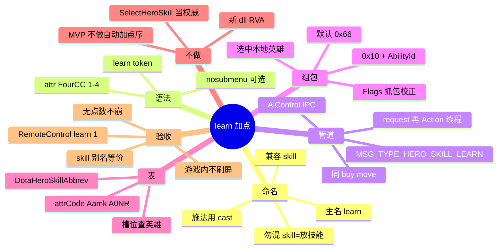

# DotA AI `learn` 加点实现方案 — 思维导图

| 字段 | 内容 |
| :--- | :--- |
| **分析模型** | Auto（Cursor Agent / Composer） |
| **分析目的** | 导图化加点命令落地；主名 `learn`，与施法 `cast` 成对 |
| **命名方式** | 文件名历史保留 `dota-ai-skill-command-implementation-mindmap`；对外命令 **`learn`** |
| **分析时间** | 2026-11-16 |

配套正文：[`dota-ai-skill-command-implementation.md`](./dota-ai-skill-command-implementation.md)
