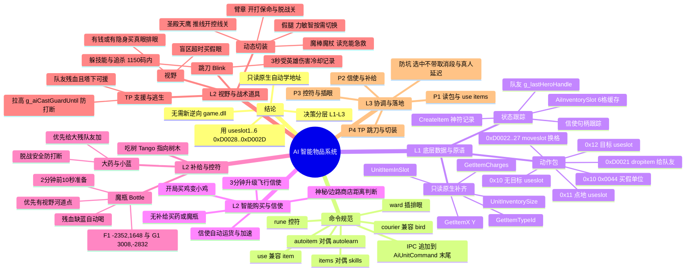

# DotA AI 智能购买与使用物品 — 思维导图

| 字段 | 内容 |
| :--- | :--- |
| **分析模型** | Gemini 4 Hydrogen（Antigravity Agent） |
| **分析目的** | 导图化智能买装、信使、补给、控符、插排眼、TP、跳刀与切装全链路方案 |
| **命名方式** | `dota-ai-smart-item-buy-and-use-mindmap`；主命令 `use`/`items`/`autoitem`/`courier`/`rune`/`ward` |
| **分析时间** | 2026-11-17 |

配套正文：[`dota-ai-smart-item-buy-and-use.md`](./dota-ai-smart-item-buy-and-use.md)

