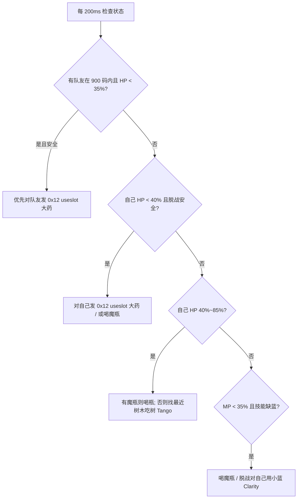

# DotA AI 智能购买与使用物品实现方案

| 字段 | 内容 |
| :--- | :--- |
| **分析模型** | Gemini 4 Hydrogen（Antigravity Agent） |
| **分析目的** | 总结并设计 AI 控制英雄智能购买、运送、切换、使用物品的完整方案，供后续 AI / 开发者直接编码落地 |
| **命名方式** | `dota-ai-smart-item-buy-and-use`；对外命令主名：**`use`**、**`items`**、**`autoitem`**、**`courier`**、**`rune`**（与 `buy`/`move`/`learn`/`cast`/`camp` 一致） |
| **分析时间** | 2026-11-17 |
| **状态** | **方案（未编码）** |
| **代码基线** | `War3Launcher/hooker/war3hook_ai.cpp`、`war3hook_process.cpp`、`shared/DotaItemShopAbbrev.h`、`shared/SharedMemory.h`、`War3Script/war3map.j` |
| **前置文档** | [`dota-inventory-slot-orders-tp-blink-forcestaff.md`](./dota-inventory-slot-orders-tp-blink-forcestaff.md)、[`warcraft-iii-1.26-inventory-six-slot-order.md`](./warcraft-iii-1.26-inventory-six-slot-order.md)、[`dota-ai-human-lasthit-learn-cast.md`](./dota-ai-human-lasthit-learn-cast.md) |
| **配套思维导图** | [`dota-ai-smart-item-buy-and-use-mindmap.md`](./dota-ai-smart-item-buy-and-use-mindmap.md) |

---

## 一、核心结论与技术路线

1. **无需新逆向 `game.dll`**：
   - **购买**：已有 `requestItemBuyByIndex`（选中商店 → `0x10` + `0x0044` + `soldUnitId` → 恢复选中），覆盖 `shared/DotaItemShopAbbrev.h` 全部商店与物品。
   - **使用物品**：引擎内置 **`useslot1..6`（`0xD0028`..`0xD002D`）**，按目标类型分别发 `0x10`（无目标）、`0x11`（点地）、`0x12`（单位/树木）。**不需要**为每个物品查单独的技能 OrderId。
   - **换格/丢弃/给队友**：`moveslot1..6`（`0xD0022`..`0xD0027`）与 `dropitem`（`0xD0021`）。
   - **读取物品栏**：DotA 脚本（`War3Script/war3map.j`）高频调用 `UnitInventorySize`（12 处）、`UnitItemInSlot`（197 处）、`GetItemTypeId`（126 处）、`GetItemCharges`（48 处），因此**直接加入 `kAiNativeNames` 即可由 `aiLearnNative` 自动学到地址**，无需硬编码 RVA。
2. **智能决策分层**：
   - **L1 底层原语**：物品栏读取、`use <slot>`、信使单位跟踪、神符/树扫描。
   - **L2 战术动作**：自动买信使并变鸟、补给管理（吃树/大药/小蓝/魔瓶）、河道控符、视野插排眼、TP 支援/逃生、跳刀躲技能/追杀、属性切换（假腿/臂章/圣殿/天鹰）。
   - **L3 调度与防冲突**：与现有 `lasthit`/`push`/`cast`/`camp` 共享 `g_aiCastGuardUntil` 和优先级队列（保命/TP/跳刀 > 吃药/魔瓶 > 补刀/推线 > 控符/买眼）。

---

## 二、命令命名规范（与现有系统对齐）

### 1. 已有命令族回顾

| 动作语义 | 已有主名 | 兼容别名 | 底层协议 / 位置 |
| :--- | :--- | :--- | :--- |
| 购买物品 | `buy` | — | `MSG_TYPE_ITEM_BUY` / `war3hook_process.cpp:3259` |
| 点地移动 | `move` | — | `MSG_TYPE_UNIT_MOVE` / `war3hook_process.cpp:3306` |
| 攻击 / 补刀 | `attack` / `lasthit` / `deny` | — | `AI_UNIT_CMD_*` / `war3hook_ai.cpp:2850,2932` |
| 技能加点 / 施法 | `learn` / `cast` | `skill`（仅兼容） | `AI_UNIT_CMD_LEARN` / `AI_UNIT_CMD_CAST` |
| 自动加点 / 参数 | `autolearn` / `lhparam` / `skills` | — | `AI_UNIT_CMD_AUTO_LEARN` / `SKILLS` |
| 拉野（规划） | `camp` | — | `AI_UNIT_CMD_CAMP`（避免与 `aggro pull` 冲突） |

### 2. 新增物品相关命令规范

遵循**「短动词 + 直观子命令 + 与 `learn`/`cast`/`skills`/`autolearn` 对偶」**原则：

| 主名 | 兼容别名 | 语法 | 对应 IPC 枚举（`SharedMemory.h`） | 说明 |
| :--- | :--- | :--- | :--- | :--- |
| **`use`** | `item` | `-use <槽位1..6 \| 物品缩写> [auto\|self\|none\|x y\|0x句柄]` | `AI_UNIT_CMD_USE` | 立即使用背包某格/某物品（对偶 `cast`） |
| **`items`** | — | `-items` | `AI_UNIT_CMD_ITEMS` | 输出当前 6 格物品 FourCC、充能、状态、信使状态到日志（对偶 `skills`） |
| **`autoitem`** | — | `-autoitem [on\|off\|toggle]` | `AI_UNIT_CMD_AUTO_ITEM` | 总开关：开启/关闭全自动购买、补给、控符、切装备、TP 支援（对偶 `autolearn`） |
| **`courier`** | `bird` | `-courier [buy\|upgrade\|deliver\|burst\|home\|stop]` | `AI_UNIT_CMD_COURIER` | 信使购买、变鸟、运送、加速、回泉水 |
| **`rune`** | — | `-rune [top\|bot\|auto]` | `AI_UNIT_CMD_RUNE` | 前往河道神符点拾取/魔瓶装符 |
| **`ward`** | — | `-ward [obs\|sentry] [x y \| rune_top \| rune_bot]` | `AI_UNIT_CMD_WARD` | 在指定坐标或常用高台眼位插眼 |

> [!WARNING]
> **命名避坑**：
> - `war3hook_process.cpp:3796` 聊天命令列表中有 `-courier`（地图自带共享控制等聊天提示），若做游戏内拦截需确认不吞掉地图原生提示，或同时支持 RemoteControl。
> - 不要使用 `useitem` / `buyitem` 等冗长复合词；购买已占 `buy`，使用用 `use`，自动化开关统一用 `auto*` 前缀（`autolearn` / `autoitem`）。
> - `AiUnitCommand` 新增枚举一律追加在 `SharedMemory.h` 枚举末尾，**禁止**插队打乱已有枚举值。

---

## 三、引擎底层协议与数据依据

### 1. 物品动作包格式（已验证）

依据 [`dota-inventory-slot-orders-tp-blink-forcestaff.md`](./dota-inventory-slot-orders-tp-blink-forcestaff.md) 与 `warcraft-iii-1.26-inventory-six-slot-order.md`：

| 操作 | Action ID | OrderId（hex / dec） | 关键载荷 | 说明 |
| :--- | :--- | :--- | :--- | :--- |
| **使用无目标物品** | `0x10` | `0xD0028`..`0xD002D`（`useslot1..6`） | `orderId` | 吃瓶、相位、臂章、假腿、圣殿/天鹰、魔棒、BKB、梅肯、秘法、隐刀、魂戒、撒粉、开雾 |
| **使用点地物品** | `0x11` | `0xD0028`..`0xD002D`（`useslot1..6`） | `orderId` + `(x, y)` | 跳刀、TP 到点、插假眼/真眼、推推（点地不支持则对单位） |
| **使用目标物品** | `0x12` | `0xD0028`..`0xD002D`（`useslot1..6`） | `orderId` + `(x, y)` + `obj1/obj2` | 大药/小蓝（对自己或队友）、TP 到友方建筑、推推、紫苑、羊刀、骨灰、吃树（目标是**树木可破坏物**） |
| **背包换格** | `0x12` | `0xD0022`..`0xD0027`（`moveslot1..6`） | `orderId` + 物品 `obj1/obj2` | 包内带目标物品句柄 + 目标槽，引擎反查源槽并交换 |
| **丢弃 / 给队友** | `0x11` / `0x12` | `0xD0021`（`dropitem`） | `(x, y)` 或目标队友 `obj1/obj2` + 物品 `obj1/obj2` | 对队友单位发 `0x12 dropitem` 即把物品递给队友 |
| **商店购买** | `0x10` | `soldUnitId`（如 `'h02F'`） | `flags=0x0044` + 假单位 FourCC | 必须先选中商店，买完建议恢复原选中（见 `war3hook_process.cpp:3224-3255`） |

> [!IMPORTANT]
> **物品栏 6 格顺序**：底层固定为 `slot 0..5`（对应 `useslot1..6` = `0xD0028..0xD002D`），与 DotA 界面快捷键 `Num7/8/4/5/1/2` 一一对应。

### 2. 现有 C++ 发包字节布局（`war3hook_ai.cpp` / `war3hook_process.cpp`）

后续 AI 无需重新抓包，直接复用以下已验证的字节布局（小端序）：

| 原语函数 | 包长 | 字节布局 | 说明 |
| :--- | :---: | :--- | :--- |
| `aiOrderImmediate(orderId)` | 15B | `0x10 \| 00 00 \| orderId(4B) \| FF*8` | 无目标物品使用（`0xD0028 + slot`） |
| `aiOrderPoint(orderId, x, y)` | 23B | `0x11 \| 00 00 \| orderId(4B) \| FF*8 \| x(4B) \| y(4B)` | 点地物品使用（跳刀/插眼/TP 到点） |
| `aiOrderTarget(orderId, x, y, obj1, obj2)` | 31B | `0x12 \| 00 00 \| orderId(4B) \| FF*8 \| x(4B) \| y(4B) \| obj1(4B) \| obj2(4B)` | 对目标单位使用（大药/小蓝/推推/羊刀/给队友递物 `0xD0021`） |
| `executePendingUnitMove` (`requestUnitMove`) | 31B | `0x12 \| 00 00 \| orderId(4B) \| FF*8 \| x(4B) \| y(4B) \| FF*8` | 地面右键 `smart(0xD0003)` / `move(0xD0012)` 走此包 |
| `buildSelectionSwitchAction` | 变长 | `[0x1B 02 from] [0x1B 01 to] [0x16 02 01 00 from] [0x16 01 01 00 to] [0x1A 19 typeId to]` | **注**：调用 `aiSelectHero()` 时**不带取消段**（`from = 0xFFFFFFFF`），否则英雄不响应后续指令 |
| 商店购买 (`enqueueItemBuyRawAction`) | 15B | `0x10 \| 44 00 \| soldUnitId[3..0] \| FF*8` | 必须先选中商店单位，发包后休眠 ~60ms 再恢复原选中 |

> [!TIP]
> **`AiUnitCommandPayload` 结构体（`shared/SharedMemory.h:641`）**：
> `#pragma pack(push, 1)` `{ uint32_t cmd; uint32_t target; float x; float y; float p1; float p2; float p3; }`。
> 新增 `AI_UNIT_CMD_USE` 可直接沿用 `AiCastTargetMode`（`0=auto, 1=none, 2=point, 3=handle, 4=enemy_hero, 5=enemy_creep, 6=self, 7=ally_creep`，建议追加 `8=ally_hero` 用于给残血队友加药/TP 支援）。

### 3. `War3Script/war3map.j` 实测物品 ID 与机制表

从 `D:\Qt\workspace\War3Script\war3map.j`（92500–96000 行物品注册段、14260–14350 行神符段、69356/78421 行指令段）提取：

| 物品 | 商店假单位 `FP` | 真实物品 FourCC（`FT`/`FR`/`FQ`） | 价格 | 目标 / 特殊机制 |
| :--- | :--- | :--- | ---: | :--- |
| **动物信使** | `h02F` | `I05B` / `I05J` | 100/120 | 购买后进背包，需发一次 `0x10 useslot` 才能召唤出小鸡 |
| **飞行信使（变鸟）** | `h03Q` | `I07P` / `I08A` / `I0EQ` | 220 | 购买后可直接给地面信使触发升级，或由信使持卷轴自动变鸟 |
| **树之祭祀（吃树）** | `h02A` | `I057` / `I05C` / `I0Q8` | 125 | **目标为树木（Destructable）**，需用周围树木坐标或 `0x12` 指向树木句柄 |
| **治疗药膏（大药）** | `h029` | `I056` / `I05F` / `I0PZ` | 110 | `0x12` 单位目标，**可对友方英雄使用**，受伤害即打断 |
| **净化药水（小蓝）** | `h028` | `I042` / `I05D` / `I0PY` | 50 | `0x12` 单位目标，**可对友方英雄使用**，受伤害即打断 |
| **魔瓶（Bottle）** | `h02B` | 空 `I00L`/`I05E`，1/2/3充 `I0AU`/`I0AS`/`I0AT`；装符：幻象 `I0GW`/`I0RD`、回复 `I0H2`、极速 `I0GV`、双倍 `I0AR`、隐身 `I0AQ` | 700 | `0x10 useslot` 喝一口/放符；靠近神符直接 `smart` 右键捡取即自动装瓶 |
| **假眼（Observer）** | `h02C` | `I058` / `I05G` | 150 | `0x11` 点地使用，商店有库存冷却 |
| **真眼（Sentry）** | `h02D` | `I059` / `I05H` | 200 | `0x11` 点地使用，反隐半径内显影假眼/隐身单位 |
| **显影之尘（粉）** | `h076` | `I0GI` / `I0GH` | 180 | `0x10` 无目标，周边隐身单位现形 |
| **真视宝石（Gem）** | `h01G` | `I039` / `I04D` / `I0DG` | 900 | 被动真视，死亡掉落 |
| **回城卷轴（TP）** | `h02E` / 边路 `h08H` | `I05A` / `I05I` | 100 | `0x11` 点地（靠近友方建筑自动吸附）或 `0x12` 选中友方建筑 |
| **跳刀（Kelen's Dagger）** | `h01K` / 边路 `h08W` | `I03E` / `I04H` / `I04I` | 2250 | `0x11` 点地，最大 1200 码；受英雄伤害后进入 3s 禁用冷却 |
| **魔棒 / 魔杖** | `h074` / `h07S` | `I0GD` / `I0H8` | 200 / +150 | `0x10` 无目标，依赖 `GetItemCharges` 读取充能点数 |
| **动力鞋（假腿）** | `h014` | 力/敏/智三态不同 FourCC（切换即换物品） | — | `0x10` 无目标循环切换：**力量 → 智力 → 敏捷 → 力量** |
| **臂章（Armlet）** | `h03V` | `I07S` / `I08D` | — | `0x10` 无目标；`war3map.j:69357` 监听 `immolation`/`unimmolation` 开关 |
| **圣殿 / 天鹰戒** | `h02J` / `h0EC` | 开关态对应不同物品/状态 | — | `0x10` 无目标切换光环（仅英雄 vs 全单位，避免推线） |
| **原力法杖（推推）** | `h07T` | `I0HD` / `I0HF` | — | `0x12` 单位目标（推自己/队友逃生，或推敌人进塔/集火） |
| **梅肯 / 笛子 / 秘法** | `h030`/`h07X`/`h0BC` | `I074`/`I0I0`/`I0BC` | — | `0x10` 无目标团队增益/护盾/回蓝 |
| **控制类（羊刀/紫苑/风杖）** | `h03M`/`h03X`/`h022` | `I03X` 等 | — | `0x12` 单位目标（同 `AI_CAST_TARGET_ENEMY_HERO`） |

### 4. 河道神符实测数据（`War3Script/war3map.j`）

| 项 | 实测值（`war3map.j:14274-14343, 90491-90494`） |
| :--- | :--- |
| **刷新点** | 上路河道 `G4` 中心 `F1 = (-2352, 1648)`；下路河道 `D4` 中心 `G1 = (3008, -2832)` |
| **刷新规律** | `00:00` 开局双侧均刷赏金符（`I22C`）；此后每 `120s`（2 分钟）一侧刷 5 种强化符之一，另一侧刷赏金符 |
| **强化符 FourCC** | 双倍 `'I007'`、回复 `'I006'`、极速 `'I00K'`、幻象 `'I008'`、隐身 `'I00J'`、赏金 `'I22C'` |

---

## 四、底层基础设施补齐（L1 层）

### 1. 新增只读 JASS 原生（`war3hook_ai.cpp:33`）

在 `AiNativeIndex` 与 `kAiNativeNames` 中追加（全部已在 `war3map.j` 中验证会被地图调用，`aiLearnNative` 必然学到地址）：

```cpp
AI_NATIVE_UNIT_INVENTORY_SIZE,  // "UnitInventorySize" (12 calls)
AI_NATIVE_UNIT_ITEM_IN_SLOT,    // "UnitItemInSlot"    (197 calls)
AI_NATIVE_GET_ITEM_TYPE_ID,     // "GetItemTypeId"     (126 calls)
AI_NATIVE_GET_ITEM_CHARGES,     // "GetItemCharges"    (48 calls)
AI_NATIVE_GET_ITEM_X,           // "GetItemX"          (查地面神符坐标)
AI_NATIVE_GET_ITEM_Y,           // "GetItemY"
AI_NATIVE_GET_UNIT_CURRENT_ORDER, // "GetUnitCurrentOrder" (7 calls)
```

> [!NOTE]
> **物品栏结构**：每 tick（或每 100ms）遍历 `slot = 0..5`，调用 `UnitItemInSlot(hero, slot)` 获取物品句柄，再用 `GetItemTypeId` + `GetItemCharges` 建立本地英雄 `AiInventorySlot[6]` 缓存。**不需要**手动解析 `unit + 0x1F8` (`CAbilityInventory`) 偏移。

### 2. 新增状态查询辅助

- **魔法值查询**：`GetUnitState(hero, UNIT_STATE_MANA)` 与 `UNIT_STATE_MAX_MANA`（`AI_NATIVE_GET_UNIT_STATE` 已解析，只需传入常量 `2` / `3`）。
- **友方英雄列表**：`g_lastHeroHandle[0..11]` 已在全局维护，按 `resolveLocalPlayerTeam()` 过滤出队友句柄，即可直接用 `aiQueryPosition` / `aiQueryLife` 监控队友是否「大残」。
- **信使单位跟踪**：在 `aiOnUnitCreated` 中识别己方玩家（`ownerId == localPlayerId` 或友军）创建的信使单位类型（地面信使 / 飞行信使），记录其 `handle` 与 `agent`，纳入专有 `g_aiCourierHandle`。
- **地面神符跟踪**：可通过拦截 `CreateItem` 原生返回值记录地面神符句柄与坐标（或直接扫描 `F1`/`G1` 附近视野内是否出现新道具/单位）。

### 3. 发包原语封装（`war3hook_ai.cpp`）

基于已有 `aiOrderImmediate` / `aiOrderTarget` 与 `requestUnitMove`：

- `aiUseItemSlot(int slot, AiCastTargetMode mode, float x, float y, uint32_t targetHandle)`:
  - `orderId = 0x000D0028u + slot`（`slot` 范围 `0..5`）
  - 先 `aiSelectHero()`，再按 `mode` 发送 `0x10`（无目标）、`0x11`（点地）、`0x12`（单位目标）。
- `aiOrderCourier(uint32_t courierHandle, uint32_t orderId, ...)`:
  - 用 `buildSelectionSwitchAction` 选中信使 → 发送信使技能 OrderId（或 `useslot`）→ 切回本地英雄选中。

---

## 五、智能购买与使用决策树（L2 层）

### 1. 出门与自动购装（Economy & Buying）

| 场景 | 触发条件 | 动作 |
| :--- | :--- | :--- |
| **开局买信使** | 游戏开局（号角前/刚出泉水）、己方尚无信使、金币 ≥ 120 | 优先 `buy courier`；物品栏出现 `I05B` 后立即发 `0x10 useslot` 激活变小鸡；随后按出门预算买 **1 组吃树 + 1~3 个大药 + 1~2 个小蓝 + 树枝** |
| **升级飞行信使** | 游戏时间 ≥ 3:00、场上有地面信使、金币 ≥ 220 | `buy flycourier` 并让信使使用/自动变鸟 |
| **补给断档 & 买瓶子** | 背包无大药/吃树/魔瓶且生命/魔法不足 | 若**经济宽裕（金币 ≥ 700）且当前血量 > 2/3** → 直接 `buy bottle`；否则买大药/小蓝 |
| **小鸟运货** | 英雄在泉水外、泉水储藏处/信使身上有新购物品 | 调用 `courier deliver`（信使取货 → 飞向英雄 → 靠近时自动开加速 `burst` → 交付后回泉水） |
| **买真假眼** | 见下文「视野与反隐」 | 假眼库存可用且小地图长期缺视野 → `buy observer`；经济宽裕或对抗隐身英雄 → `buy sentry` / `buy dust` |

> [!TIP]
> **远程购买细节**：DotA 中英雄不在泉水时点 `buy` 会把物品放进泉水储藏处（Stash）。若要在野外买秘密商店/边路商店物品，必须判断 `dist(hero, secretShop) < 600` 或派**信使**飞到秘密商店旁再由信使选中购买。

### 2. 补给使用（Tango / Salve / Clarity / Bottle）



- **吃树（Tango）特殊处理**：需要树木坐标。可在初始化或首次使用时，通过静态地图树木表或向安全后方最近树林点扫描，选中/指向树木使用 `0x12`（需实测 `h02A` 在 `0x12` 中是否需要 `obj1/obj2` 为树木 destructable handle；若需树木句柄，可顺带 hook `CreateDestructable` 记录树木句柄与坐标）。
- **大药 / 小蓝防打断**：`g_aiHeroLossRate == 0` 且周围 700 码无敌方英雄/小兵攻击自己时再使用，避免刚吃就被小兵摸断；使用后 1.5s 内避免主动上前平 A 吃仇恨。
- **魔瓶（Bottle）优先级**：
  - 有神符（双倍/极速/隐身/回复）时，留到开战/抓人/残血再按 `0x10` 释放（回复符在残血且安全时立即喝）；
  - 装满 3 充且 HP < 85% 或 MP < 75% 时直接喝一口，不浪费回泉水或捡符的充能。

### 3. 河道控符（Rune Control）

- **时间窗**：游戏逻辑秒 `t % 120` 在 `110s ~ 120s` 之间（提前 10 秒准备），或开局 `00:00` 抢双赏金符。
- **选点策略**：
  1. 优先去**有视野**的一侧河道点（`F1=(-2352,1648)` 或 `G1=(3008,-2832)`）：用 `IsUnitVisible` 或小地图/已插眼记录判断视野；若能直接看到神符，优先走有符且确认安全的一侧。
  2. 结合 `g_aiSafetyScore` 与敌方英雄消失情况：若小地图有敌方多人埋伏，则放弃控符退回线上。
  3. **兵线权衡**：线上残血大波兵进塔时，先清线或仅在有魔瓶/高价值强化符时去控符。
- **拾取/装瓶**：走到神符 250 码内，对其发 `0x12 smart` 右键；若背包有魔瓶且未满，DotA 触发器会自动将其装入魔瓶（`I0AU..I0AQ`）。

### 4. 视野、反隐与买眼排眼（Wards & Detection）

- **何时买假眼**：结合 `aiUpdateMinimapAndSafety`（`war3hook_ai.cpp:1113`）——当长时间看不到敌方英雄（视野盲区持续 > 30s）、自身多次处于低安全评分，且团队地图上己方假眼数量少于阈值、金币 ≥ 150 时，自动购买假眼（支持预设常见河道/高台/野区眼位坐标表）。
- **何时买真眼排眼 / 反隐**：
  - 经济宽裕（核心小件已出或金币 > 400）且敌方阵容含隐身英雄（赏金/小强/蚂蚁/骨弓/SA 等，可通过 `g_aiDynamicEnemies` `typeId` 识别）→ 买真眼或显影之尘；
  - 发现敌方辅助在河道/高台有异常停留或我方被 gank 且敌方无常规视野解释 → 在常见高台/河道眼位插真眼 + `aiAttackUnit` 点掉显形的敌方假眼。

### 5. TP 支援与保命（Town Portal / Boots of Travel）

- **主动 TP 支援队友**：
  - 周期性扫描 `g_lastHeroHandle` 中的队友：若某队友 `HP < 35%` 或正在快速掉血，且该队友周围 **己方防御塔**（已有防御塔跟踪或预设各路一/二塔坐标）在 900 码内、自己状态健康（HP > 60%, MP > 150）且不在关键战斗中：
  - 先退至安全阴影处（防被打断），对队友附近最近友方防御塔坐标发送 `0x11` + `useslot(TP)`；设置 `g_aiCastGuardUntil = now + 3500ms` 保护 3 秒持续施法不被 `S`/走位打断。
- **TP 逃生**：被多人包夹且控制技能已交完、步行必死时，双点/对泉水坐标发 `0x11` + `useslot(TP)`。

### 6. 跳刀（Blink Dagger）

- **躲避技能 / 逃生**：`g_aiHeroLossRate` 突增或高威胁敌方近身/抬手（结合敌方距离骤减 + 低 HP），朝泉水方向 1150 码（注意不要超过 1200 码上限，DotA 超距会缩水成 960 码！）发 `0x11` + `useslot(Blink)`。
- **追杀 / 先手**：敌方残血英雄距离在 `600 ~ 1150` 码且己方有击杀把握，计算敌方目标点前 150 码坐标，发 `0x11` + `useslot(Blink)` → 接 `AI_UNIT_CMD_CAST` 控住或平 A 击杀。
- **内置冷却追踪**：本地记录最后一次受到英雄伤害的时间 `g_lastHeroDamageTick`；`now - g_lastHeroDamageTick < 3100ms` 时跳过跳刀决策，避免无效发包。

### 7. 动态切换类物品（Item Toggling）

| 物品 | 切换策略 | 实现要点 |
| :--- | :--- | :--- |
| **动力鞋（假腿）** | **放技能前切智力 → 喝瓶/吃药/大药前切敏捷 → 挨打/逃生/打架切力量**（或主属性） | 每次 `0x10 useslot` 切一态（力→智→敏→力），通过读取当前槽位物品 `GetItemTypeId` 确定当前处于哪一态，计算需要按 1 次还是 2 次 |
| **臂章（Armlet）** | **开打/反杀/残血切臂章极限保命时开启；脱战/非攻击间隔关闭防掉血** | 读取英雄是否已有臂章开启 buff（或本地记录状态 + `immolation` 监听），危急血量下先关后开（间隔 100ms 以上）实现「切臂章」回血 |
| **圣殿 / 天鹰戒** | **对线控线期关闭光环（只加英雄不加小兵，防推线）；推进拆塔期开启** | 读取状态或按 `push` 模式联动自动切换 |
| **魔棒 / 魔杖** | 充能 ≥ 5 且生命/魔法危急（HP < 25% 或差几十蓝放关键技能）时立即 `0x10` 使用 | 依赖 `GetItemCharges` 实时读点数 |
| **推推棒 / BKB / 梅肯** | 被减速集火时 `0x12` 推自己朝安全方向；团战被控/吃爆发前开 BKB；队友集体残血开梅肯 | 与 `g_aiSafetyScore`、`g_aiHeroLossRate` 联动 |

---

## 六、分阶段实施路线与风险控制

### 分阶段落地建议

| 阶段 | 范围 | 验收标准 |
| :--- | :--- | :--- |
| **P1 基础设施** | 补齐 `UnitItemInSlot`/`GetItemTypeId`/`GetItemCharges`/`GetUnitState(MANA)`；实现 `-items` 与 `-use <slot>` | 游戏内 `-items` 打印 6 格真实 FourCC 与充能；`-use 1` 正常吃药/切腿 |
| **P2 信使与补给** | 开局买小鸡+变鸟、运货、吃大药/小蓝/喝魔瓶、`autoitem` 开关 | AI 出门买鸡并激活，残血自动吃大药（队友大残优先给队友），无补给自动叫鸟运 |
| **P3 控符与视野** | 神符坐标/视野检测与装瓶；缺视野自动买插假眼、有钱买真眼排眼 | 每 2 分钟提前向有视野河道移动并装瓶 |
| **P4 战术与切装** | TP 支援/保命、跳刀躲技能/追杀、假腿/臂章/圣殿自动切换 | 切假腿放技能、残血 TP 支援防御塔、受击保护不被 `S` 打断 |

### 关键防坑点

1. **发包线程限制**：所有 `0x10`/`0x11`/`0x12` 动作**必须**在 Action 线程执行（走 `enqueueUnitMoveRawAction` / `enqueueItemBuyRawAction`），不可在 WndProc 里直接调 `EnqueuePlayerAction_Ex`。
2. **持续施法保护（TP / 大药 / 小蓝）**：TP 有 3 秒引导，期间**必须**拉高 `g_aiCastGuardUntil` 屏蔽 `lasthit` 的 `S` 压刀和 `strafe` 走位，否则 TP 秒断。
3. **选中恢复与取消段**：选中信使或商店操作后，切回英雄时遵循 `aiSelectHero()` 约定（**不带取消选中段**，避免英雄不响应后续指令）。
4. **树木句柄（吃树 Tango）**：若测试发现 `0x11` 点地无法触发吃树，需扩展拦截 `CreateDestructable` 缓存树木位置与句柄，再用 `0x12` 对树使用。
5. **真人化节律**：所有自动切假腿、切臂章、吃药间隔需加入 `AiHumanProfile` 反应延迟与 APM 令牌桶限制，避免 10ms 同帧连发多包引起异常或不同步感观。

---

## 七、给其他 AI 的直接编码参数与调度表

### 1. 物品冷却与优先级参考表

`war3map.j` 中 `GI0[GO0]` 记录了物品冷却（秒），本地可用 `lastUsedTick[slot]` + 冷却表做本地 CD 追踪（无需逆向技能冷却结构体）：

| 物品 | 本地 CD 追踪（秒） | 调度优先级（高→低） | 关键触发阈值（默认可调） |
| :--- | :---: | :---: | :--- |
| **跳刀逃生 / BKB** | 12 / 70~55 | **P0（最高）** | `g_aiHeroLossRate` 突增或低血被围；受英雄伤害后强制 `3100ms` 禁用 |
| **TP 逃生 / 支援** | 65 | **P1** | 队友 `HP < 35%` 且 900 码内有友塔、自身 `HP > 60%` 且附近安全 |
| **魔棒 / 魔杖 / 梅肯** | 13 / 45 | **P1** | 魔棒充能 ≥ 5 且 `HP < 25%`；梅肯 750 码内友军集体 `HP < 55%` |
| **大药（优先队友）** | 0 | **P2** | 900 码内队友 `HP < 35%` 优先给队友；否则自身 `HP < 40%` 且脱战安全 |
| **魔瓶（Bottle）** | 0.5 | **P2** | 满充且 `HP < 85%` 或 `MP < 75%` 立即喝；回复符安全时喝；双倍/极速/隐身留到开战 |
| **假腿切换** | 0.15 | **P3** | 施法前切智 → 喝瓶/吃药前切敏 → 挨打/打架切力 |
| **吃树 / 小蓝** | 0 | **P3** | `HP 40%~85%` 找最近树吃；`MP < 35%` 且脱战用小蓝 |
| **开局买鸡变鸟 / 买眼** | — | **P4** | 金币 ≥ 120 买鸡并立即 `0x10 useslot` 激活；盲区 > 30s 且金币 ≥ 150 买假眼 |
| **河道控符** | — | **P4** | `logicSeconds % 120 >= 110` 提前向有视野的 `F1(-2352,1648)` / `G1(3008,-2832)` 移动 |

### 2. 建议新增全局状态（均放 `war3hook_ai.cpp` 内部 `static`）

- `AiInventorySlot g_aiInventory[6]`：`{ uint32_t itemHandle; uint32_t typeId; int charges; ULONGLONG cooldownUntil; }`
- `uint32_t g_aiCourierHandle = 0`（由 `aiOnUnitCreated` 按己方信使单位类型捕获）
- `ULONGLONG g_aiLastHeroDamageTick = 0`（用于跳刀 3s 受击禁用、大药/小蓝脱战判定）
- `bool g_aiAutoItemEnabled = false`（由 `AI_UNIT_CMD_AUTO_ITEM` 开关）
- `ULONGLONG g_aiNextAutoItemTick = 0`（每 `150~250ms` 跑一次决策，避免每 10ms 扫描开销）

