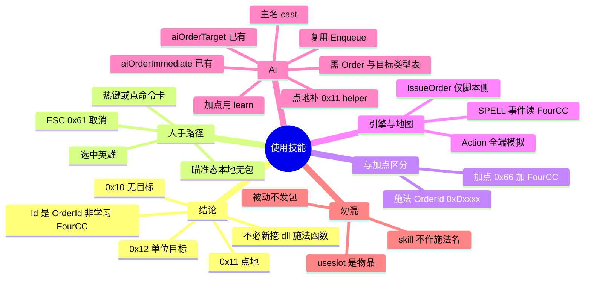

# DotA1 英雄使用技能流程 — 思维导图

| 字段 | 内容 |
| :--- | :--- |
| **分析模型** | Auto（Cursor Agent / Composer） |
| **分析目的** | 导图化施法链路与 AI 注入要点 |
| **命名方式** | `dota-hero-ability-cast-flow-mindmap` |
| **分析时间** | 2026-11-16 |

配套正文：[`dota-hero-ability-cast-flow.md`](./dota-hero-ability-cast-flow.md)
