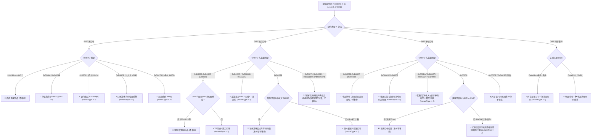

# DotA 6.83d 英雄真实轨迹与全指令逆向分析

## 一、四大 Bug 修复总览

### Bug 1：原始动作数据包流 (PacketStreamPanel)
- **问题1：全屏滚轮无法滚动 & 刷新跳回顶部**
  - 根因：`pktListView.model` 绑定内读取了 `contentY` 形成循环响应式依赖
  - 修复：改用独立 `ListModel` (`pktListModel`) 原地增量更新 (`set`/`append`/`remove`) + `onWheel` 显式平滑推进 `contentY`
- **问题2：“点击能跳转 ▶”的语义与状态控制**
  - 语义：点击某条数据包将回放时间轴 (`curSec`/`playSec`) 跳至该包秒数 `sec`
  - 状态互斥：开启“追随最新 ✓” (`liveFollow`) 时自动禁用跳转，显示 `追随最新中 (禁用跳转)`

### Bug 2：非瞬移动作出现路径绘制断裂
- **根因1：非移动坐标混入 `moves`**
  - `0x12 + 0xD0022..0xD0027` (`moveslot` 换格) 携带泉水商店出生坐标 `(-6904,-6831)` 被误判为回泉水复活
  - 远程非位移技能（照明火箭、洪流、沟壑、先祖之魂、火猫F残焰、冥火暴击、风暴之锤、投掷）混入移动点
  - 吃树 (`0x12+useslot`) 与插眼 (`0x11+useslot` 秒耗 `I014`/`I016`) 被误判为物品瞬移
  - 线上存活时切回泉水点信使被误判为死亡复活
- **根因2：`getRealMovement` 运动学缺陷**
  - 瞬移指令 (`isInstant`) 发生时跳过了 `[curT, actT]` 的前序步行推进，吞掉瞬移前走位
  - 步行阶段朝新目标而非上一目标 `lastTarget` 推进
  - 循环末尾 `[curT, maxTime]` 未 `path.push` 导致绿线末端与英雄头像脱节
- **修复：严格过滤 `moves` + 三段式运动学推进 (`instantType: -1/0/1/2/3`)**

### Bug 3：新游戏时所有 ComboBox 下拉列表不更新
- **根因**
  - `liveStatsTimer` 仅在 `!statsPage.md` 时扫描新对局
  - `refreshLiveCurrent` 未重建 `rosterLabels`
  - 4 个 `CustomComboBoxComponent` 未绑定 `currentIndex`，且 `displayText` 在数组替换时不刷新
- **修复**
  - `liveStatsTimer` 每秒调用 `syncMatchList()` 按签名增量更新 `allMatches` 并对齐 `selectedIndex`
  - 实时重建 `rosterLabels` 并显式绑定 `currentIndex` 与 `model[currentIndex]`

### Bug 4：瞬移、位移技能与物品/死亡同步完整识别
- 新增统计卡片：`瞬移 (物品/技能/复活)` 与 `物品同步 (购买/获/耗)`
- 数据包流新增独立过滤项：`⚡ 物品瞬移`、`🌀 技能瞬移/位移`、`📊 DotA与物品同步`、`🎯 地面移动与技能`

---

## 二、动作指令与 OrderID 分类体系

### `0x10` 无目标指令 (No-Target)
- `0x10 + 0xh0**` (`0x6830xxxx`)：商店购买物品（如 `h02E` 回城卷轴、`h032` 跳刀、`h028` 假眼）
- `0x10 + 0xD0004` / `0xD0019`：停止指令 (`S` / `H`) -> `instantType = -1`（定格当前位置）
- `0x10 + 0xD00A1`：白虎 (`N01V`) 跳跃 (Leap) -> `instantType = 2`（沿朝向跳跃 600~900 码）
- `0x10 + 0xD00D9` / `0xD0114`：仙女龙 (`N00B`) 幻象法球传送 (R) / 灵动之翼 (E) 中途停止
- `0x10 + 0xD0114`：凤凰 (`E02F`) 凤凰冲击停止（飞跃暂停落点）
- `0x10 + 0xD0278`：鱼人夜行者 (`H071`) 突袭跳跃 (Pounce 700码) -> `instantType = 2`

### `0x11` 地点目标指令 (Point-Target)
- **物品瞬移 (`instantType = 1`)**
  - `0x11 + 0xD0028..0xD002D` (`useslot1..6`)：结合距离与 `DRI=I009` 区分 **TP传送** 与 **跳刀闪烁**（排除插眼 `I014`/`I016`）
- **技能瞬移/位移 (`instantType = 2`)**
  - `0x11 + 0xD00D9`：灰烬之灵 (`N0M0`) 火之余烬 (R 激活瞬移)
  - `0x11 + 0xD022D`：敌法师 (`Edem`) / 痛苦女王 (`UC01`) Blink 闪烁
  - `0x11 + 0xD02AC`：发条地精 (`H00T`) 大招发射钩爪 (Hookshot)
  - `0x11 + 0xD02B6`：地精撕裂者 (`E032`) 伐木锯链 / 大地之灵 (`N0MU`) 翻滚巨石
  - `0x11 + 0xD0278`：凤凰 (`E02F`) 凤凰冲击轨迹（配合 `0x10+0xD0114` 停驻）
- **视野/预放/地形技能 (`shouldAddMove = false`，本体不移动)**
  - `0x11 + 0xD0079`：发条导弹 (`H00T`) / 船长洪流 (`H06S`) / 火猫无影拳 (`N0M0`)
  - `0x11 + 0xD020A`：灰烬之灵 (`N0M0`) 火之余烬 (F 预放残焰位置)
  - `0x11 + 0xD0278`：撼地神牛 (`Otch`) 沟壑位置 (Fissure)
  - `0x11 + 0xD02B6`：仙女龙 (`N00B`) 幻象法球发射方向（记录法球向量供 R 传球计算）
  - `0x11 + 0xD02BD`：牛头人酋长 (`O015`) 先祖之魂命中位置（开视野）

### `0x12` 单位/物体目标指令 (Unit-Target)
- **基础移动 (`instantType = 0`)**
  - `0x12 + 0xD0003` / `0xD000F`：右键移动 / 攻击目标（过滤存活时切泉水点信使）
- **背包换格 (`shouldAddMove = false`)**
  - `0x12 + 0xD0022..0xD0027` (`moveslot1..6`)：忽略商店出生点坐标 `(-6904,-6831)`
- **技能瞬移/冲刺 (`instantType = 2`)**
  - `0x12 + 0xD0097`：精灵守卫 (`O01F`) 闪电之链联结队友 (Tether)
  - `0x12 + 0xD00D9`：巨牙海民 (`E02I`) 滚动雪球 (Snowball)
  - `0x12 + 0xD00FA`：蓝猫 (`H00S`) 球状闪电 / 猛犸 (`UC11`) 獠牙冲刺 / 水人 (`O00P`) 波浪形态 / 虚空 (`EC45`) 时间漫游
  - `0x12 + 0xD0107`：神灵武士 (`H00Q`) 牺牲大招冲刺 (Life Break)
  - `0x12 + 0xD0265`：船长 (`H06S`) X标记（4秒到期或 `0x10+0xD0265` 回传标记点）
  - `0x12 + 0xD0278`：幻影刺客 (`Ewar`) 幻影突袭 / 隐形刺客 (`HC92`) 闪烁突袭 / 沙王 (`U00K`) 掘地穿刺 / 裂魂人 (`O00J`) 暗影冲刺
- **远程非位移目标技能 (`shouldAddMove = false`)**
  - `0x12 + 0xD007F`：骷髅王 (`NC00`) 冥火暴击（锤子）
  - `0x12 + 0xD0278`：山岭巨人 (`Ucrl`) 投掷 (Toss)
  - `0x12 + 0xD02B6`：流浪剑客 (`H001`) 风暴之锤（锤子）

### `0x16` 与 `0x6B` 状态同步
- **`0x6B Data:Hero<被杀者>=<击杀者>` + `0x16`**
  - 击杀者：`0`=近卫电脑，`6`=天灾电脑，`12`=中立野怪，`1..5/7..11`=玩家
  - 死亡时刻定格 (`instantType = -1`)，复活时生成回泉水节点 (`instantType = 3`)
- **`0x6B Data:PUI_<pid>=<itemId>`**：购买/拾取/合成获得物品同步
- **`0x6B Data:DRI_<pid>=<itemId>`**：出售/丢弃/消耗物品同步（换格不触发）

---

## 三、Mermaid 轨迹状态机与指令分流图

