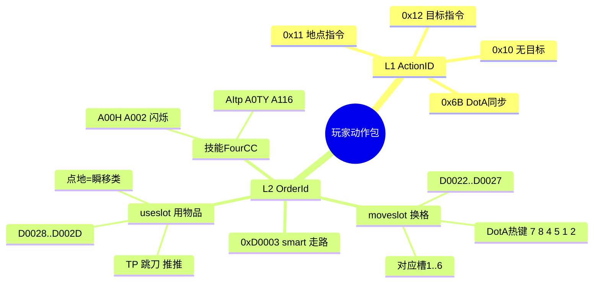
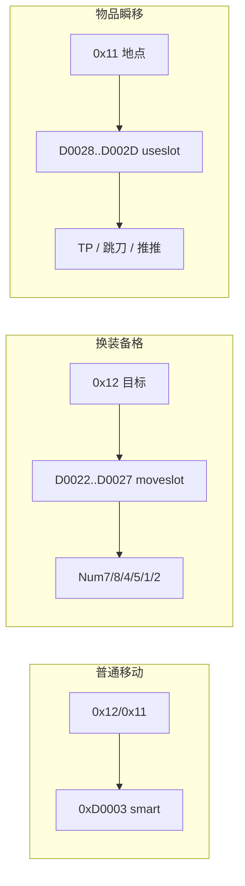
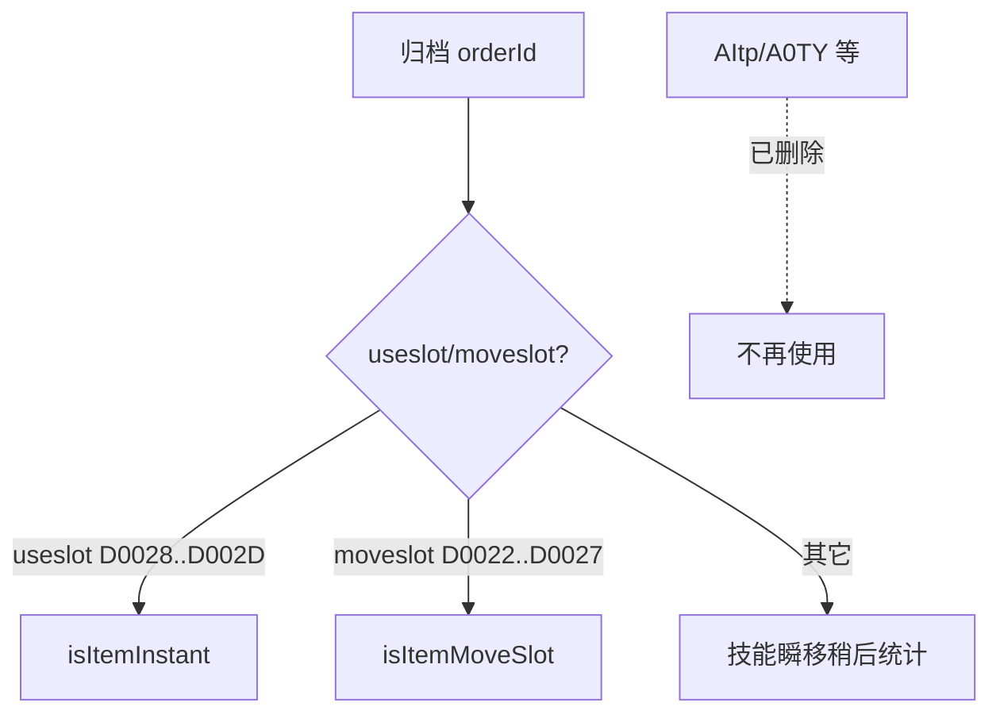

# DotA 物品栏 moveslot / useslot — 思维导图

详细论证见：[`dota-inventory-slot-orders-tp-blink-forcestaff.md`](./dota-inventory-slot-orders-tp-blink-forcestaff.md)

---

## 一、分类层级

---

## 二、实测映射

---

## 三、当前识别（已删 FourCC）

