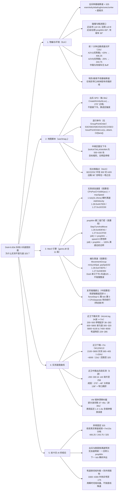

# DotA 6.83d 兵线小兵速度剖面与非匀速成因（思维导图）

| 字段 | 内容 |
| :--- | :--- |
| **分析模型** | Gemini 4 Neon (Medium) |
| **分析目的** | 以思维导图汇总 DotA 6.83d 兵线小兵物编、脚本、War3 引擎机制、实测速度曲线与卡兵 AI 预测结论 |
| **命名方式** | `dota-lane-creep-speed-profile-mindmap` |
| **分析时间** | 2026-11-20 |
| **配套正文** | [`dota-lane-creep-speed-profile.md`](./dota-lane-creep-speed-profile.md) |

