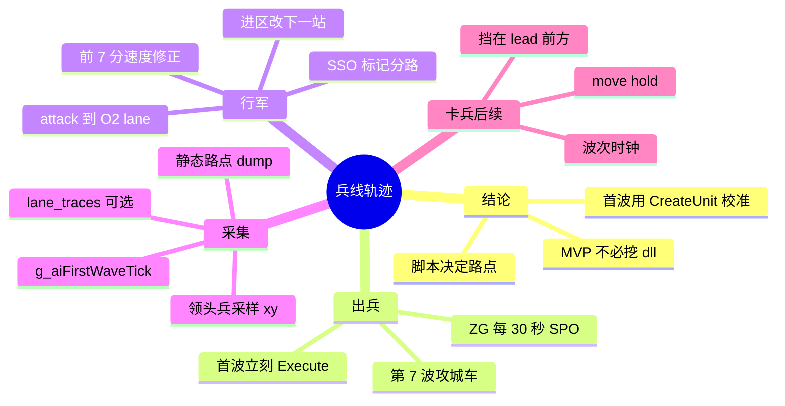

# 兵线轨迹与卡兵前置 — 思维导图

| 字段 | 内容 |
| :--- | :--- |
| **分析模型** | Auto（Cursor Agent / Composer） |
| **分析目的** | 导图化 30s 出兵、路点与轨迹采集 |
| **命名方式** | `dota-lane-creep-trajectory-mindmap` |
| **分析时间** | 2026-11-18 |

配套正文：[`dota-lane-creep-trajectory.md`](./dota-lane-creep-trajectory.md)
