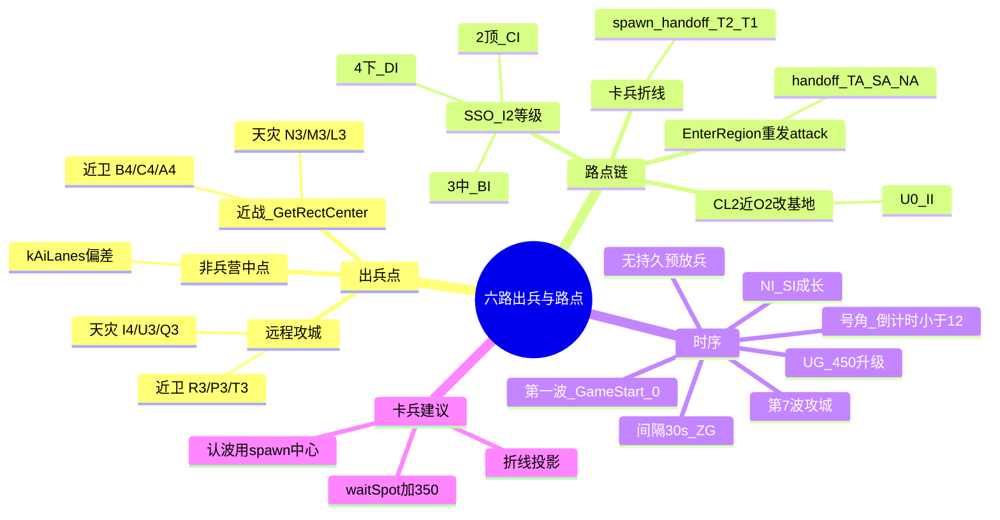

# DotA 6.83d 出兵点 / 路点 / 时序 — 思维导图

| 字段 | 内容 |
| :--- | :--- |
| **分析模型** | Auto（Cursor Agent / Composer） |
| **分析目的** | 导图索引 `dota-lane-spawn-waypoints` |
| **命名方式** | `dota-lane-spawn-waypoints-mindmap` |
| **分析时间** | 2026-11-21 |
| **正文** | [`dota-lane-spawn-waypoints.md`](./dota-lane-spawn-waypoints.md) |

## 速查

- 近卫上路刷点：(-6160,-4064) / (-6192,-4304)，不是 (-6368,-4480)
- 第一波 = GameStart，约号角 +12s
- 每路常态 4 兵，每 7 波 5 兵（+车）
- 头文件：`artifacts/lane-spawn/DotaLaneWaypoints.h`
