# DotA 6.83d 六路兵线移速随时间的完整规律与卡兵决策思维导图

| 项目 | 内容 |
|---|---|
| **分析模型** | Gemini 4 Argon (Medium) |
| **分析目的** | 以思维导图形式直观呈现 DotA 6.83d 六路兵线在时间维度、空间维度、引擎全版本维度的移速规律及卡兵决策结论 |
| **命名方式** | `dota-lane-speed-by-time-mindmap` |
| **分析时间** | 2026-11-21 |
| **关联正文** | [dota-lane-speed-by-time.md](file:///D:/Qt/workspace/War3Analysis/analyses/dota-lane-speed-by-time.md) |

```mermaid
flowchart LR
    Root["DotA 6.83d 六路兵线移速规律与卡兵决策<br/>(实测 + war3map.j + Game.dll 全11版本)"]

    %% 1. 时间维度
    Root --> TimeDim["一、时间维度<br/>(war3map.j 刷兵与计时器)"]
    TimeDim --> AuraCond["1. 光环触发条件 (SPO -> SZO / SVO)<br/>唯一常规条件: TimerGetElapsed(M) < 420.0s<br/>与塔是否存活、玩家人数无关<br/>攻城车(SQO)与中路全程不挂光环"]
    TimeDim --> TimerBug["2. 重大发现: 计时器 M 未减号角前时间 N<br/>TimerStart(M) 在地图加载 main() L7395 即启动<br/>0:00 号角响时 N = TimerGetElapsed(M) 已过 100~165s<br/>真实光环结束游戏钟 t_game = 420 - N:<br/>• -ap/-ar/-sd (BL=90, N≈105s): 游戏钟 5:15 停止 (仅 Wave 1~11)<br/>• -rd (BL=120, N≈135s): 游戏钟 4:45 停止 (仅 Wave 1~10)<br/>• -xl (BL=150, N≈165s): 游戏钟 4:15 停止 (仅 Wave 1~9)<br/>• -cm (BL=180+BP): 游戏钟 <=3:45 停止"]
    TimeDim --> Wave15s["3. 单波严格 15.0s (AX1 -> AW1)<br/>出生挂 A2V1(+25%, B0H2) 或 A2V0(-25%, B0H1)<br/>15.0s 单次触发器到期剥离技能与 Buff<br/>跨 420s 时在途波保留满 15s，下一波起出生即 325"]
    TimeDim --> Post7m["4. 7分钟后 (t_M >= 420s) 恒定 325.0<br/>• TQO 每450s升级8项科技(R007..R00D/R003/R009..R00B)<br/>  仅含 ratx(加攻) 与 rhpx(加血)，零移速加成<br/>• 超级兵/攻城车基础移速均为 325<br/>• 昼夜交替与夜晚视野(800)不影响移速"]

    %% 2. 路的维度
    Root --> LaneDim["二、路的维度<br/>(六路几何、转向与分段实测)"]
    LaneDim --> SafeLanes["1. 优势路: 近卫下 (8776) / 天灾上 (7427)<br/>• 前7分钟(t_M<420s): 前15s 面板 406.25 (实测排头 396~400/s)<br/>  15s到期在 s≈6050~6150 (二塔后)，恢复 325.0 (实测 306~317/s)<br/>  近卫下 s=6150..8200 为急 S 弯道，天灾上 s=6050 距一塔仅剩 1377<br/>• 7分钟后(t_M>=420s): 全段 325.0 (实测排头 306~319/s)<br/>  自然交汇点回退 1170，近卫下仅在一塔外 +911"]
    LaneDim --> OffLanes["2. 劣势路: 近卫上 (5752) / 天灾下 (5512)<br/>• 出生朝向: 近卫上 270°->90° 掉头停顿 0.28s；天灾下 270°->270° 零停顿<br/>• 前7分钟(t_M<420s): 前15s 面板 243.75 (实测排头 238~241/s)<br/>  15s到期在 s≈3000~3600 (刚过二塔)，恢复 325.0 (实测 318~319/s)<br/>• 7分钟后(t_M>=420s): 全段 325.0 (实测排头 317~320/s)"]
    LaneDim --> MidLanes["3. 中路: 近卫中 (4650) / 天灾中 (4512)<br/>• 出生朝向: 近卫中 270°->41° 停顿 0.16s；天灾中 270°->221° (49°<60°) 零停顿<br/>• 全时段恒定 325.0: 出门绕建筑 293~304/s -> 主干道 318~320/s<br/>• 自然交汇点恒在河道中心 (-560, -515)，距双方一塔 +1519 (t=17.4s)"]

    %% 3. 引擎维度
    Root --> EngineDim["三、引擎维度<br/>(Game.dll 全11版本移速链)"]
    EngineDim --> AmovStruct["1. CAbilityMove (CUnit+0x1EC)<br/>• +0x70 baseSpeed = 325.0f<br/>• +0x78 speedMultiplier = 1.250f (A2V1) / 1.000f / 0.750f (A2V0)<br/>• +0x7C immobilizeCount (!=0 时返回 0)<br/>• CalcMoveSpeed (1.27 0x5DF170) 钳制 [100.0, 522.0]"]
    EngineDim --> StepChain["2. 32Hz 步进与世界坐标合成<br/>• GroupSpeedMin (1.27 0x03E900): /32 写入 CPoPosCl+0x88(maxSpd) 与 +0xB4(acc)<br/>  ForGroup 单兵独立下令(851983)，攻城车不触发编队同速拖慢<br/>• StepTurnAndMove (1.27 0x03EE00): propWin=60°，夹角>=60°原地纯转身<br/>• AddVelocity (1.27 0x040A10): 零惯性1帧达速，写入 +0x80/+0x84 (velX/Y)<br/>• GetWidgetWorldPos (1.27 0x03EBF0):<br/>  worldX = ([+0x78] + (t_sim - [+0x60]) * [+0x80]) * 32 - 8192"]
    EngineDim --> All11Ver["3. 全11版本 RVA 100% 覆盖<br/>1.0.17.5988 / 1.0.20.6048 / 1.20.4.6074 / 1.21.0.6263<br/>1.22.0.6328 / 1.23.0.6352 / 1.24.1.6374 / 1.24.4.6387<br/>1.25.1.6397 / 1.26.0.6401 / 1.27.0.52240<br/>结构体偏移跨全版本 100% 一致"]

    %% 4. 卡兵决策与及格线
    Root --> BlockDec["四、卡兵决策与建议及格线"]
    BlockDec --> WhyBotFail["1. 为什么冰女近卫下路门口 ~3分、6400处 47分？<br/>• 前15s 兵速 406.25 vs 冰女 280，门口 2.5s 被全员超车(~3分)<br/>• s=6400 距一塔(8450)仅剩 2050 (不卡仅 6.6s)，而 delayScore<br/>  要求按全长 8700 拖慢 12s，物理天花板被锁死在 ~38分<br/>• s=6400..8200 正处 S 形双弯道易漏 2~3 兵<br/>• aiBlockBoostActive 用 g_aiFirstWaveTick+420s 错位 + 回程撞兵"]
    BlockDec --> SafeRule["2. 优势路 (近卫下 / 天灾上)<br/>• 前7分钟(t_M<420s): ❌ 绝不该卡，必须设为【免考 / 不计分】<br/>  (天灾上光环结束处距一塔仅剩 1377，且不卡自然交汇点 +2081 最优)<br/>• 7分钟后(t_M>=420s): ⚠ 实战禁卡超过 2s (近下自然交汇仅 +911，<br/>  卡 3s 即变成 +446 进一塔射程反推！纯技术考全程需从门口 s=600 起卡)"]
    BlockDec --> OffRule["3. 劣势路 (近卫上 / 天灾下)<br/>• 前7分钟(t_M<420s): ✅ 强烈必卡 (兵速 243.75 比 280 冰女慢 36)<br/>  兵营门口起卡可拖慢 12~20s，交汇点拉回 1800~2500<br/>  建议及格线: <=280档 75分 | 300档 80分 | >=310档 85分"]
    BlockDec --> MidRule["4. 中路 (近卫中 / 天灾中)<br/>• 全时段: ✅ 必卡 (拖慢 3~5s 即可把河道中心 +1519 拉上己方高坡 +744~+1054)<br/>  建议及格线: <=280档 55分 | 300档 65分 | >=310档 75分"]
```

