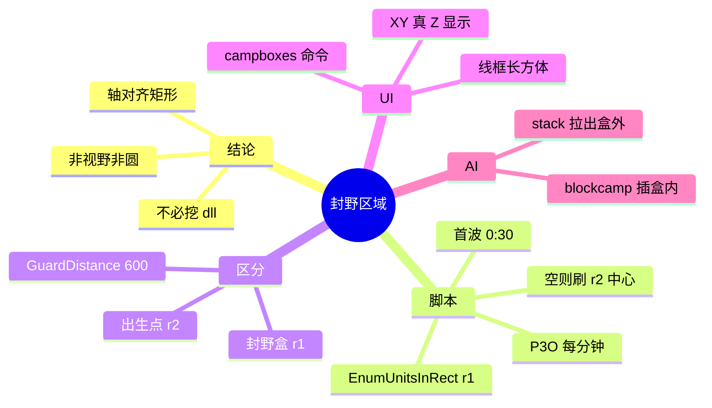

# 野点封野 AABB — 思维导图

| 字段 | 内容 |
| :--- | :--- |
| **分析模型** | Auto（Cursor Agent / Composer） |
| **分析目的** | 导图化封野盒 vs 仇恨圆 vs UI |
| **命名方式** | `dota-neutral-camp-spawn-box-mindmap` |
| **分析时间** | 2026-11-19 |

配套正文：[`dota-neutral-camp-spawn-box.md`](./dota-neutral-camp-spawn-box.md)
