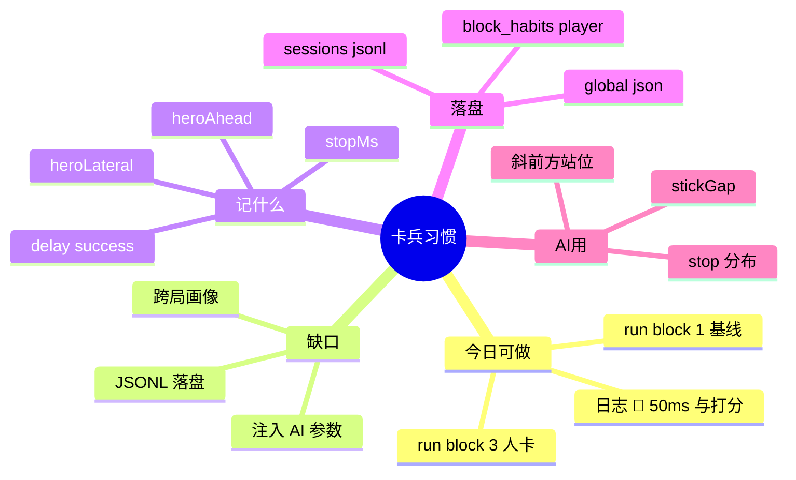

# 真人卡兵习惯采集 — 思维导图

| 字段 | 内容 |
| :--- | :--- |
| **分析模型** | Auto（Cursor Agent / Composer） |
| **分析目的** | 导图化真人卡兵教师数据流 |
| **命名方式** | `dota-player-block-habit-recorder-mindmap` |
| **分析时间** | 2026-11-18 |

配套正文：[`dota-player-block-habit-recorder.md`](./dota-player-block-habit-recorder.md)
