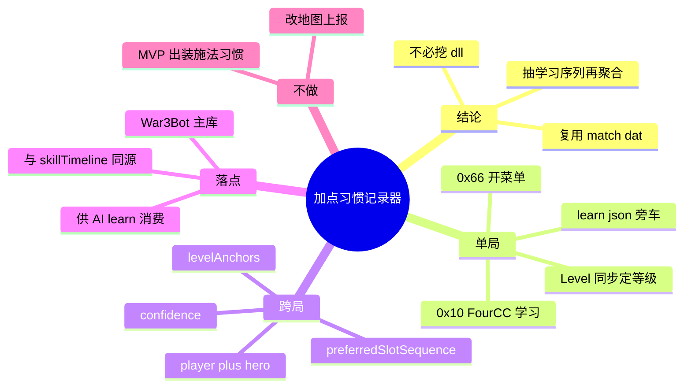

# 玩家加点习惯记录器 — 思维导图

| 字段 | 内容 |
| :--- | :--- |
| **分析模型** | Auto（Cursor Agent / Composer） |
| **分析目的** | 导图化学习序列抽取与跨局画像 |
| **命名方式** | `dota-player-learn-habit-recorder-mindmap` |
| **分析时间** | 2026-11-16 |

配套正文：[`dota-player-learn-habit-recorder.md`](./dota-player-learn-habit-recorder.md)
