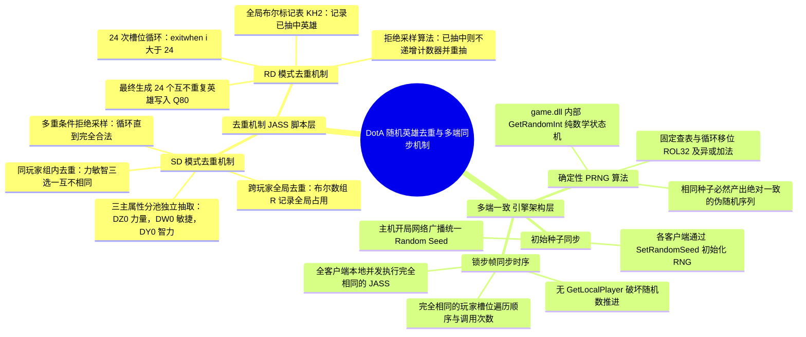
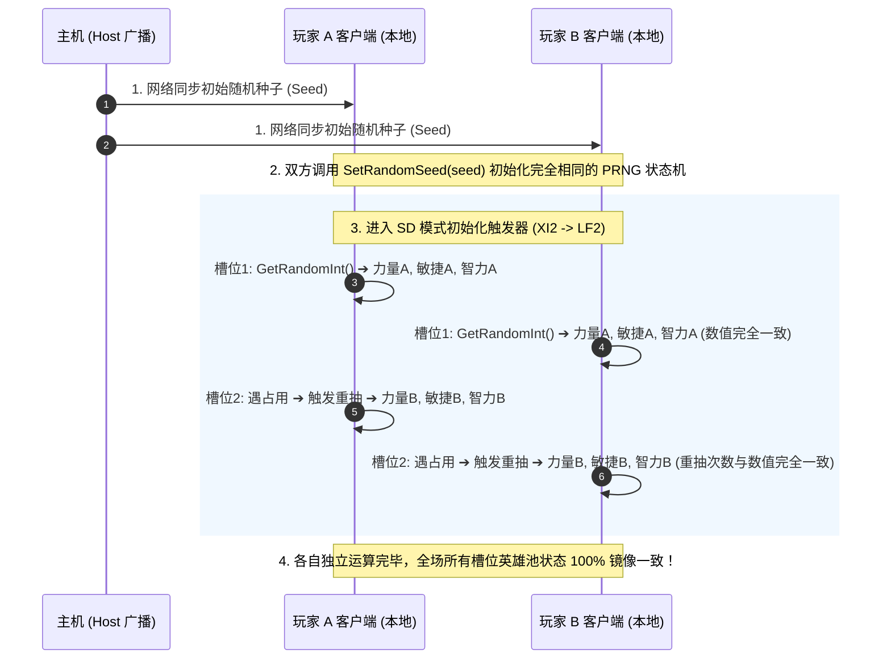
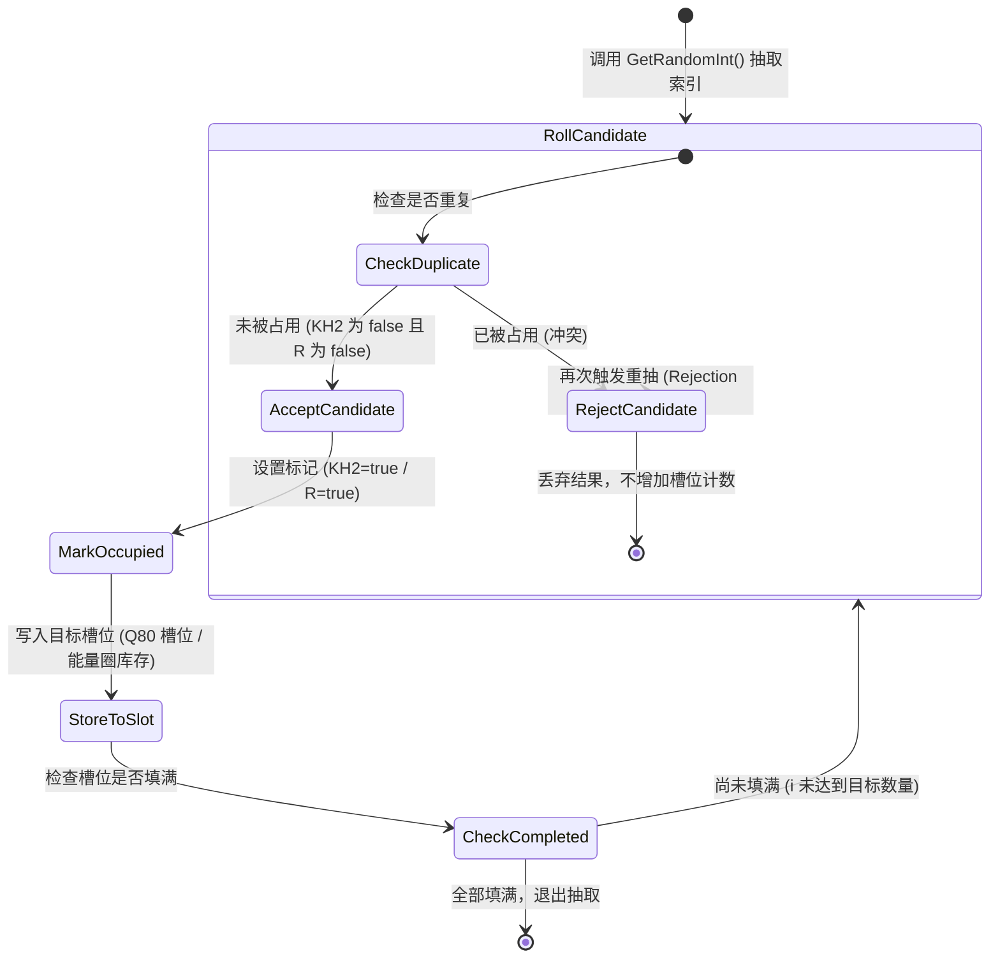

# DotA 随机英雄“去重与多端一致性”逆向分析与思维导图

## 摘要与核心结论

在魔兽争霸 III（以经典 DotA 6.83d 地图与 1.27.0.52240 `game.dll` 为例），RD（Random Draft）与 SD（Single Draft）模式下保证每位玩家随机到的英雄**“不重复”**且**“全场所有客户端计算结果数学上完全一致”**，是由 **JASS 地图脚本算法** 与 **`game.dll` 引擎底层确定性架构** 两层机制严格协同完成的：

1. **不重复（去重机制）**：由 JASS 脚本通过 **布尔标记表 + 拒绝采样（Rejection Sampling）** 算法保证。已抽中的英雄会被数组打上标记，一旦再次抽中则放弃并触发重抽。
2. **多端一致（无网络分发仍完全相同）**：由游戏引擎通过 **网络随机种子广播（Random Seed）+ 确定性伪随机算法（PRNG）+ 锁步帧同步（Lockstep）** 保证。所有客户端以相同的初始种子和相同的代码顺序推进随机数状态机，各自独立计算却必然得到完全相同的结果。

---

## 一、全景思维导图 (Mindmap)



---

## 二、“不重复”的 JASS 底层算法实现

### 1. RD 模式：全局 24 英雄不重复（`war3map.j` 约 35680 行）
```jass
set i = 1
loop
    exitwhen i > 24
    set TJI = RHI(true, true)     // 随机抽取一个英雄索引

    // 关键去重：KH2 是布尔标记数组
    if KH2[TJI] == false and (TJI != 23) then
        set KH2[TJI] = true       // 打上已占用标记
        set Q80[i] = TJI          // 写入 RD 英雄槽位 Q80
        set i = i + 1             // 仅当抽到新英雄时，槽位计数才递增
    endif
    // 若 KH2[TJI] 为 true，则跳过递增，直接进入下一次循环（重抽）
endloop
```
- **算法设计**：拒绝采样模型。
- **状态维护**：`KH2[heroIndex]` 记录占用状态，`Q80[slot]` 存储最终 24 个槽位的英雄映射。

### 2. SD 模式：组内三属性 + 跨玩家全局去重（`war3map.j` 约 36470 行）
```jass
// LE2: 属性分类 (1=力量DZ0, 2=敏捷DW0, 3=智力DY0)
// LG2, LH2: 该玩家本轮已抽到的前两个英雄
function LF2 takes integer LG2, integer LH2, integer LE2 returns integer
    local integer R4O = LD2(LE2)  // 从指定属性池随机抽取英雄

    // 循环条件：英雄全局未被占用，且不与同组前两名英雄相同
    loop
        exitwhen R[R4O] == false and LG2 != R4O and LH2 != R4O
        set R4O = LD2(LE2)        // 冲突则重新随机
    endloop

    set R[R4O] = true             // 标记该英雄已在全局被抽走
    return R4O
endfunction
```
- **组内去重**：`LG2 != R4O and LH2 != R4O`，确保玩家自己的力、敏、智三个选项绝无重复。
- **全局去重**：`R[heroId]` 记录全场分配情况。除非特定娱乐模式开启 `F2 == true`，否则常规 SD 下 10 位玩家的候选英雄在全局也互不冲突。

---

## 三、“多端完全一致”的引擎底层原理

在网络层中，**不存在“将 24 个 RD 英雄或 3 个 SD 候选打包广播给各客户端”的封包**。所有客户端完全依靠本地推导，其数学一致性由三层支柱保证：

### 1. 初始种子网络同步
- 游戏进入载入流程时，主机（Host）向所有客户端发送包含全局种子（Seed）的网络消息。
- 各客户端调用 `game.dll` 的 `SetRandomSeed(seed)`（在 1.27a 中位于 `0x6F1F64B0`）。
- 引擎在此函数中初始化全局 RNG 上下文（`DAT_6FBC5FB0` 中的累加状态与四个表索引字节）。

### 2. 确定性伪随机数发生器 (PRNG)
- 魔兽争霸 3 的 `GetRandomInt(min, max)`（在 1.27a 中位于 `0x6F1E43E0`）是一个**严格封闭的数学确定性状态机**：
  - 它通过 `0x6F964E48` 的置换表执行：
    $$\text{ROL32}(T[b1], 3) \oplus \text{ROL32}(T[b2], 2) \oplus T[b0] \oplus \text{ROL32}(T[b3], 1)$$
  - 将计算结果累加回状态。
  - **关键特性**：不依赖任何操作系统时钟或硬件随机源。给定相同的 Seed，第 $N$ 次调用 `GetRandomInt` 返回的值在所有电脑上必然 100% 相同。

### 3. 严格一致的调用时序（锁步模拟）
- 地图脚本中遍历玩家槽位的代码在所有客户端以**相同的顺序**执行（例如 SD 中均是从近卫玩家 1..5 到天灾玩家 1..5）。
- 代码中**绝无**破坏随机数序列的局部逻辑（没有使用 `GetLocalPlayer()` 分支来调用 `GetRandomInt`）。
- 相同初始种子 + 相同调用序列 = **各客户端本地生成的候选英雄列表必然绝对相同**。

---

## 四、多端同步时序流程图 (Sequence Diagram)



---

## 五、状态机拒绝采样模型 (State Diagram)



---

## 六、工程启示与开发防坑指南

1. **为什么不需要网络发包**：
   魔兽 3 的设计思想是“算力换带宽”。通过网络广播 1 个 32 位的种子，省去了广播所有英雄数据包的开销。
2. **为什么异步会发生（Desync 风险）**：
   如果在地图开发或 Hook 开发中，有人在 `GetLocalPlayer()` 的本地分支里误调用了哪怕一次 `GetRandomInt`，就会导致该客户端的 PRNG 状态多推进了一步。从这一步开始，所有后续随机抽取将全盘错乱，最终引发全员掉线（Desync）。
3. **Hook 监听的可靠性**：
   在 `war3hook.cpp` 中通过 `D30` 能量圈配合 `AddUnitToStock` 拦截对手的英雄候选之所以 100% 可行，正是因为这套确定性计算在玩家本地完整无遗漏地运行过一遍。