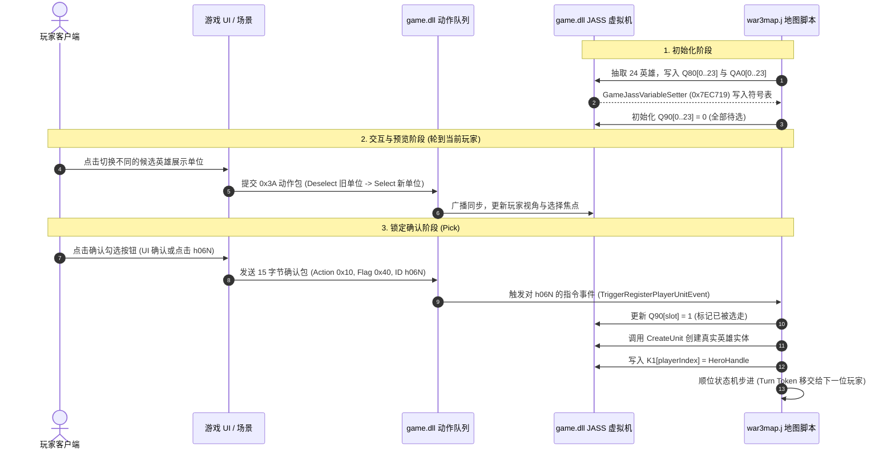
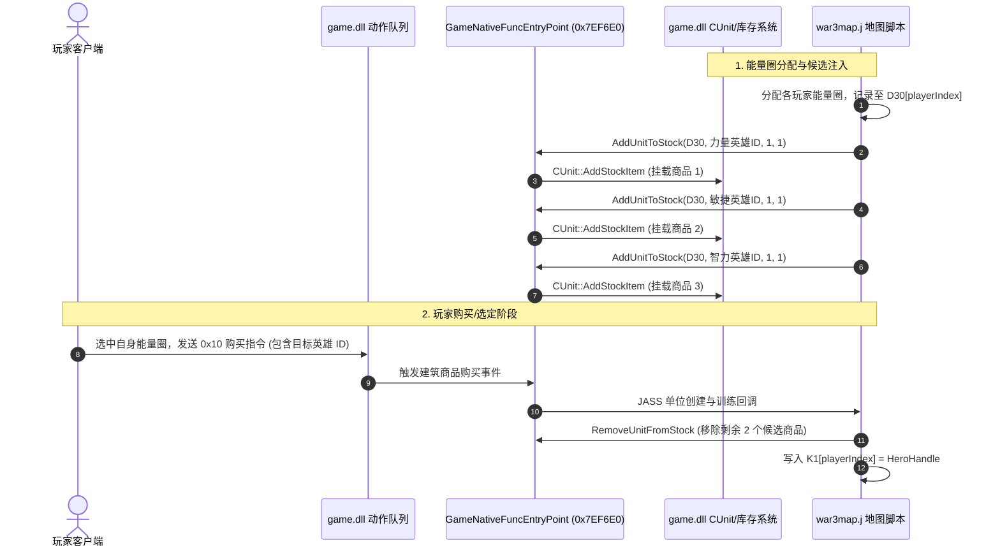
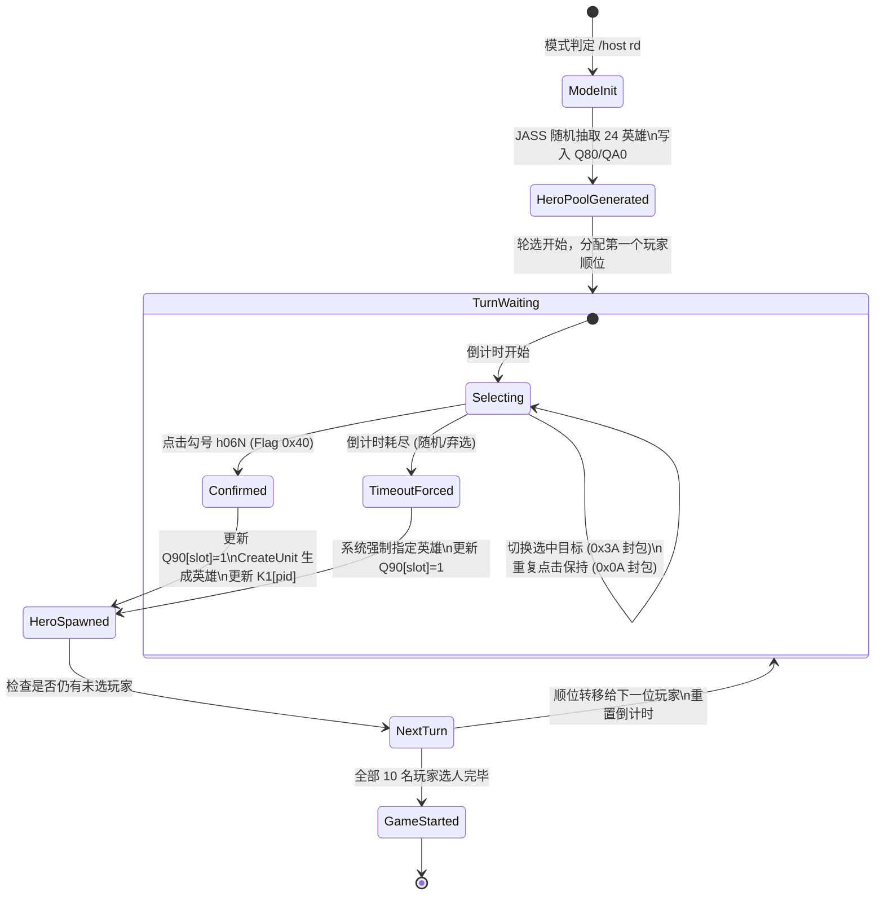

# DotA RD 与 SD 模式执行链路思维导图与架构图

本文档通过 Mermaid 思维导图、时序流程图与状态图，直观展现 Warcraft III `game.dll` 与 DotA 地图脚本在 **RD (Random Draft)** 与 **SD (Single Draft)** 模式下的底层执行链路。

---

## 一、全景思维导图 (Mindmap)

```mermaid
mindmap
  root(("魔兽3 DotA 选人模式执行链路"))
    RD 随机征召模式
      模式规则
        全局共享 24 个候选英雄池
        双方玩家按顺位轮流征召
        倒计时限制与顺位推进
      JASS 数据结构
        "Q80: 槽位映射 (Slot -> HeroIndex)"
        "Q90: 锁定状态 (0=可选, 1=锁定)"
        "QA0: 展示实体 Handle 映射"
        "K1: 玩家最终英雄 Handle"
      网络动作协议
        "0x3A 复合动作包 (Deselect -> Select -> 镜头同步)"
        "0x0A 保持动作包 (1B 01 H1 H2)"
        "0x0F 确认勾号包 (Flag: 0x40, UnitId: h06N)"
      game.dll 底层切入点
        "GameJassVariableSetter_1 (0x7EC719 / 0x7EC6C0)"
        "GameJassVariableSetter_2 (0x7EC660)"
        CreateUnit 生成真实英雄
    SD 单一征召模式
      模式规则
        每位玩家独立 3 选 1 候选池
        力/敏/智 主属性各随机 1 名
        各玩家选择互不干扰
      JASS 数据结构
        "D30: 玩家专属能量圈 Handle"
        "K1: 玩家最终英雄 Handle"
      Native API 链路
        "GameNativeFuncEntryPoint (0x7EF6E0)"
        "AddUnitToStock: 向 D30 能量圈挂载候选商品"
        "RemoveUnitFromStock: 选定后清空剩余商品"
      网络动作协议
        "0x10 单位购买/训练指令"
      game.dll 底层切入点
        "GameNativeFuncEntryPoint: Native 统一网关"
        "CUnit::AddStockItem: 建筑库存与商品系统"
        EnqueuePlayerAction 标准单位购买指令
```

---

## 二、RD 模式执行时序图 (Sequence Diagram)



---

## 三、SD 模式执行时序图 (Sequence Diagram)



---

## 四、RD 模式状态机模型 (State Diagram)



---

## 五、关键底层符号与内存地址速查

| 符号 / 功能 | 1.27.0.52240 地址 | 调用约定 | 关联模式 | 核心作用 |
| :--- | :--- | :--- | :--- | :--- |
| `GameJassVariableSetter_1` | `0x7EC719` / `0x7EC6C0` | `__fastcall` | RD / SD | 监控 `Q80`、`Q90`、`QA0`、`D30`、`K1` 变量变更 |
| `GameJassVariableSetter_2` | `0x7EC660` | `__thiscall` | RD | 数组变量清理与重置 |
| `GameNativeFuncEntryPoint` | `0x7EF6E0` | `__cdecl` | SD / RD | 拦截 `AddUnitToStock`、`CreateUnit` 等 Native API |
| `EnqueuePlayerAction` | 导出网络层 | `__thiscall` | RD / SD | 动作包入队：RD 确认 (`0x40`, `h06N`) 与 SD 购买 (`0x10`) |