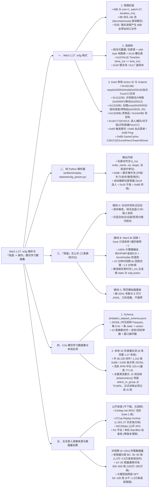

# War3 1.27 录像解析与「局面 → 操作」模仿学习数据集思维导图

| 字段 | 内容 |
|---|---|
| **分析模型** | Gemini 4 Neon (Medium) |
| **分析目的** | 以思维导图呈现 War3 1.27 `.w3g` 二进制格式、解析器架构、三条局面补齐路线对比、0.5s JSONL 数据集 Schema、本地统计与真人录像来源 |
| **命名方式** | `dota-replay-imitation-dataset-mindmap` |
| **分析时间** | 2026-11-21 |
| **关联正文** | [dota-replay-imitation-dataset.md](file:///D:/Qt/workspace/War3Analysis/analyses/dota-replay-imitation-dataset.md) |

