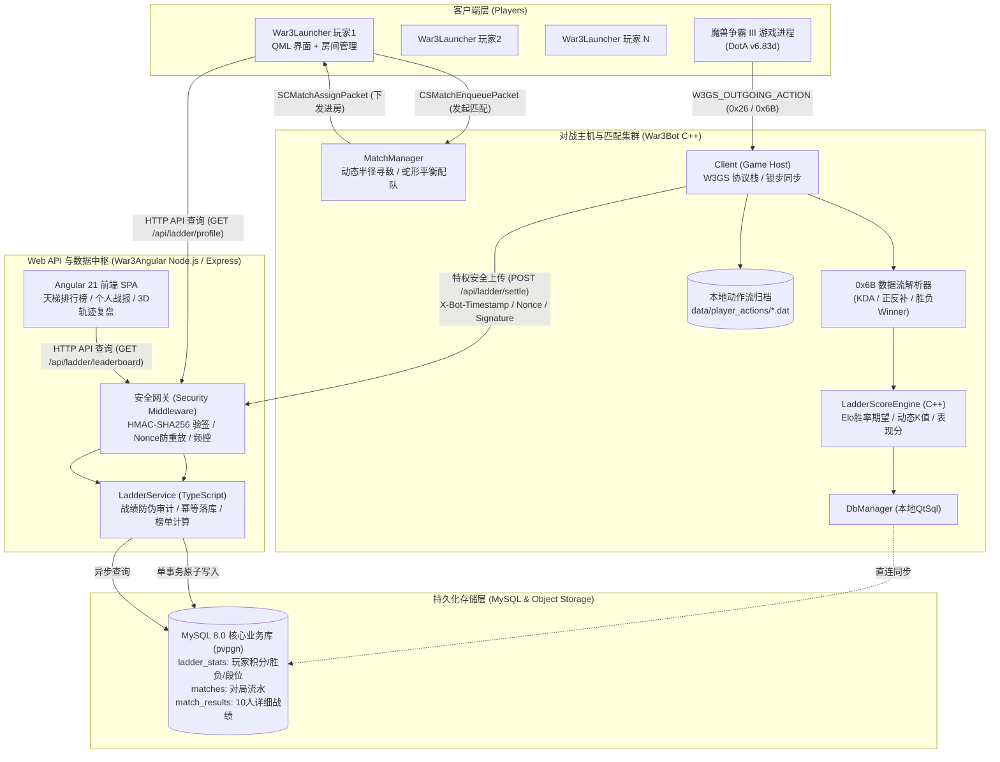
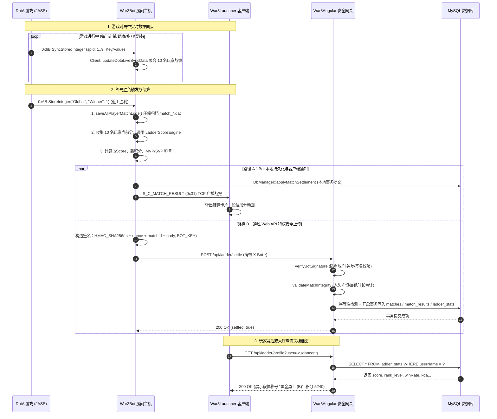

# Dota1 天梯积分系统与分布式多服务架构 — 思维导图与全景拓扑

本文档提供 Dota1 天梯积分体系、分布式结算流水与安全防护架构的 Mermaid 思维导图、网络拓扑图以及时序交互图。

详细设计原理与技术白皮书见：[`dota1-ladder-system-and-multi-service-architecture.md`](./dota1-ladder-system-and-multi-service-architecture.md)

---

## 一、 全景技术思维导图

```mermaid
mindmap
  root((Dota1 天梯积分与多服务系统))
    天梯算法模型
      Elo 基础分
        胜率期望 EA/EB
        团队均分加权
      动态 K 因子
        低分段快速收敛 K=36
        中分黄金段 K=30
        高分巅峰段 K=18~22
      表现分 Performance Bonus
        KDA 加权权重
        参团率 KP 收益
        正补/反补/经济转化
      特殊赏罚机制
        全场 MVP +3分额外奖励
        败方 SVP 35%掉分减免
        强退/逃跑秒退 -45分严惩并清空连胜
    等级与称号并存体系
      等级代码 (数据库/通信/匹配)
        ["-", "D", "C", "B", "A", "S", "SS", "SSS"]
        8阶单字符或短代码，易于SQL索引与网络封包
      段位中文称号 (UI展示/成就)
        见习新手 (-)
        青铜守护 (D)
        白银先锋 (C)
        黄金勇士 (B)
        铂金统领 (A)
        璀璨钻石 (S)
        超凡大师 (SS)
        最强王者 (SSS)
      分数线映射
        0 / 1000 / 3000 / 5000 / 7000 / 9000 / 11000 / 13000
    分布式多服务架构
      War3Bot (分布式主机/匹配服务)
        MatchManager: 搜索半径动态扩张 (±50 到 ±400)
        MatchManager: 蛇形排队配平两队均分 (1/2-2/2-2/1)
        Client: 监听 0x6B (Winner=1/2, 1..9战绩数据)
        Client: 赛后自动生成 zlib 压缩动作流 .dat 归档
      War3Launcher (客户端启动器)
        RoomManager: Q_ENUM(LadderRankLevel) 暴露 QML
        RoomComponent: 数据库代码与中文称号并存展示
        NetworkManager: 接收 S_C_MATCH_RESULT (0x31) 战报包
      War3Angular (Web API 与微服务中枢)
        Express + SSR 高并发网关
        MySQL 连接池与单事务 ACID 落库
        Angular 前端 LadderService 响应式数据流
    全链路安全防护机制
      身份特权鉴权
        HMAC-SHA256 双向数字签名
        BOT_SECRET_KEY 服务间私钥校验
        常量时间对比 crypto.timingSafeEqual
      反重放攻击 Replay Defense
        X-Bot-Timestamp ±60秒时钟漂移拦截
        X-Bot-Nonce 32位随机唯一凭证
        5分钟内存滑动黑名单容器
      战绩真实性审计
        3分钟最低时长校验 (防秒开秒退)
        人头数守恒定理 (近卫击杀 == 天灾死亡)
        极端异常值与负数注入过滤
      幂等性与事务原子性
        matchId 唯一约束防重复入库
        MySQL 开启单事务多表联动提交
```

---

## 二、 系统架构全景拓扑图



---

## 三、 游戏生命周期与天梯结算时序图



