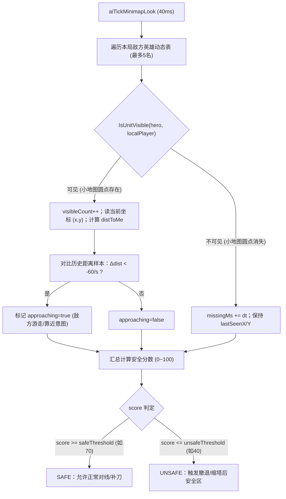

# War3 小地图圆点（敌方英雄可见性）与意图检测逆向分析

## 一、小地图圆点的底层判定机制

在魔兽争霸 III（`game.dll`）中，客户端小地图上是否绘制某个敌方单位（英雄）的圆点，完全受本地玩家的战争迷雾与隐身状态控制（`CMinimap` 渲染循环与 JASS `IsUnitVisible` 共用底层单位可见性判定）：
1. 本地玩家句柄由 `GetLocalPlayer()` 返回。
2. 对每个敌方英雄句柄 `hUnit`，当且仅当 `IsUnitVisible(hUnit, localPlayer) != 0` 且单位存活（`life > 0.405`）时，该敌方英雄在小地图上以圆点形式可见，其坐标 `(x, y)` 对本地客户端合法暴露（非开图/不读迷雾内存）。
3. 若 `IsUnitVisible(hUnit, localPlayer) == 0`，该单位处于战争迷雾或隐身不可见状态，小地图圆点消失：此时**禁止读取其当前坐标**，仅保留最后一次可见坐标 `(lastSeenX, lastSeenY)` 并累计消失时长 `missingMs`。

---

## 二、全版本 `game.dll` 关键函数 RVA 对照表（基址 `0x6F000000`）

以下地址均从 `D:\Qt\workspace\War3Launcher\versions` 下全部 11 个版本的 JASS 原生注册表第一处正式注册提取（已验证 `1.26` 与 `1.27` 反汇编签名）：

| 版本 | `IsUnitVisible` `(Hunit;Hplayer;)B` | `IsUnitFogged` `(Hunit;Hplayer;)B` | `IsUnitMasked` `(Hunit;Hplayer;)B` | `GetLocalPlayer` `()Hplayer;` |
|---|---|---|---|---|
| `1.0.17.5988` | `0x2C60D0` | `0x2C6E20` | `0x2C7020` | `0x2CC8E0` |
| `1.0.20.6048` | `0x2C60D0` | `0x2C6E20` | `0x2C7020` | `0x2CC8E0` |
| `1.20.4.6074` | `0x2C61F0` | `0x2C6F40` | `0x2C7140` | `0x2CCA00` |
| `1.21.0.6263` | `0x2C97C0` | `0x2CA510` | `0x2CA710` | `0x2CFFD0` |
| `1.22.0.6328` | `0x3C0D90` | `0x3C0FA0` | `0x3C1020` | `0x3B6080` |
| `1.23.0.6352` | `0x3C2AB0` | `0x3C2CC0` | `0x3C2D40` | `0x3B7DA0` |
| `1.24.1.6374` | `0x3C8570` | `0x3C8780` | `0x3C8800` | `0x3BC5E0` |
| `1.24.4.6387` | `0x3C8630` | `0x3C8840` | `0x3C88C0` | `0x3BC6A0` |
| `1.25.1.6397` | `0x3C78C0` | `0x3C7AD0` | `0x3C7B50` | `0x3BB930` |
| `1.26.0.6401` | `0x3C7AF0` | `0x3C7D00` | `0x3C7D80` | `0x3BBB60` |
| `1.27.0.52240` | `0x1E8E80` | `0x1E8640` | `0x1E8B00` | `0x1E3150` |

> [!NOTE]
> 在 `war3hook_ai.cpp` 中，除了上述 11 版本静态 RVA 兜底表，还通过 `aiLearnNative()` 在运行时直接从 `NativeFuncNode` 按名称自动捕获 `IsUnitVisible` 与 `GetLocalPlayer`，实现零硬编码、跨全版本自动解析。

---

## 三、敌方意图（游走）与安全评分模型

1. **可见圆点意图检测**：对每个当前可见的敌方英雄圆点保存最近 ~2 秒的距离滑动窗口（`prevDist -> currDist`），若 `currDist < 3200` 且距离持续缩短（`Δdist <= -120` 单位 / 2s），判定 `approaching = true`（正在向我方游走/包抄）。
2. **安全评分（`0 ~ 100`）**：
   - 基准分 `100`：当小地图可见敌方圆点数 `== enemyHeroTotal`（如 5 个）且全员都在各自安全距离外时，保持 `100` 分；
   - **安全距离侵入扣分**：有可见敌方英雄进入其静态/动态安全距离 `safeDist` 内（按侵入深度扣 `25 ~ 60` 分）；
   - **游走靠近扣分**：可见敌方英雄距离正在持续缩短且距我 `< 2800`（每个靠近目标扣 `15 ~ 30` 分）；
   - **小地图消失扣分**：当小地图可见敌方圆点数 `< 5` 且存在消失时间 `> 30s`（或 `> 10s`）的敌方英雄时，按消失人数与消失时长扣分（每人最多扣 `18` 分）。
3. **状态联动（SAFE / UNSAFE）**：
   - `score >= 70`（高分安全）：处于 `SAFE` 状态，允许正常对线补刀；
   - `score <= 40`（低分或 `0` 分不安全）：进入 `UNSAFE` 状态，若开启自动避险（或 `-unsafe` 猥琐模式），立即暂停激进补刀并向己方最近防御塔后方（或安全距离外、同时尽量保留在经验区范围内）撤退。

