# War3 锁定英雄镜头与选目标共存分析导图

- **分析模型**：Gemini 4 Neon (Medium)
- **分析目的**：以结构化导图总览镜头锁定与 A 键补刀 / 定向施法冲突的静态逆向链、H1~H6 判定、分级改造方案与全 11 版偏移结论。
- **命名方式**：`war3-camera-lock-targeting-mindmap`
- **分析时间**：2026-11-21
- **验证状态**：与正文 [war3-camera-lock-targeting.md](file:///D:/Qt/workspace/War3Analysis/analyses/war3-camera-lock-targeting.md) 一致

```mermaid
flowchart TD
    Root["锁定英雄镜头 (-lock on) 与 A 键补刀 / 定向施法共存"]

    Root --> C1["1. 静态逆向两条链与交叉点 (1.27.0.52240)"]
    Root --> C2["2. H1~H6 判定结论"]
    Root --> C3["3. 三级改造方案 (全主线程, 零不同步)"]
    Root --> C4["4. 全 11 版 game.dll 偏移结论"]

    C1 --> C1A["选目标链: CGameUI+0x1B4 == m_targetMode (+0x210/+0x204)<br/>SetMode(0x356AC0) / PopMode(0x356E50)<br/>CWorldFrameWar3::OnMouseDown(0x367C70) → HitTest(0x366950)"]
    C1 --> C1B["镜头链: SetTargetController(0x345E70) 仅写 [cam+0x44..0x58]<br/>SetPosition(0x346440) 解绑+写[cam+0x1A4]+置[WorldFrame+0x38C]=1<br/>ResetCamera(0x344CA0) 仅重置相机, 均不调 PopMode/SetMode"]
    C1 --> C1C["核心交叉点: HasTargetController(0x343250) 全部 7 处调用<br/>CMinimap::OnMouseDown(0x3A2EB2) 直接 return 0 吞掉小地图点击!<br/>世界左键不检查 HasTargetController (仅中键 btn==2 检查)"]

    C2 --> H1["H1: 小地图证实 / 世界点击排除"]
    C2 --> H2["H2: 排除 (重绑控制器无 UI 副作用)"]
    C2 --> H3["H3: 取消选目标排除 / 15ms高频可见集脏标副作用证实"]
    C2 --> H4["H4: 未定 (移动平移致射线滑动, 待30秒实机对照)"]
    C2 --> H5["H5: 部分证实 (左22%x下28%宽屏误伤左下地面)"]
    C2 --> H6["H6: 未定 (代码未见拦截A键, 待关改键/锁鼠实机排除)"]

    C3 --> P1["方案1 (首选共存): 仅首次/脱锁绑一次 SetCameraTargetController<br/>删 15ms SetCameraPosition; 选目标点小地图前解绑、后立即重绑<br/>按 4:3 等比收紧小地图命中矩形"]
    C3 --> P2["方案2 (次选): 保留拉回但 isGameTargetingMode() 时跳过 SetCameraPosition"]
    C3 --> P3["方案3 (兜底): isGameTargetingMode() 期间 ResetToGameCamera(0)<br/>退出选目标后 ≤15ms 自动重绑恢复"]

    C4 --> V1["全 11 版已核验: g_pGameUI / GetCGameUI / m_camera / m_worldFrame<br/>m_camDirty(+0x38C) / m_currentMode(+0x1B4) / m_targetMode(+0x204/+0x210)"]
    C4 --> V2["1.22~1.27 全部核验: m_targetUnit(+0x44) / HasTargetController(7 xref)<br/>SetMode / PopMode; 1.0.17~1.21 此4项按规范标未确认"]
```

