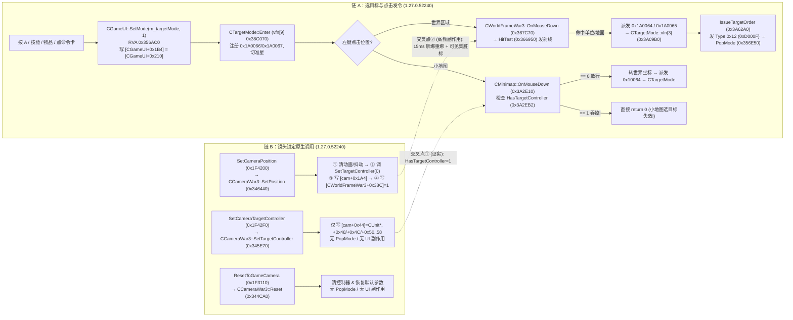

# War3 锁定英雄镜头与 A 键补刀 / 定向施法共存逆向分析

- **分析模型**：Gemini 4 Neon (Medium)
- **分析目的**：查明开启 `-lock on`（英雄镜头锁定）后无法用 A 键补刀与定向施法的底层根因，逐条证实或排除 H1~H6，梳理全 11 个版本 `game.dll` 的选目标模式与镜头控制器内存布局，给出镜头锁定与选目标真正共存的分级方案与实机验收表。
- **命名方式**：`war3-camera-lock-targeting`
- **分析时间**：2026-11-21
- **验证状态**：全 11 版 `game.dll` 静态反汇编交叉核验 + `War3Launcher/hooker` 源码审计 + 历史日志对照（只读，未改源码、未注入、未开局；H4/H6 与方案效果待实机按 §5/§6 验证）
- **证据与脚本**：
  - 1.27 / 1.26 镜头原生递归反汇编：[camera_natives_disasm.txt](file:///D:/Qt/workspace/War3Analysis/artifacts/camera-lock-targeting/camera_natives_disasm.txt)（脚本 [disasm_camera_natives.py](file:///D:/Qt/workspace/War3Analysis/artifacts/camera-lock-targeting/disasm_camera_natives.py)）
  - 1.27 RTTI / `CTargetMode` / `CWorldFrameWar3` / `CCameraWar3` 虚表与交叉点：[rtti_and_chains_127.txt](file:///D:/Qt/workspace/War3Analysis/artifacts/camera-lock-targeting/rtti_and_chains_127.txt)、[crosspoints_127.txt](file:///D:/Qt/workspace/War3Analysis/artifacts/camera-lock-targeting/crosspoints_127.txt)、[deep_dive_127.txt](file:///D:/Qt/workspace/War3Analysis/artifacts/camera-lock-targeting/deep_dive_127.txt)
  - 全 11 版批量扫描结果：[all_versions_offsets.txt](file:///D:/Qt/workspace/War3Analysis/artifacts/camera-lock-targeting/all_versions_offsets.txt)、[all_versions_part2.txt](file:///D:/Qt/workspace/War3Analysis/artifacts/camera-lock-targeting/all_versions_part2.txt)（脚本 [scan_all_versions.py](file:///D:/Qt/workspace/War3Analysis/artifacts/camera-lock-targeting/scan_all_versions.py)、[scan_all_versions_part2.py](file:///D:/Qt/workspace/War3Analysis/artifacts/camera-lock-targeting/scan_all_versions_part2.py)）
  - 历史日志：`C:\War3Run\War3Launcher\logs\AiUnit.log`、`ActionData2.log`

---

## 核心结论（先看这里）

1. **根因定性（静态逆向实锤 + 需实机确认项）**：
   - **已证实根因①（H1 — 仅限小地图选目标）**：`CCameraWar3::HasTargetController`（1.27 RVA `0x343250`）在全引擎共有 7 处调用，其中 **`CMinimap::OnMouseDown`（1.27 `0x3A2EB2`）与 `OnMouseMove`（`0x3A300E`）明确检查 `if (HasTargetController()) return 0;`**。只要 `SetCameraTargetController` 处于绑定态，**小地图会直接吞掉所有左键点击**，导致选目标态下无法对小地图 A-move 或施法。
   - **已排除（H1 世界点击、H2、H3 取消选目标）**：`SetCameraTargetController`（`0x345E70`）、`SetCameraPosition`（`0x346440`）、`ResetToGameCamera`（`0x344CA0`）**均不调用** `CGameUI::PopMode`（`0x356E50`）或 `SetMode`（`0x356AC0`），**不会取消选目标模式**；`CWorldFrameWar3::OnMouseDown`（`0x367C70`）与 `CTargetMode::OnWorldLBtn`（`0x3A6AF0`, `btn==1`）**也不检查 `HasTargetController`**（`0x3A7056` 仅拦截中键 `btn==2` 拖屏）。
   - **已证实副作用（H3 高频刷新 + H5 左下角误判）**：当前 `aiTickCameraLock` 在 WndProc 每 `15ms`（含每次鼠标移动/点击前）对 `dist > 16` 反复调用 `SetCameraPosition(hx, hy)` + `SetCameraTargetController(hero)`，导致**每次先解绑控制器、重写 `[cam+0x1A4]` 并置 `[CWorldFrameWar3+0x38C] = 1`（每帧强制重算世界可见集 `0x2F3F0`）**；同时 `aiPointInMinimapApprox`（左 `22%` × 下 `28%`）在宽屏下超出真实小地图，点击左下地面会误触发 `ResetToGameCamera`。
   - **待实机区分（H4 / H6）**：现有 `ActionData2.log` 在 `-lock on` 期间记录到 `0` 条 `0xD000F`（`-lock off` 后 `225` 条），尚缺「锁定下英雄静止 vs 移动按 A + 左键」的独立对照日志，因此 **H4（移动中射线/目标滑动落空）与 H6（改键/其它 Hook 叠加）标为「未定」**，已在 §2.2 给出 30 秒最短实机区分步骤。
2. **推荐方案**：优先采用 **方案 1（共存改造）+ 方案 2（选目标态只停 `SetCameraPosition`）组合**——① 删除 `aiTickCameraLock` 对 `SetCameraPosition` 的 15ms 高频重调，仅在首次绑定 / 换英雄 / 真正脱锁（`dist > 128`）时绑定一次 `SetCameraTargetController`，引擎原生已每帧跟随；② 通过读 `CGameUI` 内存精确检测选目标态（`*(void**)(ui + 0x1B4) == *(void**)(ui + m_targetMode)`，全 11 版已验证），**选目标态下禁止 `SetCameraPosition` 重算可见集**；③ 选目标态下左键命中精确小地图区域时，在 `CallWindowProcA` 前临时 `ResetToGameCamera(0)` 放行 `CMinimap::OnMouseDown`，处理完后**立即重绑** `SetCameraTargetController(hero)`（不丢锁）。若实机确认 H4 导致移动中难以点中小兵，再一键切换至 **方案 3（选目标态临时解锁、退出自动恢复）**。
3. **尚未实机验证项**：① 仅绑一次 `SetCameraTargetController`（不调 `SetCameraPosition`）时，英雄静止/移动下 A 点单位是否 100% 发出 `0xD000F`；② 选目标态左键点小地图时「前解绑 + 后重绑」是否能在单次 `WM_LBUTTONDOWN` 内同时发出 `0xD000F` 且保持锁定；③ 宽屏下 `CMinimap` 真实矩形边界。

---

## 一、静态逆向：两条调用链与交叉点（1.27.0.52240 实证）



### 1.1 链 A：选目标模式生命周期与点击射线链（1.27.0.52240）

1. **核心对象与字段**：
   - `g_pGameUI` = `*(CGameUI**)(gameBase + 0xBE6350)`（由 `GetCGameUI` `0x34F3A0` 返回）。
   - `[CGameUI + 0x1B4]` = `m_currentMode`（当前激活的 `CInputMode*`，如 `CSelectMode*`、`CTargetMode*`）。
   - `[CGameUI + 0x210]` = `m_targetMode`（`CTargetMode*` 单例，vtable `0x98BE80`；`[CGameUI + 0x214]` 为 `CSelectMode*`，`+0x21C` 为中键拖屏模式）。
   - `[CTargetMode + 0x10]` = 当前选目标的 `OrderId`（如攻击 `0x000D000F`、技能/物品命令号）；`[CTargetMode + 0x14]` = 目标类型掩码 flags。
2. **进入与退出**：
   - **进入**：按 A 键、技能/物品快捷键或点击命令卡 → 填充 `m_targetMode` 的 `+0x10 / +0x14` → 调用 `CGameUI::SetMode(m_targetMode, 1)`（`0x356AC0`）将旧模式压栈至 `[CGameUI + 0x1B8]`、置 `[CGameUI + 0x1B4] = m_targetMode`、调用 `CTargetMode::vfn[9]`（`0x38C070`）。
   - **取消 / 完成**：右键（`event+0x28 == 4`）、Esc 或下达指令后 → 调用 `CGameUI::PopMode`（`0x356E50`）→ 调 `CTargetMode::vfn[10]`（`0x390C40`）注销 `0x1A0066/0x1A0067`、清除范围圈和光标、恢复 `CSelectMode`。
3. **世界区域左键 → 射线取目标 → 发令**：
   - `CWorldFrameWar3::OnMouseDown`（`vfn[14] 0x367C70`）检查 `[CWorldFrameWar3 + 0x320] == 0`，通过 `CGameUI::IsCurrentMode`（`0x350BB0`）判断当前为 `m_targetMode` 后，读取 `[m_targetMode + 0x14]` 构造过滤掩码，在 `0x367EC3` 调用 **`CWorldFrameWar3::HitTest`（`0x366950`）**：
     - 校验 `CGameUI::IsFocus`（`0x350A70`）、视口宽高有效、`mouseY < [0x6F98E000]`；
     - 调用 `0xA19D0` 用当前相机矩阵把 `(mx, my)` 转为世界射线，再调 `0x3655D0` 求交；
     - 命中单位/物体则派发 `0x1A0064` → `CTargetMode::0x3A5E20` → `CTargetMode::IssueTargetOrder`（`0x3A62A0`）；命中地面则派发 `0x1A0065` → `0x3A0FD0`；两者最终发送 `Type 0x12` 动作包并 `PopMode`。
4. **小地图左键点击**：
   - `CMinimap::OnMouseDown`（`0x3A2E10`）在 `0x3A2E7C` 确认存在 `0x10064` 监听者（`CTargetMode` 监听 `0x10064 → 0x3A4AF0`），随后在 **`0x3A2EB2` 调用 `CCameraWar3::HasTargetController`（`0x343250`）**：
     ```asm
     0x3A2EA4: call 0x6f34f3a0  ; GetCGameUI()
     0x3A2EAB: call 0x6f34da20  ; CGameUI::GetCamera() -> [ui + 0x254]
     0x3A2EB2: call 0x6f343250  ; CCameraWar3::HasTargetController()
     0x3A2EB7: test eax, eax
     0x3A2EB9: jne  0x6f3a2f7c  ; 若绑定了目标控制器 -> 直接 return 0!
     ```

### 1.2 链 B：镜头原生函数底层修改清单（1.27.0.52240）

| 原生函数 | 内部实现 RVA | 实际修改的对象与字段 | 是否调用 `PopMode`/`SetMode`/清悬停？ |
|---|---|---|---|
| `SetCameraTargetController` (`0x1F42F0`) | `CCameraWar3::SetTargetController` (`0x345E70`) | 仅写 `[cam+0x44] = CUnit*`（同指针跳过引用计数）、`[cam+0x50..0x58] = (offX, offY, 0)`、`[cam+0x48] = inheritOrient`、`[cam+0x4C] = 0` | **否**（`CCameraWar3` 区域 `0x340000..0x348000` 零处调用 `PopMode` / `SetMode`） |
| `SetCameraPosition` (`0x1F4200`) | `CCameraWar3::SetPosition` (`0x346440`) | ① `0x347210`/`0x346FF0` 清平滑/抖动；② **调用 `SetTargetController(0)` 解绑控制器**；③ 裁剪并写 `[cam+0x1A4]`；④ 位移 `> [0x6FBB8288]` 时写 **`[CWorldFrameWar3 + 0x38C] = 1`**（下一帧 `0x3690F3` 强制重算世界可见集 `0x2F3F0`） | **否**（不取消选目标，但有解绑重绑 + 每帧重算可见集副作用） |
| `ResetToGameCamera` (`0x1F3110`) | `CCameraWar3::Reset` (`0x344CA0`) | 清全部相机曲线控制器、调用 `SetTargetController(0)`、重置默认视距/俯仰/滚转 | **否** |

> [!NOTE]
> **`CCameraWar3::HasTargetController`（1.27 `0x343250`）全引擎全部 7 处调用点已逐一核对**（1.22~1.27 全版本均为精确 7 处）：
> 1. `0x34DAAC`：`CGameUI::MoveCameraToXY`（禁止普通切屏）
> 2. `0x34DAEF`：`CGameUI::MoveCameraToUnit`（禁止双击头像/编队跳屏）
> 3. `0x376D35`：`CSelectMode` 中键拖屏（禁止拖屏）
> 4. `0x3A2EB2`：**`CMinimap::OnMouseDown`（吞掉小地图左键点击，含选目标态！）**
> 5. `0x3A300E`：**`CMinimap::OnMouseMove`（吞掉小地图左键拖动）**
> 6. `0x3A68A8`：`CTargetMode::IssueTargetOrder` 尾部 `btn == 2`（仅拦截中键拖屏，不影响左键 `btn == 1`）
> 7. `0x3A7056`：`CTargetMode::OnWorldLBtn` 尾部 `btn == 2`（仅拦截中键拖屏，不影响左键 `btn == 1`）

---

## 二、H1 ~ H6 根因定性与实机最短区分步骤

### 2.1 假设逐条判定表

| # | 假设 | 结论 | 证据（1.27.0.52240 为主，1.22~1.26 同构） |
|---|---|---|---|
| **H1** | 目标控制器本身让 UI 进入受限状态，选目标模式起不来或不接受点击 | **部分证实（仅限小地图）；世界点击排除** | **证实（小地图）**：`CMinimap::OnMouseDown (0x3A2EB2)` 直接因 `HasTargetController() == 1` 返回 `0`，吞掉选目标态下对小地图的左键点击。<br>**排除（世界区域）**：`SetMode (0x356AC0)`、`CWorldFrameWar3::OnMouseDown (0x367C70)`、`CTargetMode::OnWorldLBtn (0x3A6AF0, btn==1)` 均不检查 `HasTargetController`。 |
| **H2** | 重复调 `SetCameraTargetController` 会取消或重置选目标模式 | **排除** | `SetTargetController (0x345E70)` 仅写 `[cam+0x44..0x58]`，同单位时连引用计数都不改，零处调用 `PopMode`/`SetMode`。 |
| **H3** | `SetCameraPosition` 有副作用（取消选目标、清悬停单位、重置输入） | **取消选目标排除；高频重算可见集证实** | `SetPosition (0x346440)` 不调 `PopMode`/`SetMode`、不直接清 `[CWorldFrameWar3+0x244]`；但在 `aiTickCameraLock`（15ms / 每次鼠标移动前）高频调用时，反复先解绑 `SetTargetController(0)`、重写 `[cam+0x1A4]` 并置 `[CWorldFrameWar3+0x38C] = 1`，强迫每帧重算可见集 `0x2F3F0`，属于必须消除的副作用。 |
| **H4** | 镜头每帧移动，点击射线或悬停单位用的是过期坐标，点击落空 | **未定（移动补刀失败头号候选）** | `HitTest (0x366950)` 用渲染相机当前矩阵实时发射线；当英雄移动时画面以 `280~400 px/s` 平移，且 `aiTickCameraLock` 在 `WM_LBUTTONDOWN` 前刚改完 `[cam+0x1A4]`（渲染矩阵到下一帧才同步），极易导致点击落空或点成地面。历史 `ActionData2.log` 锁定期间 `0xD000F` 计数为 `0`（`-lock off` 后 `225` 次），缺独立对照采样，需实机确认。 |
| **H5** | 小地图近似矩形（左 22% × 下 28%）误判，点击途中解锁导致镜头跳变 | **部分证实（仅限左下区域与小地图）** | `war3hook.cpp L1212..1218` 在 `CallWindowProcA` 前对 `x < 0.22*W && y >= 0.72*H` 无条件调 `ResetToGameCamera(0)`：宽屏（16:9）真实小地图宽仅 `~14.5%~16%`，点左下角地面会误解锁跳镜；且选目标态点小地图后不会自动恢复锁定。 |
| **H6** | 其它 Hook（改键、智能施法、鼠标锁定）和锁定叠加 | **未定（代码未见直接冲突，待实机排除）** | 审计 `war3hook.cpp` 与 `war3hook_gfx.cpp`：`SkillRemap` 仅重映射 `skill_map` 至 `S/D/Q/W/E/R`，未硬编码拦截 `A` 键；但若用户配置将某技能绑至 `A` 键，或 `WndProc` 中 `aiTick()` 在 `WM_KEYDOWN('A')` 前同步执行触发重入/异常，需实机关闭改键/锁鼠对照排除。 |

### 2.2 最短实机区分测试步骤（30 秒定位 H4 vs H6）

用户无需改代码，在当前测试局中按顺序做 4 步，随后对照两份日志即可 100% 钉死 H4 / H6：

1. **前置**：输入 `-lock on`，关闭技能改键与窗口锁鼠（先排除 H6）。
2. **动作 1（英雄完全静止）**：按 `S` 让英雄站死，确认 `AiUnit.log` 中 `[Lock] ... 偏差:0.0`，然后对屏幕**中央附近**一只敌方小兵按 `A` + 左键点击（观察光标是否变成红色准星、小兵是否高亮）。
3. **动作 2（英雄移动中）**：右键让英雄走动，在走动中按 `A` + 左键点击屏幕中央附近的小兵。
4. **动作 3（小地图目标）**：按 `A` + 左键点击小地图某处。
5. **查看日志判定**：
   - `C:\War3Run\War3Launcher\logs\AiUnit.log`（看 `[Lock]` 行）：确认动作 1/2 期间**没有**出现 `临时解除锁定（左击小地图）`（若有则是 H5 误判）。
   - `C:\War3Run\War3Launcher\logs\ActionData2.log`（看 `Type:0x12` Hex 第 3~6 字节小端命令号：`0f 00 0d 00` = 攻击 `0xD000F`，`03 00 0d 00` = 右键智能 `0xD0003`；第 23~30 字节全 `ff` = 点地面，非 `ff` = 点中单位）：
     - 若动作 1 发出 `0xD000F`（目标非 `ff`）而动作 2 发成 `ff`（点地）或无包 → **证实 H4 + H3**；
     - 若动作 1 和动作 2 均无 `0xD000F` 且准星根本没变红 → **证实 H6**（检查改键/热键冲突或 `WndProc` 拦截）；
     - 若动作 1/2 正常、开启改键/锁鼠后才失效 → **证实 H6**。

---

## 三、分级解决方案（均在游戏主线程执行，零网络包，绝不不同步）

### 3.0 公共基础：全 11 版本可靠的「正在选目标」检测函数 `isGameTargetingMode()`

不监听任何按键（因此对 **A 键、改键、单位/点/范围技能、主动物品、鼠标点命令卡** 100% 通用，且右键/Esc/发令取消瞬间同步归零）：

```cpp
// 游戏主线程调用（加 SEH 保护）；版本表见 §四
bool isGameTargetingMode()
{
    if (!g_gameDllBaseAddress || !isCameraNativeCallable()) return false;
    // g_pGameUI RVA 与 m_targetMode 偏移按版本号查表（m_currentMode 全 11 版均为 0x1B4）
    const uintptr_t ui = *(uintptr_t *)(g_gameDllBaseAddress + off_g_pGameUI);
    if (!ui) return false;
    const uintptr_t curMode = *(uintptr_t *)(ui + 0x1B4);
    const uintptr_t tgtMode = *(uintptr_t *)(ui + off_m_targetMode); // 1.0.17~1.21: 0x204, 1.22~1.27: 0x210
    return curMode != 0 && curMode == tgtMode;
}
```

### 3.1 方案 1（首选 — 锁定与选目标真正共存）

- **思路**：
  1. **只绑一次 `SetCameraTargetController`，彻底移除 15ms 高频重调 `SetCameraPosition`**：引擎原生在 `[cam+0x44] != NULL` 时每帧 `CCameraWar3::Update (0x3474E0 → 0x342020)` 自动读取单位实时坐标跟随，不需要每 15ms 调 `SetCameraPosition` 拉回；仅在首次开启、换英雄、或被地图触发器强行解绑（读 `[cam+0x44] == 0` 或 `dist > 128`）且**非选目标态**时才重新绑定。
  2. **解决小地图选目标冲突（H1 根治）**：在 `war3hook.cpp` 的 `WM_LBUTTONDOWN` 命中**精确小地图区域**时，区分两种情况：
     - **正在选目标（`isGameTargetingMode() == true`）**：在 `CallWindowProcA` 前临时调用 `ResetToGameCamera(0)`（让 `CMinimap::OnMouseDown` 放行 `0x10064` 发 A-move/施法），**在 `CallWindowProcA` 返回后立刻调用 `SetCameraTargetController(hero)` 恢复锁定**（既发出了小地图目标指令，镜头也不脱锁！）。
     - **非选目标（`isGameTargetingMode() == false`）**：沿用现有逻辑，临时解锁看地图，右键地面/小地图后恢复锁定。
  3. **修正小地图命中矩形（H5 根治）**：4:3 基准小地图在归一化坐标 `x ∈ [0.008, 0.195], y ∈ [0.765, 0.990]`；宽屏下按 4:3 等比缩放修正左右宽度（`right = clientH * 4 / 3 * 0.195`），不再误伤左下角地面。
- **修改函数**：`war3hook_ai.cpp::aiTickCameraLock`、`aiPointInMinimapApprox`；`war3hook.cpp::newWndProc`（`WM_LBUTTONDOWN` 处）。
- **核心伪代码**：
  ```cpp
  // 1. aiTickCameraLock(now)（游戏主线程）
  if (!g_aiCameraLock) return;
  const uint32_t hero = aiLocalHeroHandle();
  if (!hero) return;
  const bool targeting = isGameTargetingMode();
  const bool bound = isCameraTargetControllerBoundToHero(); // 读 [cam+0x44] != 0
  if (hero != g_aiCameraLockHero || !bound) {
      if (!targeting) {
          float hx, hy;
          if (aiQueryPosition(hero, &hx, &hy)) callGameCameraPositionSetterEx(hx, hy, true);
      }
      if (callGameCameraTargetController(hero)) g_aiCameraLockHero = hero;
  }

  // 2. newWndProc 中 WM_LBUTTONDOWN（游戏主线程）
  bool minimapTargetPassThrough = false;
  if (g_aiCameraLock && isInAccurateMinimapRect(mx, my, rc)) {
      if (isGameTargetingMode()) {
          // 选目标态点小地图：仅在本次消息内临时解除控制器，放行 CMinimap::OnMouseDown
          callGameResetToGameCamera();
          minimapTargetPassThrough = true;
      } else {
          aiTempUnlockCameraLock(L"左击小地图");
      }
  }
  LRESULT ret = CallWindowProcA(g_oldWndProc, hWnd, msg, wParam, lParam);
  if (minimapTargetPassThrough && g_aiCameraLock && g_aiCameraLockHero) {
      callGameCameraTargetController(g_aiCameraLockHero); // 立即恢复，不丢锁
  }
  ```
- **线程与不同步**：全部在游戏窗口主线程执行，只改本地镜头状态，不产生任何网络包，**零不同步风险**。
- **补充备选（纯底层免控制器跟随）**：也可不调 `SetCameraTargetController`，改写 `[CCameraWar3 + 0x2C] = 1`（屏蔽 `CCameraWar3::OnEvent 0x343DD0` 全部边缘/键盘滚屏）并在每帧更新 `[cam + 0x1A4]`；优点是 `HasTargetController()` 恒为 0、小地图天然放行，缺点是需直接写相机内存且禁用滚轮缩放，维护成本高于上述方案 1。

### 3.2 方案 2（次选 — 选目标期间只暂停 `SetCameraPosition`，画面仍跟随）

- **适用场景**：若主会话仍希望保留 `dist > 16` 强拉回逻辑以防止极端外力拖屏。
- **改法**：在 `aiTickCameraLock` 的 `distSq > 16*16` 分支前加门控 `if (isGameTargetingMode()) return;`。选目标期间不调 `SetCameraPosition`（消除 `[CWorldFrameWar3+0x38C] = 1` 和解绑/重绑抖动），画面仍由已绑定的 `SetCameraTargetController` 原生跟随；小地图处理同方案 1。
- **线程与不同步**：游戏主线程，零不同步风险。

### 3.3 方案 3（兜底 — 选目标期间临时解锁，完成 / 取消后自动恢复）

- **适用场景**：若实机验证确认 H4（即使不调 `SetCameraPosition`，英雄高速移动导致镜头平移时玩家仍难以点中移动小兵）。
- **修改函数**：`war3hook_ai.cpp::aiTickCameraLock`（新增 `static bool g_aiCameraLockPausedForTarget = false;`）。
- **核心伪代码**：
  ```cpp
  const bool targeting = isGameTargetingMode();
  if (targeting && g_aiCameraLock && !g_aiCameraLockPausedForTarget) {
      g_aiCameraLockPausedForTarget = true;
      callGameResetToGameCamera(); // 画面定格在当前帧，方便点兵与点小地图
      return;
  }
  if (!targeting && g_aiCameraLockPausedForTarget) {
      g_aiCameraLockPausedForTarget = false;
      if (g_aiCameraLock && hero) callGameCameraTargetController(hero); // 完成/右键/Esc退出即刻恢复
  }
  ```
- **小地图与右键处理**：选目标态下已解锁，`CMinimap::OnMouseDown` 天然放行；左键发令或右键/Esc 取消后 `isGameTargetingMode()` 立刻变 `false`，下一 tick（≤15ms）自动恢复锁定，无需额外右键。
- **线程与不同步**：游戏主线程，零不同步风险。

---

## 四、全 11 个版本 `game.dll` RVA 与结构体偏移总表

均扫描自 `D:\Qt\workspace\War3Launcher\versions\` 下全部 11 个版本（基址 `0x6F000000`），逐版反汇编核验；`1.0.17~1.21.0` 中 `HasTargetController` / `SetMode` / `PopMode` / `m_targetUnit` 结构与 `1.22+` 不同且尚未逐条人工反汇编展开，按规范明确标注 **「未确认」**（不影响全 11 版 `isGameTargetingMode()` 和方案 1~3 的全部核心功能）。

| 版本 | `g_pGameUI` | `GetCGameUI` | `m_camera` | `m_worldFrame` | `m_camDirty` | `m_currentMode` | `m_targetMode` | `SetTargetController` | `m_targetUnit` | `SetPosition` | `ResetCamera` | `HasTargetController` (xrefs) | `CGameUI::SetMode` | `CGameUI::PopMode` |
|---|---|---|---|---|---|---|---|---|---|---|---|---|---|---|
| `1.0.17.5988` | `0x86D3C4` | `0x0F5C30` | `+0x248` | `+0x3B0` | `+0x38C` | `+0x1B4` | `+0x204` | `0x0F60B0` | 未确认 | `0x0FEB60` | `0x0FE190` | 未确认 | 未确认 | 未确认 |
| `1.0.20.6048` | `0x86E404` | `0x0F5C30` | `+0x248` | `+0x3B0` | `+0x38C` | `+0x1B4` | `+0x204` | `0x0F60B0` | 未确认 | `0x0FEB60` | `0x0FE190` | 未确认 | 未确认 | 未确认 |
| `1.20.4.6074` | `0x86E424` | `0x0F5C40` | `+0x248` | `+0x3B0` | `+0x38C` | `+0x1B4` | `+0x204` | `0x0F60C0` | 未确认 | `0x0FEB70` | `0x0FE1A0` | 未确认 | 未确认 | 未确认 |
| `1.21.0.6263` | `0x86F45C` | `0x0F5C60` | `+0x248` | `+0x3B0` | `+0x38C` | `+0x1B4` | `+0x204` | `0x0F60E0` | 未确认 | `0x0FEB90` | `0x0FE1C0` | 未确认 | 未确认 | 未确认 |
| `1.22.0.6328` | `0xAA1988` | `0x2FFB90` | `+0x254` | `+0x3BC` | `+0x38C` | `+0x1B4` | `+0x210` | `0x3027D0` | `+0x44` | `0x306D30` | `0x306200` | `0x3057E0` (7) | `0x2FAC60` | `0x2FADA0` |
| `1.23.0.6352` | `0xABA7D8` | `0x3010D0` | `+0x254` | `+0x3BC` | `+0x38C` | `+0x1B4` | `+0x210` | `0x303D10` | `+0x44` | `0x308270` | `0x307740` | `0x306D20` (7) | `0x2FC1A0` | `0x2FC2E0` |
| `1.24.1.6374` | `0xACBDD8` | `0x301190` | `+0x254` | `+0x3BC` | `+0x38C` | `+0x1B4` | `+0x210` | `0x303DD0` | `+0x44` | `0x308330` | `0x307800` | `0x306DE0` (7) | `0x2FC260` | `0x2FC3A0` |
| `1.24.4.6387` | `0xACBDD8` | `0x301250` | `+0x254` | `+0x3BC` | `+0x38C` | `+0x1B4` | `+0x210` | `0x303E90` | `+0x44` | `0x3083F0` | `0x3078C0` | `0x306EA0` (7) | `0x2FC320` | `0x2FC460` |
| `1.25.1.6397` | `0xAB4F80` | `0x3004E0` | `+0x254` | `+0x3BC` | `+0x38C` | `+0x1B4` | `+0x210` | `0x303120` | `+0x44` | `0x307680` | `0x306B50` | `0x306130` (7) | `0x2FB5B0` | `0x2FB6F0` |
| `1.26.0.6401` | `0xAB4F80` | `0x300710` | `+0x254` | `+0x3BC` | `+0x38C` | `+0x1B4` | `+0x210` | `0x303350` | `+0x44` | `0x3078B0` | `0x306D80` | `0x306360` (7) | `0x2FB7E0` | `0x2FB920` |
| `1.27.0.52240` | `0xBE6350` | `0x34F3A0` | `+0x254` | `+0x3BC` | `+0x38C` | `+0x1B4` | `+0x210` | `0x345E70` | `+0x44` | `0x346440` | `0x344CA0` | `0x343250` (7) | `0x356AC0` | `0x356E50` |

> 注：JASS 原生入口 `SetCameraTargetController` / `SetCameraPosition` / `ResetToGameCamera` / `GetCameraTargetPositionX|Y` 全 11 版 RVA 已在 [camera_lock_target_controller.md](file:///D:/Qt/workspace/War3Analysis/analyses/camera_lock_target_controller.md) 与 `war3hook_jass.cpp` 中核验无误，本文不再重复罗列。

---

## 五、实机验收表（`-lock on` 开启状态）

| 测试场景 | 英雄静止：预期行为与日志 | 英雄移动中：预期行为与日志 |
|---|---|---|
| **A + 左键点单位**（正补 / 反补） | 光标变红准星、悬停小兵高亮；左键后英雄攻击目标。<br>`ActionData2.log`：`Type:0x12` 命令 `0f 00 0d 00`（`0xD000F`），目标句柄非 `ff`。<br>`AiUnit.log`：`[Lock]` 保持跟随，无 `临时解除锁定`。 | 同左，英雄转向攻击该小兵且镜头持续紧跟无跳变。<br>`ActionData2.log`：`Type:0x12` `0xD000F` 目标非 `ff`。<br>`AiUnit.log`：`[Lock]` 无脱锁。 |
| **A + 左键点地面**（含左下地面） | 英雄向点击点攻击移动，左下角非小地图区域不误解锁。<br>`ActionData2.log`：`Type:0x12` `0xD000F`，目标 `ff ff ff ff ff ff ff ff`。<br>`AiUnit.log`：无 `临时解除锁定`。 | 同左，镜头持续跟随英雄前进。<br>`ActionData2.log`：`0xD000F` 点地坐标有效。<br>`AiUnit.log`：无脱锁。 |
| **单位目标技能**（如冰女 W 冰封禁制） | 按技能键/改键进选目标准星，悬停敌方高亮，左键施放。<br>`ActionData2.log`：`Type:0x12` 对应技能 OrderId，目标非 `ff`。<br>`AiUnit.log`：无脱锁。 | 走动中流畅施放，镜头持续跟随。<br>`ActionData2.log`：对应技能 OrderId，目标非 `ff`。 |
| **点 / 范围目标技能**（如冰女 Q 冰霜新星） | 显示范围圈，左键向指定点施放。<br>`ActionData2.log`：`Type:0x12` 对应技能 OrderId，目标 `ff`、坐标匹配。<br>`AiUnit.log`：无脱锁。 | 范围圈随鼠标平滑移动，施放无落空，镜头不跳。<br>`ActionData2.log`：对应技能 OrderId 坐标匹配。 |
| **选目标物品**（如跳刀 / 吃树 / 推推） | 按物品键或点物品栏进选目标，左键使用成功。<br>`ActionData2.log`：`Type:0x12` 物品槽 OrderId（`0xD0028..0xD002D`）。<br>`AiUnit.log`：无脱锁。 | 走动中正常使用物品，跳刀落地后镜头立即居中跟随英雄。<br>`ActionData2.log`：`0xD0028..0xD002D`。 |
| **选目标时左键点小地图**（A-move / 全图技能） | `CallWindowProcA` 前临时放行、后立即重绑；英雄向小地图点攻击移动/施法，**镜头仍锁定英雄不脱锁**。<br>`ActionData2.log`：`0xD000F` 或技能 OrderId，坐标为小地图目标点。<br>`AiUnit.log`：不进入永久临时解锁。 | 同左，英雄走动中改变攻击移动目的地，镜头不切走、不脱锁。<br>`ActionData2.log`：`0xD000F` 坐标正确。 |
| **右键 / Esc 取消选目标** | 准星与范围圈立即消失、退回普通选择态；右键不误触发额外操作。<br>`ActionData2.log`：无 `0xD000F` 发出。<br>`AiUnit.log`：`[Lock]` 保持 `on`（方案 3 则在取消后 ≤15ms 恢复 `on`）。 | 同左，取消后镜头继续紧跟英雄，无卡顿或脱锁。<br>`ActionData2.log`：无攻击/施法包。 |
