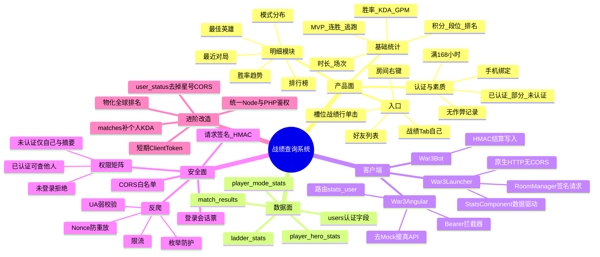
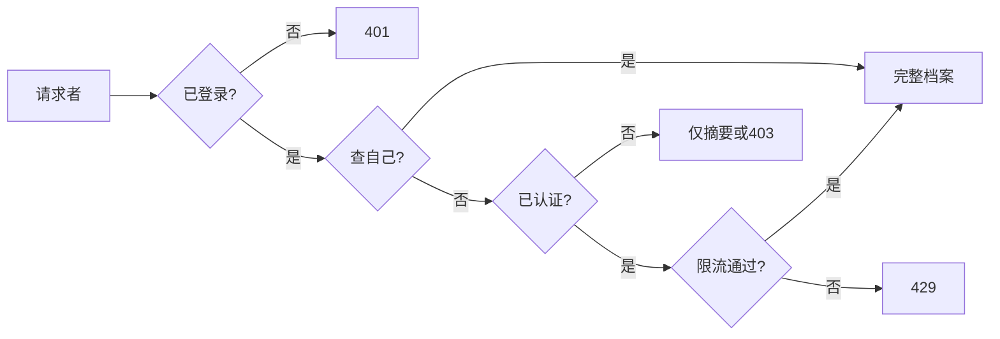
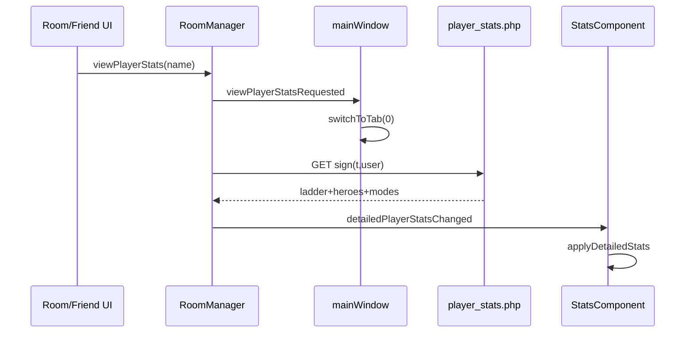
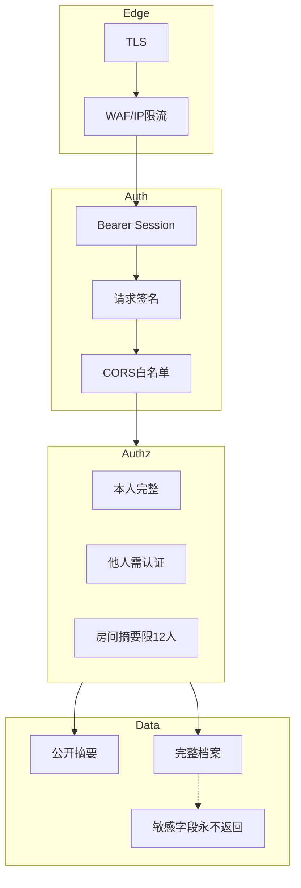

# War3 战绩查询系统 — 思维导图

> 配套正文：[`war3-player-stats-query-system-design.md`](./war3-player-stats-query-system-design.md)  
> 分析模型：Composer · 目的：战绩产品 + 安全架构 · 时间：2026-11-17

## 权限矩阵（简图）

## 跳转与拉数（简图）

## 分层防护（简图）

