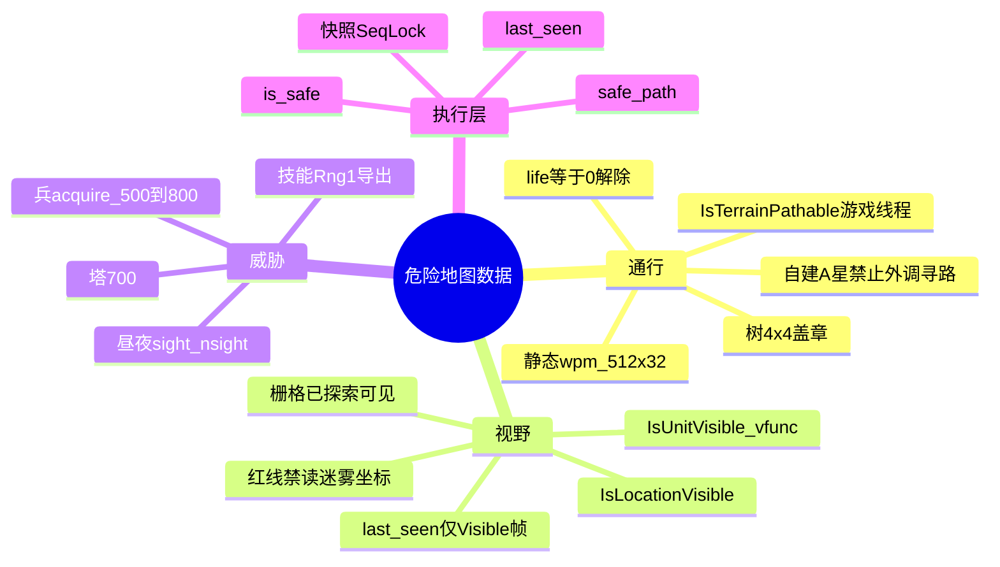

# 危险地图：通行 / 视野 / 威胁 — 思维导图

| 字段 | 内容 |
| :--- | :--- |
| **分析模型** | Auto（Cursor Agent / Composer） |
| **分析目的** | 索引 `war3-threat-map-pathing-vision` |
| **命名方式** | `war3-threat-map-pathing-vision-mindmap` |
| **分析时间** | 2026-11-21 |
| **正文** | [`war3-threat-map-pathing-vision.md`](./war3-threat-map-pathing-vision.md) |

## 速查

- 通行：`wpm` + 活树；查询 `IsTerrainPathable`（1.26 `0x3B42D0` / 1.27 `0x1E8440`）
- 视野：只信 `IsUnitVisible(lp)`；迷雾坐标 = 作弊
- 塔威胁半径：**700**
- MCP：`artifacts/threat-map/mcp_threat_api_sketch.json`
