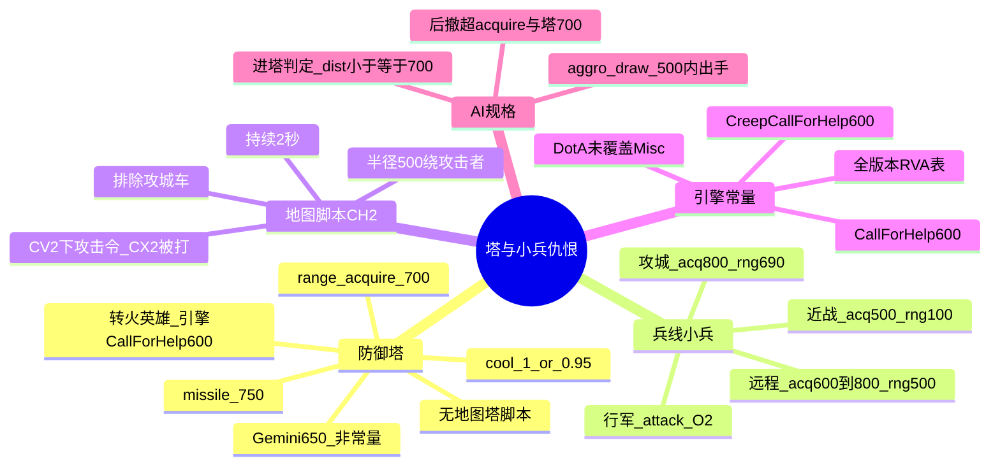

# 塔 / 小兵索敌与仇恨 — 思维导图

| 字段 | 内容 |
| :--- | :--- |
| **分析模型** | Auto（Cursor Agent / Composer） |
| **分析目的** | 索引 `war3-tower-creep-aggro` |
| **命名方式** | `war3-tower-creep-aggro-mindmap` |
| **分析时间** | 2026-11-21 |
| **正文** | [`war3-tower-creep-aggro.md`](./war3-tower-creep-aggro.md) |

## 速查

- 塔：**700 = 射程 = 索敌**；弹速 750；**没有 650 常量**
- 卡仇恨脚本：**500 / 2s**（`war3map_3.j` CH2）
- 引擎求救：默认 **600**（野怪等）
- 进塔：`dist(敌兵, 己方T1) ≤ 700`
