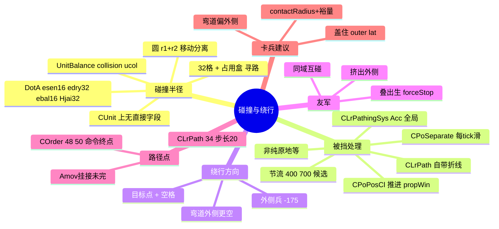

# 单位碰撞与被挡绕行 — 思维导图

| 字段 | 内容 |
| :--- | :--- |
| **分析模型** | Composer / Grok 路由（Cursor Agent） |
| **分析目的** | 导图配套 [`war3-unit-collision-and-repath.md`](./war3-unit-collision-and-repath.md) |
| **命名方式** | `war3-unit-collision-and-repath-mindmap` |
| **分析时间** | 2026-11-21 |

## RVA 速查（构造 / vtable）

| | 1.24.4 | 1.26 | 1.27 |
| :--- | :---: | :---: | :---: |
| `CLrPath` ctor | `0x49D52F` | `0x49CA1F` | `0x111F10` |
| `CLrPath` vt | `0x9654C4` | `0x95336C` | `0x961300` |
| `CPoSeparate` vt | `0x96430C` | `0x9521B4` | `0x960EB0` |

## 下路弯道站位（一句话）

`progress 3300~4300`：横向对准**最外侧未越过兵**，再向外偏约 `0.5×(heroCol+creepCol)`，前进仍保持 70~110。
