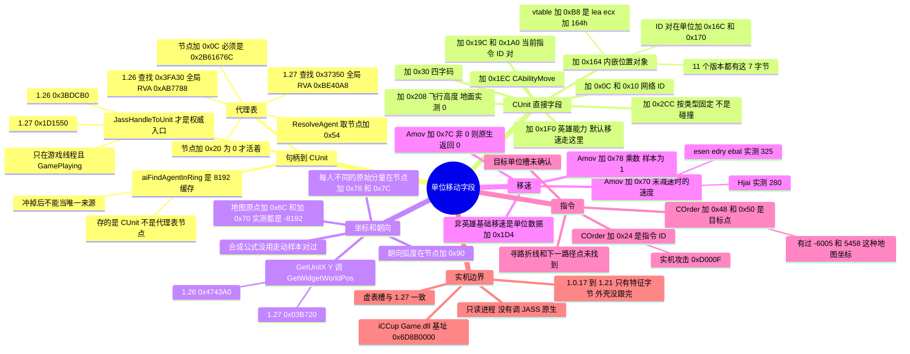

# Warcraft III 单位移动字段 — 思维导图

| 字段 | 内容 |
| :--- | :--- |
| **分析模型** | Grok 4.7 |
| **分析目的** | 把单位坐标、朝向、移速、指令目标点的读取路径收成一张图，并标出碰撞和寻路折线还没找到 |
| **命名方式** | `war3-unit-movement-fields-mindmap`；正文 [`war3-unit-movement-fields.md`](./war3-unit-movement-fields.md) |
| **分析时间** | 2026-11-20 |

