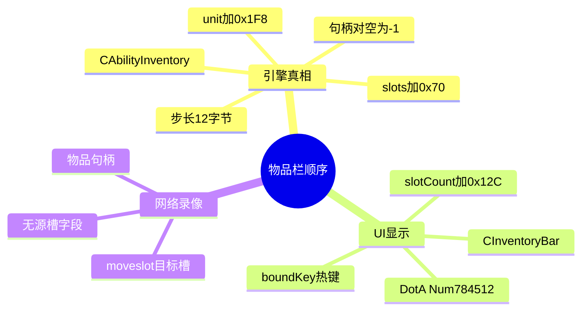
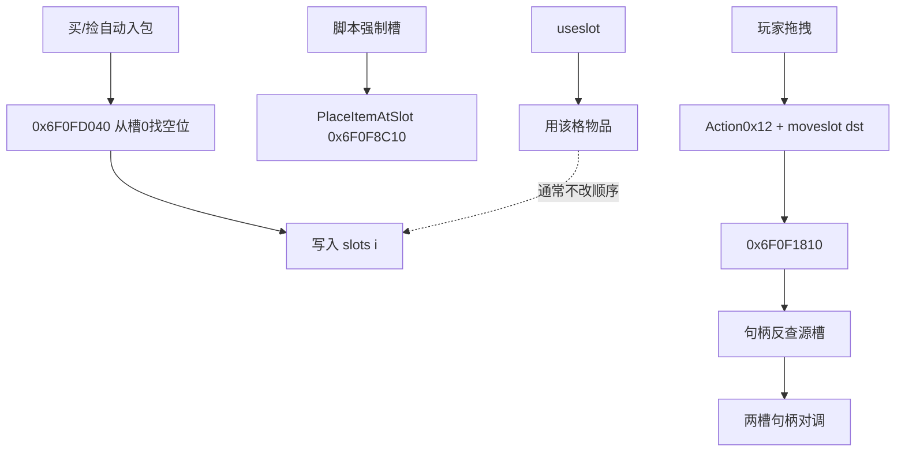
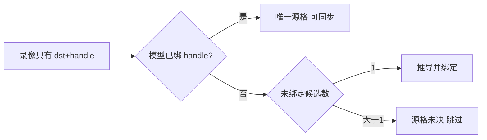

# Warcraft III 1.26 物品栏 6 格顺序 — 思维导图

详细论证见：[`warcraft-iii-1.26-inventory-six-slot-order.md`](./warcraft-iii-1.26-inventory-six-slot-order.md)

---

## 一、数据归属

---

## 二、顺序如何改变

---

## 三、与「源格未决」

