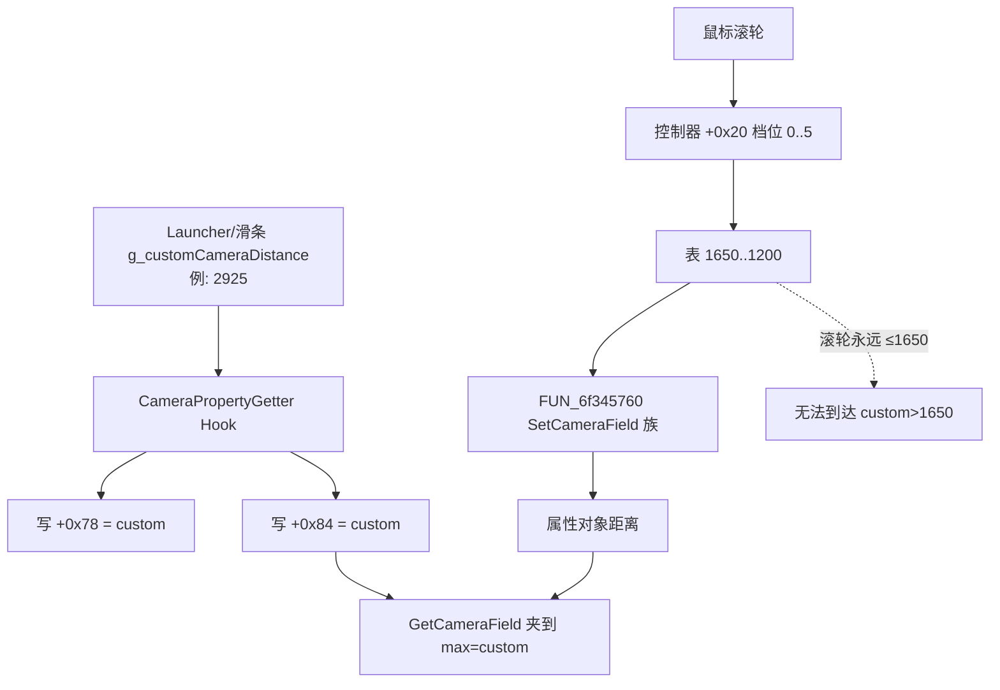

# Warcraft III 1.27：相机视距与鼠标滚轮缩放问题

## 结论摘要

- **滚轮缩放不走 `war3hook` 正在改的「属性上下限」，而走一份写死的 6 档距离表。** 表项为 `1650 / 1600 / 1500 / 1400 / 1275 / 1200`。把属性对象 `+0x84`（max）抬到滑条值（实机曾同步到 **2925.4**）**不会**让滚轮能拉到 2925。
- **当前 Hook 把「期望视距」和「最大视距」写成同一个数：** 同时写 `+0x78` 与 `+0x84 = g_customCameraDistance`。这会把 GetCameraField 的夹限上界压成「当前设定值」，并与滚轮档位表冲突，表现为滚轮一动视距跳回 ≤1650，或无法回到滑条设定。
- **字段角色被误标：** `+0x70` 不是最终「目标视距」，而是 `FUN_6f10d790` 动画插值状态（实机同步日志里经常是 `0.00`）；GetCameraField 最终值来自 `+0x78` 链，再夹到 `[+0x80, +0x84]`。
- **要修滚轮，必须改档位表 / 档位应用函数（或自接管滚轮），只改 PropertyGetter 旁路不够。**

| 项目 | 记录 |
| --- | --- |
| 目标版本 | Warcraft III 1.27.0.52240 |
| 目标文件 | `game.dll` |
| 大小 | 13,187,048 字节 |
| SHA-256 | `E04D1716603C075EB0C8E1E21CF1093A664ADC5249EFAB396BFA08D7B09D0C3A` |
| 来源 | `War3Launcher/versions/1.27.0.52240/game.dll` |
| 分析副本 | `C:\War3Analysis\samples\1.27.0.52240\game.dll`（固定 NTFS；哈希一致） |
| 工具 | Ghidra 12.1.4 headless（`War3_127`）+ Capstone；REA doctor 已通，单次 `rea function` 曾因 Java 探测超时失败后改走已有工程 |
| Ghidra 项目 | `War3Analysis/ghidra/projects/War3_127.gpr` |
| ImageBase | `0x6F000000`；`.text` 文件偏移 ≈ RVA − `0xC00` |
| 对照代码 | `War3Launcher/hooker/war3hook.cpp` → `doSomeThingsBeforeCallGameCameraPropertyGetter` |
| 运行时日志 | `War3Launcher/build/.../logs/Hcameras.log`、`War3Hook.log` |
| 分析状态 | 静态路径已对齐；运行时日志证实 custom≈2925 与滚轮表上限 1650 冲突；**滚轮实机逐档验证仍可补测** |
| 置信度 | 档位表与 GetCameraField 夹限路径：**高**；Hook 误用字段导致滚轮体验异常：**高**；`0x438` 即 TARGET_DISTANCE 槽的精确类型语义：**中**（行为上匹配 100/10000 界） |

## 方法与证据边界

1. D: 为可移动卷，样本拷到 `C:\War3Analysis\samples\...` 后校验 SHA-256。
2. 对 `CameraPropertyGetter` 调用点 `game.dll+0x03AE0A` / 函数 `+0x10D790` 做 Ghidra 反编译；对 `1650.0` 常量与 `DAT_6f9714d0` 做 PE 扫描与 Capstone 反汇编。
3. 对照 Launcher 日志：`初始视距同步: 1650.0 -> 2925.4`，随后 PropertyGetter 同步仍看到 `[0x70]=0`、`[0x78]=1650`（打印在写入前）、`[0x80]=100`、`[0x84]=10000`。
4. 未改磁盘原始 `game.dll`；未在本轮重跑游戏逐步滚动验证每一档。

## 路径 A：GetCameraField / PropertyGetter（Hook 当前切入点）

### 调用点（Hook）

| 项 | VA | RVA | 文件偏移 |
| --- | ---: | ---: | ---: |
| 调用点（`g_offsetsForGameCameraPropertyGetter[0]`） | `0x6F03AE0A` | `0x03AE0A` | `0x3A20A` |
| Getter 函数（`[1]`） | `0x6F10D790` | `0x10D790` | `0x10CB90` |
| 外层读取函数 | `0x6F03ADF0` | `0x03ADF0` | `0x3A1F0` |

外层 `FUN_6f03adf0`（thiscall，栈上 `float* out`）：

1. `edx = [this+0xC]`（Hook 里的 `serialNumber`；代码过滤 `0x438`）
2. `ecx = [this+0x8]` → `FUN_6f037350` 得到属性对象 `esi`
3. `FUN_6f10d790`：用 `esi+0x70` / `esi+0x74` 做时间插值
4. `FUN_6f0527e0(esi+0x7C)`、`FUN_6f0529d0(esi+0x78)`：浮点组合
5. **结果夹到 `[esi+0x80, esi+0x84]` 再写回 `out`**

`FUN_6f10d790` 本身：

```c
// VA 0x6F10D790
out = FUN_6f108e10(out, obj, &obj->f70, obj->f74);
```

因此：

| 偏移 | Hook 现用名 | 静态结论 |
| ---: | --- | --- |
| `+0x70` | 「目标值」 | 插值状态/起点；同步时常见 `0.00`，**不是**滚轮最终距离 |
| `+0x74` | （未改） | 与 `+0x70` 一起交给插值器 |
| `+0x78` | 「源始值」 | GetCameraField 主值链输入；Hook 强制写成 custom |
| `+0x7C` | （未改） | 与 `+0x78` 组合 |
| `+0x80` | 最小值 | 绝对下限，样本/日志均为 `100` |
| `+0x84` | 最大值 | 绝对上限，原版 `10000`；Hook 改成 custom |

rdata 中成对常量（与日志一致）：

```text
VA 0x6FA538B0  100.0
VA 0x6FA538B4  10000.0
```

### Hook 问题代码（现状）

```cpp
// war3hook.cpp doSomeThingsBeforeCallGameCameraPropertyGetter
*g_pCameraDistanceSource = g_customCameraDistance; // +0x78
*g_pCameraDistanceMax    = g_customCameraDistance; // +0x84
if (*g_pCameraDistanceTarget > g_customCameraDistance) // +0x70
    *g_pCameraDistanceTarget = g_customCameraDistance;
```

实机：`g_customCameraDistance` 可被 Launcher 设为 **2925.4**。于是 max/source 都被压到 2925，而 `+0x70` 仍为 0。

## 路径 B：鼠标滚轮——固定 6 档距离表（真正控制滚轮）

### 档位表

| VA | 值 |
| ---: | ---: |
| `0x6F9714D0` | 1650.0 |
| `0x6F9714D4` | 1600.0 |
| `0x6F9714D8` | 1500.0 |
| `0x6F9714DC` | 1400.0 |
| （栈上补）`0x449F6000` | 1275.0 |
| （栈上补）`0x44960000` | 1200.0 |

社区描述的「滚轮大约 1200–1650」与该表一致；**没有 2925 / 3600 档。**

### 选档函数

`FUN_6f20b080`（RVA `0x20B080`，文件 `0x20A480`）：

```text
movaps xmm0, [0x6F9714D0]          ; 1650,1600,1500,1400
cmp ecx, 6
sbb eax, eax
mov [ebp-0xC], 1275.0
and eax, ecx                       ; ecx∈[0,5] 保留，否则变 0
mov [ebp-8], 1200.0
fld [ebp+eax*4-0x1C]               ; 按档取距离
```

同类逻辑内联在 `FUN_6f341350`（RVA `0x341350`）：读控制器 **`[obj+0x20]` 作为档位索引**，取出距离后调用 `FUN_6f345760`（按 camerafield 分支写入，等价 SetCameraField 族）。

同文件旁还有 AOA 类表 `FUN_6f20b030`（`304/311/318/325/332/335`），不是 TARGET_DISTANCE。

### 与 Hook 的交叉效应



因此「调了视距滑条后滚轮异常」的直接原因是：

1. Hook 把当前距离/上限拉到 custom（可 >1650）；
2. 滚轮只能跳到表内 ≤1650 的离散值；
3. 两者争用同一套相机距离状态，表现为跳动、回不去、或「滚轮没用/乱跳」。

## 与 `war3hook` 偏移表的对应关系

| 符号 | 1.27 RVA | 含义 |
| --- | ---: | --- |
| `g_offsetsForGameCameraPropertyGetter[0]` | `0x03AE0A` | `FUN_6f03adf0` 内 `call FUN_6f10d790` |
| `g_offsetsForGameCameraPropertyGetter[1]` | `0x10D790` | 属性插值 getter |
| （尚未接入）滚轮选档 | `0x20B080` | 6 档距离查表 |
| （尚未接入）档位应用 | `0x341350` | 读 `+0x20` 并 Set 字段 |
| （尚未接入）距离表 | `0x9714D0` | `float[4]` + 栈上 1275/1200 |

1.27 调用点前 `mov edx,[ecx+0xC]`，故 Hook 从 `edx` 取 `serialNumber` 在该站点仍成立。

## 修复方向（分析建议，本轮未改代码）

1. **语义拆分：** `g_customCameraDistance` 若表示「默认/当前视距」，只应通过 SetCameraField 路径或写正确的值字段设置一次；**max（`+0x84`）应单独表示允许上限**（例如 `max(custom, 1650)` 或滑条 Max），不要默认 `max = current`。
2. **不要在每次 PropertyGetter 里强写 `+0x78`：** 否则会对抗滚轮/地图脚本改距离；改为检测滑条/IPC 边沿时设置一次。
3. **要让滚轮尊重更大视距：** 必须改 `DAT_6f9714d0` / `FUN_6f20b080` / `FUN_6f341350` 的档位内容或索引逻辑，或 Hook 滚轮消息改为连续 `±delta` 夹在 `[1200, customMax]`。
4. **日志：** 同步时打印 `+0x74/+0x7C`、档位索引 `[controller+0x20]`，避免再把 `+0x70=0` 误当成目标距离。

## 产物

- `artifacts/camera-distance/ghidra-camera-dump.txt` — Ghidra 反编译摘录  
- `artifacts/camera-distance/capstone-camera-zoom.txt` — 关键函数 Capstone 反汇编  
- `analyses/warcraft-iii-1.27-camera-distance-mouse-wheel-mindmap.md` — 思维导图  

## 代码修复（War3Launcher，待实机验证）

`war3hook.cpp` 已按本报告改动：

1. PropertyGetter：只保证 `+0x84=max`；当前视距仅在滑条/IPC/`needsApply` 时写 `+0x78`，平时不抢滚轮。
2. 1.27：按 `g_customCameraDistance` 重写 `DAT_6f9714d0` 四档，并补丁 1275 立即数写点（RVA `0x20B0A3` / `0x34137E` / `0x3429F6`），使滚轮 6 档均匀落在 `[1200, customMax]`。

## 未验证事项

- 滚轮输入到 `[controller+0x20]` 自增/自减的精确窗口过程函数（本轮只钉到档位消费端）。
- `serialNumber == 0x438` 的类型字典正式名（行为上已对齐距离界 100/10000）。
- 1.26 及更早版本同表 RVA（更早版本无 1650/1600/1500/1400 连表；滚轮补丁仅 1.27）。
- **改码后的实机滚轮/滑条验证**（用户侧待测）。
