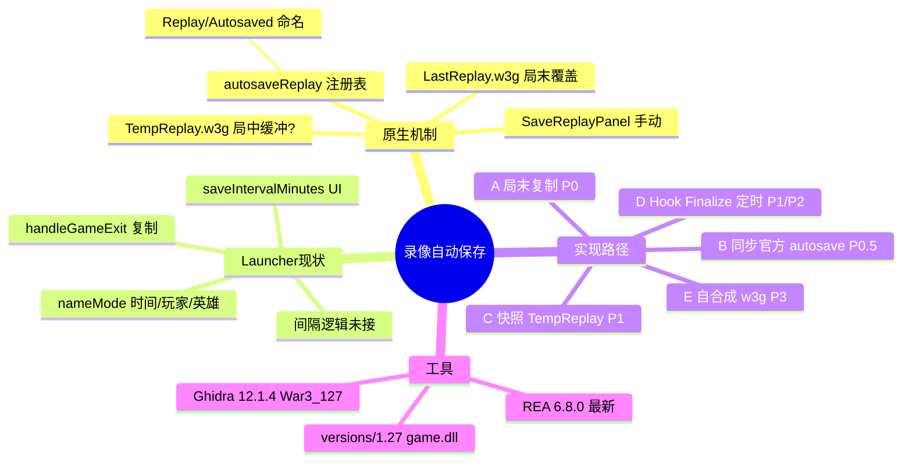

# 录像自动保存 — 思维导图



## 决策简图

```text
saveIntervalMinutes
        │
        ├─ 0 游戏结束 ──► A (±B) 复制 LastReplay
        │
        └─ N 分钟 ──────► 先验证 TempReplay 可播?
                              │
                              ├─ 可 ──► C 进程外轮询快照
                              │         └─ 再升级 D Hook 原生保存
                              └─ 否 ──► 必须 D（找 Finalize）或放弃间隔
```
