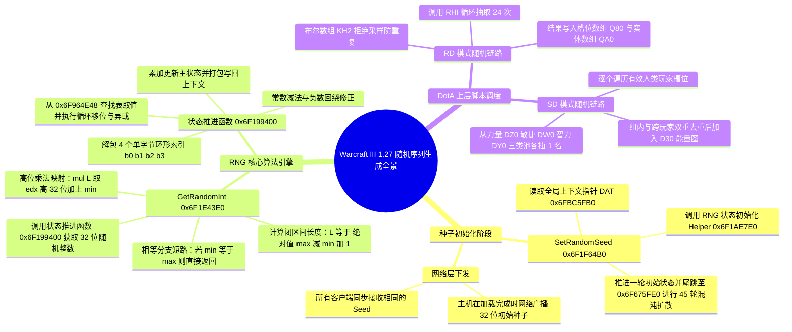
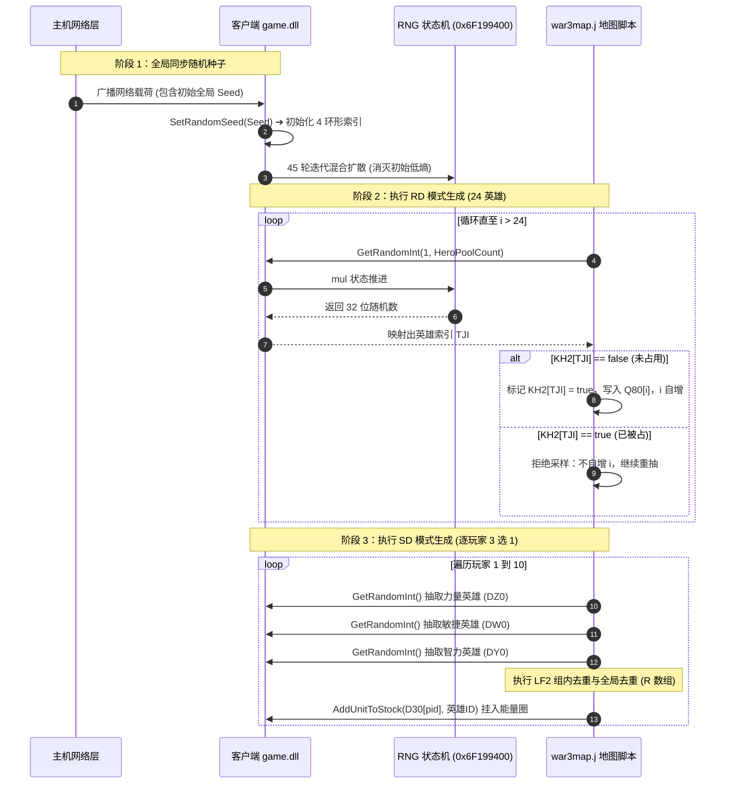

# Warcraft III 1.27.0.52240: RD 与 SD 随机序列底层逆向分析报告

## 摘要与环境说明

本报告针对 **Warcraft III 1.27.0.52240 `game.dll`**（SHA-256: `E04D1716603C075EB0C8E1E21CF1093A664ADC5249EFAB396BFA08D7B09D0C3A`）进行深度反汇编与算法逆向，系统性还原 **RD (Random Draft)** 与 **SD (Single Draft)** 模式随机英雄序列的底层生成全过程。

---

## 一、全景架构思维导图 (Mindmap)



---

## 二、关键函数符号与内存地址速查表

| 函数 / 符号 | 虚拟地址 (VA) | 相对偏移 (RVA) | 文件物理偏移 | 调用约定 | 核心职责 |
| :--- | :--- | :--- | :--- | :--- | :--- |
| **`GetRandomInt`** | `0x6F1E43E0` | `+0x1E43E0` | `0x001E37E0` | `__cdecl` | JASS Native 随机整数接口，执行范围裁剪与乘法映射 |
| **`RNG_advance`** | `0x6F199400` | `+0x199400` | `0x00198800` | `__thiscall` | 核心伪随机数发生器，执行查表、移位与异或状态推进 |
| **`SetRandomSeed`** | `0x6F1F64B0` | `+0x1F64B0` | `0x001F58B0` | `__cdecl` | JASS Native 随机种子设置接口，启动初始状态构建 |
| **`RNG_init_helper`**| `0x6F1AE7E0` | `+0x1AE7E0` | `0x001ADBE0` | `__thiscall` | 种子打包例程，将 32 位 Seed 投影为 4 个环形索引 |
| **`RNG_diffuse`** | `0x6F675FE0` | `+0x675FE0` | `0x00674FE0` | `__thiscall` | 45 轮混沌扩散函数，消除初始低熵 |
| **`DAT_6FBC5FB0`** | `0x6FBC5FB0` | `+0xBC5FB0` | `.data` 段 | 内存指针 | 指向当前激活的 `RNGContext` 结构体 |
| **`g_RngTable`** | `0x6F964E48` | `+0x964E48` | `.rdata` 段 | 常量数组 | 预计算的置换与混沌非线性查找表 |

---

## 三、核心汇编反编译与算法解析

### 1. `GetRandomInt(int min, int max)`
- **反汇编指令清单**：
```assembly
.text:6F1E43E0  push    ebp
.text:6F1E43E1  mov     ebp, esp
.text:6F1E43E3  mov     eax, [ebp+0Ch]      ; eax = max
.text:6F1E43E6  push    edi
.text:6F1E43E7  mov     edi, [ebp+08h]      ; edi = min
.text:6F1E43EA  cmp     edi, eax            ; 比较 min 与 max
.text:6F1E43EC  jne     short loc_proceed   ; 不相等则进入正常随机流程
.text:6F1E43EE  mov     eax, edi            ; min == max: 直接返回 min
.text:6F1E43F0  pop     edi
.text:6F1E43F1  pop     ebp
.text:6F1E43F2  retn                        ; 关键：不推进 RNG 状态机直接返回！
.text:6F1E43F3 loc_proceed:
.text:6F1E43F3  push    esi
.text:6F1E43F4  cmp     edi, eax
.text:6F1E43F6  jle     short loc_ordered   ; min <= max
.text:6F1E43F8  mov     esi, edi
.text:6F1E43FA  sub     esi, eax            ; esi = min - max
.text:6F1E43FC  jmp     short loc_calc_len
.text:6F1E43FE loc_ordered:
.text:6F1E43FE  mov     esi, eax
.text:6F1E4400  sub     esi, edi            ; esi = max - min
.text:6F1E4402 loc_calc_len:
.text:6F1E4402  mov     ecx, ds:6FBC5FB0h   ; ecx = RNGContext 指针
.text:6F1E4408  inc     esi                 ; esi = 区间长度 L = |max - min| + 1
.text:6F1E4409  call    RNG_advance         ; call 0x6F199400，返回 32 位随机数 eax
.text:6F1E440E  mul     esi                 ; edx:eax = 32位随机数 * L
.text:6F1E4410  pop     esi
.text:6F1E4411  lea     eax, [edi+edx]      ; 返回值 eax = min + edx (高32位取模投影)
.text:6F1E4414  pop     edi
.text:6F1E4415  pop     ebp
.text:6F1E4416  retn
```
- **核心数学算法**：
  暴雪没有使用常规的取模操作符（`rand % L`，需要执行缓慢的 `div` 指令），而是采用**高位乘法投影法**：
  $$\text{Result} = \min + \left\lfloor \frac{\text{Random32} \times L}{2^{32}} \right\rfloor$$
  该算法在保持极高执行效率的同时，保证了区间映射的高度均匀性。

---

### 2. 伪随机数发生器核心：`RNG_advance`
- **反汇编指令清单**：
```assembly
.text:6F199400  push    ebp
.text:6F199401  mov     ebp, esp
.text:6F199403  sub     esp, 0Ch
.text:6F199406  mov     eax, ecx            ; eax = RNGContext 指针
.text:6F199408  push    ebx
.text:6F199409  push    esi
.text:6F19940A  push    edi
.text:6F19940B  mov     edx, [eax+4]        ; 读取打包的 4 字节索引 state_idx
.text:6F19940E  mov     esi, edx
.text:6F199410  mov     ecx, edx
.text:6F199412  movzx   edi, dl             ; edi = b0
.text:6F199415  shr     edx, 10h            ; edx = (b2)
.text:6F199418  shr     esi, 8              ; esi = (b1)
.text:6F19941B  and     edx, 0FFh           ; edx = b2
.text:6F199421  shr     ecx, 18h            ; ecx = b3
.text:6F199424  and     esi, 0FFh           ; esi = b1
.text:6F19942A  mov     [ebp-0Ch], eax
.text:6F19942D  sub     edx, 0Ch            ; b2 -= 12
.text:6F199430  sub     ecx, 4              ; b3 -= 4
.text:6F199433  mov     eax, [eax]          ; 读取主累加状态 state_acc
.text:6F199435  mov     [ebp-8], eax
.text:6F199438  jns     short loc_b3_ok
.text:6F19943A  add     ecx, 0BCh           ; b3 负数环形回绕修正 (+188)
.text:6F199440 loc_b3_ok:
.text:6F199440  sub     esi, 18h            ; b1 -= 24
.text:6F199443  test    edx, edx
.text:6F199445  jns     short loc_b2_ok
.text:6F199447  add     edx, 0D4h           ; b2 负数环形回绕修正 (+212)
.text:6F19944D loc_b2_ok:
.text:6F19944D  mov     ebx, ds:6F964E48h[ecx*4] ; 查表 Table[b3]
.text:6F199453  sub     edi, 1Ch            ; b0 -= 28
.text:6F199456  test    esi, esi
.text:6F199458  jns     short loc_b1_ok
.text:6F19945A  add     esi, 0ECh           ; b1 负数环形回绕修正 (+236)
.text:6F199460 loc_b1_ok:
.text:6F199460  mov     eax, ds:6F964E48h[edx*4] ; 查表 Table[b2]
.text:6F199466  rol     ebx, 1              ; Table[b3] 循环左移 1 位
.text:6F199468  mov     [ebp-4], eax
.text:6F19946B  test    edi, edi
.text:6F19946D  jns     short loc_b0_ok
.text:6F19946F  add     edi, 0F4h           ; b0 负数环形回绕修正 (+244)
.text:6F199475 loc_b0_ok:
.text:6F199475  mov     eax, ds:6F964E48h[esi*4] ; 查表 Table[b1]
.text:6F19947B  rol     dword ptr [ebp-4], 2; Table[b2] 循环左移 2 位
.text:6F19947F  rol     eax, 3              ; Table[b1] 循环左移 3 位
.text:6F199482  xor     eax, [ebp-4]        ; (Table[b1] rol 3) ^ (Table[b2] rol 2)
.text:6F199485  xor     eax, ds:6F964E48h[edi*4] ; ^ Table[b0]
.text:6F19948B  shl     ecx, 8
.text:6F19948E  xor     eax, ebx            ; ^ (Table[b3] rol 1)
.text:6F199490  mov     ebx, [ebp-8]        ; 取出旧 state_acc
.text:6F199493  or      ecx, edx            ; 重新组装索引字节
.text:6F199495  mov     edx, [ebp-0Ch]      ; 取出上下文指针
.text:6F199498  add     ebx, eax            ; state_acc = state_acc + 异或混合值
.text:6F19949A  shl     ecx, 8
.text:6F19949D  mov     eax, ebx            ; 返回新状态在 eax
.text:6F19949F  or      ecx, esi
.text:6F1994A1  shl     ecx, 8
.text:6F1994A4  or      ecx, edi
.text:6F1994A6  mov     [edx], ebx          ; 写回 ctx[0] (state_acc)
.text:6F1994A8  pop     edi
.text:6F1994A9  pop     esi
.text:6F1994AA  mov     [edx+4], ecx        ; 写回 ctx[4] (更新后的索引包)
.text:6F1994AD  pop     ebx
.text:6F1994AE  mov     esp, ebp
.text:6F1994B0  pop     ebp
.text:6F1994B1  retn
```
- **算法特征总结**：
  这是一个极其精巧且高周期的**带非线性查表的伪随机发生器（Lagged Fibonacci / Shift-XOR-Add 变体）**：
  1. 维护 4 个在环形缓冲区（`0xBC, 0xD4, 0xEC, 0xF4` 周期）中步进的滑窗指针；
  2. 对查找表输出执行不对称的位移（`ROL 1, ROL 2, ROL 3, ROL 0`）；
  3. 执行非线性异或融合后累加进状态，同时具有极高雪崩效应和周期长度。

---

### 3. 初始种子初始化：`SetRandomSeed`
- **反汇编指令清单**：
```assembly
.text:6F1F64B0  push    ebp
.text:6F1F64B1  mov     ebp, esp
.text:6F1F64B3  push    esi
.text:6F1F64B4  mov     esi, ds:6FBC5FB0h   ; esi = RNGContext
.text:6F1F64BA  mov     ecx, esi
.text:6F1F64BC  push    [ebp+8]             ; 传入 Seed
.text:6F1F64BF  call    RNG_init_helper     ; 0x6F1AE7E0: 将 Seed 投影为 4 个索引
.text:6F1F64C4  mov     ecx, esi
.text:6F1F64C6  call    RNG_advance         ; 0x6F199400: 推进一轮
.text:6F1F64CB  mov     ecx, eax
.text:6F1F64CD  pop     esi
.text:6F1F64CE  pop     ebp
.text:6F1F64CF  jmp     RNG_diffuse         ; 尾调用 0x6F675FE0: 循环 45 轮混沌扩散
```

---

## 四、RD 与 SD 的上层生成链路时序图



---

## 五、结论与逆向启示

1. **绝对一致的根源**：
   `GetRandomInt` 在参数相等时有 `cmp edi, eax; je ...` 的短路退出，**不推进 RNG 状态机**；而在参数不等时，通过确定性的乘法查表推进。只要对局内所有客户端按相同的顺序调用 `GetRandomInt`，状态机就会分秒不差地输出相同的随机数。
2. **拒绝采样的确定性**：
   虽然 RD 和 SD 在遇到重复英雄时会触发拒绝采样重新 roll 点，但由于每台客户端上碰到的冲突时机与次数完全一致，重抽的额外次数也是完全对齐的，绝不会因此发生异步（Desync）。