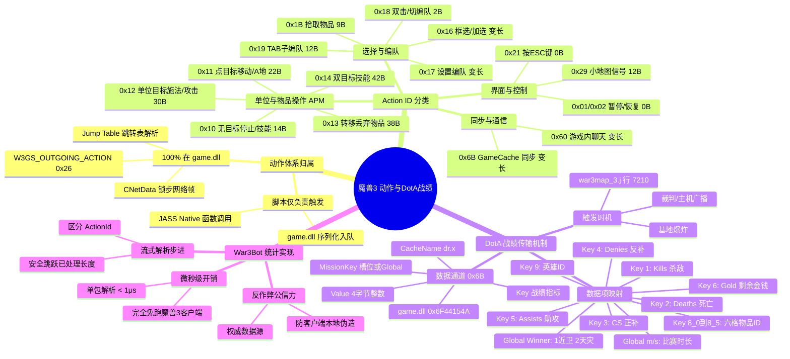
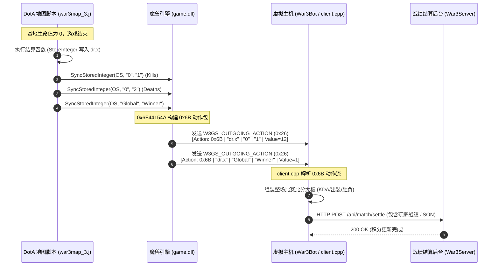

# 魔兽争霸 III 动作体系与 DotA 战绩传输 — 思维导图与架构图

本文档用 Mermaid 展现魔兽争霸 III 底层网络动作（Action IDs）体系，以及 DotA 游戏战绩从 JASS 脚本通过 `game.dll` `0x6B` 封包流向 `War3Bot` 服务器的全链路结构。

详细论证与汇编证据见：[`warcraft-iii-action-ids-and-dota-stats-transmission.md`](./warcraft-iii-action-ids-and-dota-stats-transmission.md)

---

## 一、 全景思维导图



---

## 二、 战绩数据端到端数据流转图



---

## 三、 APM 与动作过滤架构

```mermaid
flowchart TD
    A[收到 0x26 W3GS_OUTGOING_ACTION] --> B[剥离前 4 字节 CRC32]
    B --> C[进入 actionData 字节流]
    C --> D{读取当前字节: Action ID}

    D -->|0x10, 0x11, 0x12, 0x13| E[有效单位操作]
    D -->|0x16, 0x17, 0x18, 0x19| F[有效选择/编队操作]
    D -->|0x1B| G[有效捡神符/物品操作]
    
    E --> H[玩家有效操作计数++ (APM)]
    F --> H
    G --> H

    D -->|0x60| I[聊天与命令捕获: -ap, -stats]
    D -->|0x6B| J[DotA 结算数据捕获: 比分/出装/胜负]

    D -->|0x01, 0x21, 0x29 等| K[常规辅助操作 (不计入有效APM)]

    H --> L[根据 paramLen 步进 offset]
    I --> L
    J --> L
    K --> L

    L --> M{offset < dataSize?}
    M -->|是: 存在连包| D
    M -->|否: 本帧动作解析完毕| N[加入时隙广播队列 m_actionQueue]
```
